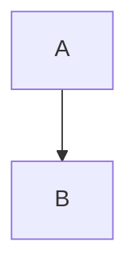
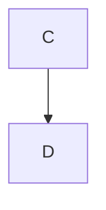
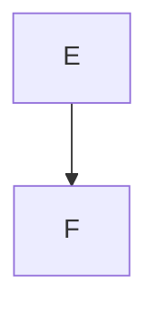

Probe: mermaid_badcap.


*Fig 1. not*


*Figure 2.*


*Figure 3. has trailing text* more

Probe: fig_cap_two_em.

```mermaid
A
```
*Figure 1. a* *b*

Probe: fig_cap_3a.

```mermaid
A
```
*Figure 3a. x*

Probe: fig_cap_link.

```mermaid
A
```
*Figure 1. see [x](y).*

Probe: fig_cap_lower.

```mermaid
A
```
*figure 3. x*

Probe: fig_cap_strong.


**Figure 7. cap**

Probe: fig_cap_underscore.


_Figure 7. cap_

Probe: fig_cap_with_em.


*Figure 8. a *nested* em.*

Probe: fig_caption_multiline.


*Figure 1. line1
line2*

Probe: fig_caption_nodot.


*Figure 7 cap*

Probe: fig_caption_para_two.


*Figure 1. cap*
text after same para
