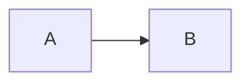

> [!NOTE"><script>alert(1)</script>]
> spoofed marker

> [!note]
> lower case

> [!NOTE] level 1
> > [!NOTE] level 2
> > > [!NOTE] level 3
> > > > [!NOTE] level 4
> > > > > [!NOTE] level 5
> > > > > > [!NOTE] level 6
> > > > > > > [!NOTE] level 7
> > > > > > > > [!NOTE] level 8
> > > > > > > > > [!NOTE] level 9
> > > > > > > > > > [!NOTE] level 10
> > > > > > > > > > > [!NOTE] level 11
> > > > > > > > > > > > [!NOTE] level 12
> > > > > > > > > > > > > [!NOTE] level 13
> > > > > > > > > > > > > > [!NOTE] level 14
> > > > > > > > > > > > > > > [!NOTE] level 15
> > > > > > > > > > > > > > > > [!NOTE] level 16
> > > > > > > > > > > > > > > > > [!NOTE] level 17
> > > > > > > > > > > > > > > > > > [!NOTE] level 18
> > > > > > > > > > > > > > > > > > > [!NOTE] level 19
> > > > > > > > > > > > > > > > > > > > [!NOTE] level 20
> > > > > > > > > > > > > > > > > > > > > [!NOTE] level 21
> > > > > > > > > > > > > > > > > > > > > > [!NOTE] level 22
> > > > > > > > > > > > > > > > > > > > > > > [!NOTE] level 23
> > > > > > > > > > > > > > > > > > > > > > > > [!NOTE] level 24
> > > > > > > > > > > > > > > > > > > > > > > > > [!NOTE] level 25


*Figure 1. <script>alert(1)</script>*

```js
let a = 1;
```
*Figure 2. after a code fence*
