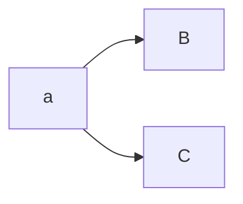
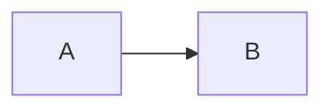
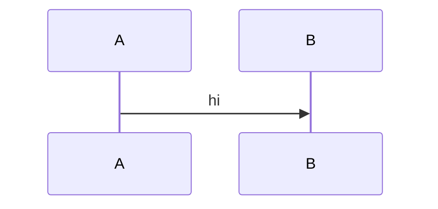
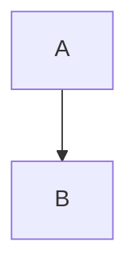
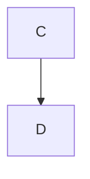

Probe: mermaid.


*Figure 1. Caption with `code` and **bold**.*

text after

Probe: mermaid_nocap.



Plain para.

Probe: mermaid_capsep.



*Figure 12. Separate paragraph caption.*

Probe: fig_after_two_blank.




*Figure 1. Far.*

Probe: fig_two_in_row.

```mermaid
A
```
```mermaid
B
```
*Figure 2. second*

Probe: fig_empty.

```mermaid
```

Probe: fig_tilde.

~~~mermaid
graph TD
~~~

Probe: mermaid_in_list.

- item

  ```mermaid
  graph TD
  A-->B
  ```
  *Figure 4. in list.*

Probe: fig_bq.

> ```mermaid
> graph TD
> ```
> *Figure 9. in bq.*

Probe: mermaid_info.

```mermaid extra
graph TD
 A-->B
```



```Mermaid
X
```

Probe: (added) mermaid kinds after comments and diagram front matter.

```mermaid
%% a comment line

---
title: Kinds
---
%% another comment
stateDiagram-v2
  [*] --> Ready
```
