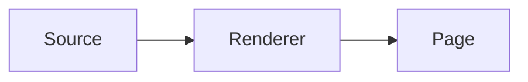

# Shared renderer for team notes

**Spec** · 2026-01-15 · Status: Draft

## In short

- **What:** one renderer for every notes page.
- **Why:** two renderers drift apart.
- **Cost:** a corpus of examples kept in step.

## 1. Context

Each page is written in Markdown. Two programs render it today, and their output differs in small ways.

<!-- id:R1 -->
`RULE-ONE` — **One renderer.** Every page renders through the same library.

## 2. Design

The flow below shows a page from source to screen.


*Figure 1. A page from source to screen.*

### 2.1 Options

| Option | Choice | Status |
|---|---|---|
| One library | Shared package | Agreed |
| Two renderers | Keep both | Rejected |

> [!WARNING]
> A change to the renderer moves the examples.

```promise-delta
+ D1: one renderer for every page
```

## 3. Where things stand

<details>
<summary>History</summary>

Drafted, reviewed, revised.

</details>

- [x] **Agreed:** one renderer.
- [ ] **Waiting on you:** the review.
- [ ] **Later:** a second theme.
