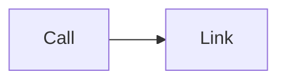

# A directive that binds clicks

A flowchart that binds a call and a script link to its nodes, after an init directive that asks for the loose security
level. The security level is secure: nothing is bound, and no link runs script.

*Figure 1. Clicks that do nothing.*
