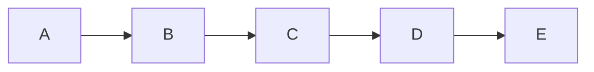

# A diagram over the edge limit

The host allows 3 edges; this diagram draws 4, after an init directive that asks for 1000 edges and for a text size of
10 characters, which would swap the drawing for Mermaid's own notice. The limits are secure, so the drawing fails, and
the figure shows its note.

*Figure 1. One edge too many.*
