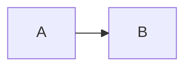

# A diagram that asks for ELK

This flowchart's front matter asks for the ELK layout, which the self-hosted Mermaid file leaves out. The drawing
fails, and the figure shows its note.

*Figure 1. Laid out by ELK.*
