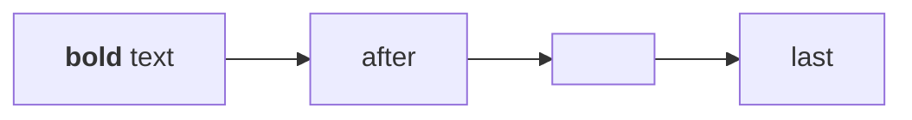

# An HTML label

A flowchart whose labels hold markup: a handler, a script, a style attribute, a class the reader styles and a style
element. Drawn with the strict security level, its labels keep their text and lose the rest.

*Figure 1. Labels with markup.*
