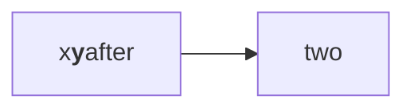

# A style element in a label

A flowchart whose first label holds a style element after other markup, where the sanitiser's own default keeps it.
Drawn with the reader's configuration, the label keeps its text and loses the element, so nothing outside the drawing
changes: this paragraph keeps its colour.

*Figure 1. A label with a style element.*
