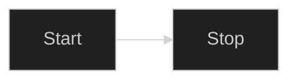

# A directive that restyles

A flowchart whose init directive asks for CSS that fixes its labels to the top of the page, another theme, a dark
mode, its own colours and its own font. Each of those keys is secure: the diagram is drawn in the reader's theme.

*Figure 1. Restyled by its directive.*
