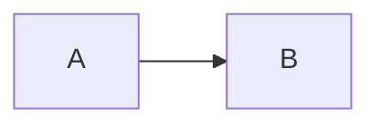
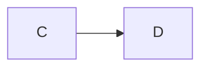
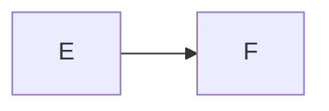
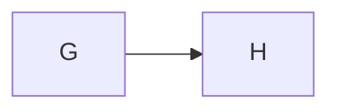
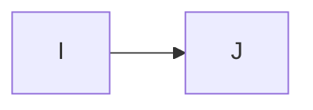
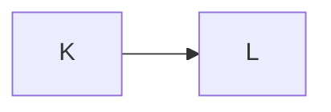

# Figure captions

**Spec** · 2026-10-20 · Status: Draft

Each figure below ends in a caption of another shape, or in none.

## Shapes

*Figure 1. A caption with its number and its text.*

*Figure 2.No space after the number.*

*Figure 3.*

*Figure 4. A caption with **bold** words and `code`.*

No caption follows this figure.

*Figure ٦. A number in another script stays as it is written.*
