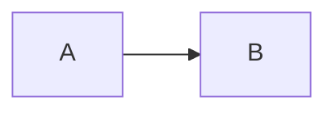

# Blocks fixture

## 1. Headings and lists

### Level three

#### Level four

##### Level five

###### Level six

1. First
2. Second
   - nested

- [x] done
- [ ] todo

---

Text with ~~strike~~, `code`, **bold**, *italic*, <kbd>K</kbd>, x<sup>2</sup>, H<sub>2</sub>O, a line<br>break and a note.[^1]

> A quote.

| Left | Centre | Right |
|:-----|:------:|------:|
| a | b | c |

<details>
<summary>More</summary>

Inside.

</details>

```bash
echo "hi"
```



## 2. Second

Text.

## 3. Third

Text.

[^1]: The note.

```javascript
class A extends B {}
```
