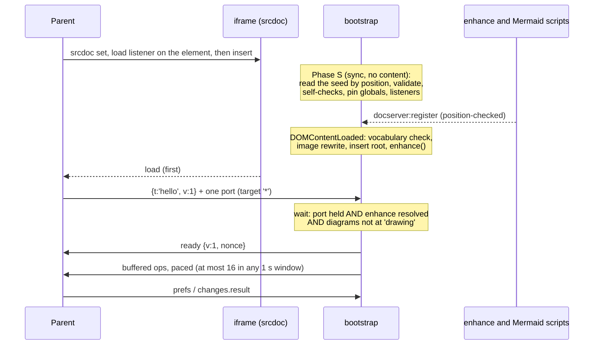
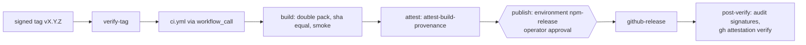
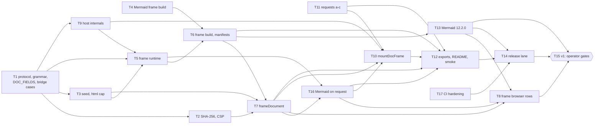

# docserver L3 — the sealed frame, the host helper and the v1 release: Implementation Plan

> **For agentic workers:** REQUIRED SUB-SKILL: Use superpowers:subagent-driven-development to implement this plan task by task. Each task runs as L2's did: an implementer subagent, a held-out review panel, then one fix round ("How this wave runs"). The plan is lean (C40): it holds no implementation code. It does hold the frame contract in full ("Reference: the frame contract"), because the design it was written from is not committed and a task must stand on this file alone.

**Status:** in execution under ledger C85 (2026-10-26): the plan runs with its defaults, each still open to the operator's review; every outward step of Task 15 waits for the operator's explicit go. The repository becomes public at v1 (C84). Written 2026-10-26 from the L3 design (three candidate designs, two judges, the coordinator's rulings R1 to R7 and the critic's minors), the prototype on draft PR #41 (branch `l3-prototype`: `main` at `d7eb18fb4` plus `95d14bb8` and `58d9016e`) and its fix round. Runtime model of this plan's writer: Opus 5.5 (`claude-opus-5-5`).

**Goal:** Ship the frame layer of `@synapsium-labs/docserver` and then v1. `./frame` builds the sealed reader frame's srcdoc as a pure string. Its click guard, bootstrap and enhance bundle ship as hashed classic scripts, with a classic Mermaid build beside them. `./host` mounts that frame for other viewers. `./highlight`, `render(md, {highlight: false})` and the xml strip answer the first consumer's requests (a) to (c). `assets.json` lists every shipped asset with its sha256 and size. Then v1: the repository goes public, and the package is published through npm trusted publishing with provenance and a build attestation, from a signed tag.

**Architecture:** The prototype proved the shape on Chromium: a srcdoc that starts with a hash-only CSP meta, then the guard, the seed and the bootstrap; the rendered HTML only as escaped text in the seed, materialised once at DOMContentLoaded; scripts handing references to each other through position-checked events, so nothing sits on the window; one `hello` with one port; `ready` echoing the seed's nonce. L3 completes it into three pure or import-inert entries (`./frame`, `./host`, `./highlight`), a frame runtime built to classic IIFEs (`src/frame-runtime/`), a reproducible build with committed manifests, real-browser rows on Chromium and WebKit, and a tag-triggered release workflow behind operator gates.

**Tech Stack:** Node `>=22`; CI runs Node 22 and 24. L1's and L2's exact pins stay (`package.json`): esbuild 0.28.2, playwright-core 1.63.0, TypeScript 6.0.3, vitest 4.1.11, jsdom 29.1.1, highlight.js 11.12.0. L3 adds no runtime dependency. Mermaid moves from 12.1.0 to 12.2.0 in Task 13 (eligible 2026-10-27 under the 14-day rule). New GitHub actions are pinned by full commit sha, each at least 14 days old. Local browser runs are Chromium only (C69: no install and no container fallback); WebKit is proven in CI.

**Spec:** [Rich Docs reader and a shared renderer](https://github.com/Synapsium-Labs/ccrc-pwa/blob/main/docs/superpowers/specs/2026-10-12-rich-docs-reader-and-shared-renderer-design.md), the first consumer's public spec: §3 the library (§3.1 contents, §3.2 API, §3.4 rules, §3.5 corpus, §3.6 packaging, §3.8 versioning), §4 the reader frame (§4.1 shape, §4.2 the policy, §4.3 what reaches the frame, §4.4 the bridge, §4.5 one page load, §4.6 watchdog and fallback, §4.7 imports), §5 security, §7.1 mutation rows M8.1 to M8.22, §8 sequencing and requests (a) to (c).

**Design decisions:** recorded in this plan ("Decisions this plan makes", FD1 to FD22, and the reference sections). The coordinator's design rulings of 2026-10-26 (R1 fragment grammar, R2 free globals, R3 the seed's html cap, R4 Mermaid on request, R5 rate limits, R6 visible escapes, R7 the host page's policy) are folded in and cited as "ruling R<n>".

**Ledger:** [`docs/superpowers/programs/docserver.md`](../programs/docserver.md). C1 to C80 and PD1 to PD9 stay binding. L3's rulings are recorded there from C81 on. `main` holds C1 to C80 since the ledger PR #40 merged as `a9cfbfe`; every task branches from `main` after #41's merge, which follows `a9cfbfe`.

## In short

- **Seventeen tasks.** The design's T1 to T16, plus T17 (CI hardening: the browser install hit the 30-minute job limit three times on a stalling package mirror). Ten merge groups, A to J (figure 3).
- **The prototype is the start, not the end.** It built the skeleton, the seed subset, the pure SHA-256, the CSP builder and floor, the guard, the bootstrap's Phase S and ready logic, the Mermaid IIFE, the build and both committed manifests, with 54 unit and 19 Chromium rows green. Each task says what it keeps, what it replaces and what it adds.
- **Five prototype findings change the design:**
  1. esbuild's `define` set must not map `require` (a bundled CommonJS `require('./x')` becomes `(void 0)("./x")` and Mermaid throws);
  2. the seed's html cap is stated in escaped seed characters (the escapes inflate html about 1.57 times, and the worst corpus file reaches about 10 seed characters per markdown byte), and `maxSrcdocChars`' default is derived from it (FD17);
  3. the parent cannot observe a MessagePort closing, so `./host` treats `error` as terminal by itself;
  4. dropping the face probe is an equivalent mutant while L2 loads the regular faces at start, so its browser row accepts that and a unit row pins the probe;
  5. the 2 MiB measurement row is opt-in (`DOCREADER_MEASURE=1`).
- **A sixth finding, from WebKit CI:** WebKit follows a link in place on an `auxclick` of any button but the right one, a back or forward button included. The prototype's guard left those alone, so on WebKit the frame navigated away (CI runs on `58d9016e` and `c58b3b87`: the link was gone after synthetic auxclicks of buttons 2 to 4). The guard now prevents every link activation whatever the button and forwards only a click or the middle button's auxclick (P-13); the "P6 other buttons" row asserts the frame keeps its one load and its links.
- **Operator gates.** The repository flip, the npm trusted-publisher setup, the protected `npm-release` environment, the tag-signing key, the signed tag and the publish approval are the operator's acts (Task 15). Waiting, at release: Q5 (a placeholder publish, if npm needs one) and Q9 (the signing key). The plan's defaults stay open to the operator's review without blocking execution (ledger C85).

## Global Constraints

Carried from L2:

- **Public-ready** text in every tracked file, commit and PR body. Neutral names only: no product, host, person or private repository names. The consuming product is "the first consumer"; its public spec is linked by its GitHub blob URL. The reference layout and renderer are never named (C5).
- **Pure where declared.** `./frame` and `./highlight`: no DOM, no clock, no randomness, no I/O (the purity walls `./render` uses). `./host`: import-inert, touches the DOM only inside `mountDocFrame`.
- **CSP-safe.** No `innerHTML`, `outerHTML`, `insertAdjacentHTML`, `eval`, the `Function` constructor (`Function.prototype.toString` is read once each by the guard and the bootstrap, L3.M19), inline handlers, style attributes or `cssText` anywhere in shipped code. The frame runtime adds its own walls (L3.M19).
- **Import-inert** entries (the walls test). **No module-level state** in `./host` but WeakMaps; two mounts never share a port, nonce or timer.
- **Host data is untrusted.** Every value from a host adapter, from storage or from the port is checked for shape, type, count and length.
- **No network in tests.** The test process opens no socket (`test/setup/no-network.ts`). Browser pages load only from `https://docreader.test/`, fulfilled by `page.route`; every other request is aborted, and the browsers resolve no host (L2 Task 6's harness).
- **Tests** run as `./node_modules/.bin/vitest run --maxWorkers=2 [file]`, in the foreground, never a bare `npx vitest` (C54). A run that loses a worker is run again, never read as a pass. `npm run typecheck` covers every tsconfig project.
- **Bounded commands** (C75). Every command a task runs, each Verify line included, starts behind a bounded-output wrapper: `timeout -k 10 900`, with output captured to a log capped at 8 MiB. A run that reaches either limit is recorded as incomplete, never as passing. The Verify lines below name the command only; the wrapper is implied.
- **The corpus is the contract.** No task moves a golden without a C-ruling first and a `Goldens-moved:` trailer; a moved Level 2 case is named in a `Layout-moved:` trailer; a hostile case is never removed and its input never edited.
- **Commits.** Files staged by name; subject `<area>: <what> (docserver L3 T<n>)`; the writer's `Co-Authored-By:` trailer. No task pushes on its own; the coordinator pushes. Never `git stash`, `reset --hard` or `checkout --`. No Docker.

Added for L3:

- **Release bytes only.** Every browser row runs the exact hashed bytes that ship. No shipped script (guard, bootstrap, enhance bundle, Mermaid frame build) carries a test branch, hook, flag or probe (L3.M19 scans for them). A row that needs a broken frame builds it in the test, by string surgery on a valid `frameDocument` output. A row that needs an extra handler or reading adds it from the parent side through Playwright's frame access. Violations are collected from the parent side (CDP console on Chromium, console capture on WebKit). An init script that runs in the frame is opt-in, named and used only by the row that states why (the prototype's `countCloses`, `observeDiagrams` and `measure`).
- **Hash-only CSP.** The frame's `script-src` holds `'sha256-…'` sources only. Never a host, `'self'`, `'unsafe-eval'`, `'unsafe-inline'` for scripts, `'strict-dynamic'`, a nonce, `data:` or `blob:`. If a Mermaid diagram type needs eval, drop the type; never widen the policy.
- **No network, from the frame or the library.** The library never fetches, and holds no URL of its own. The frame loads nothing: fonts and images arrive as `data:` URLs, scripts and the stylesheet inline.
- **The frame contract** ("Reference" below) is the wire the first consumer re-implements on its side. A change to it is additive only (BRIDGE_PROTOCOL 1), and every wire choice is a fixture in `conformance/bridge-cases.json`, not only prose.
- **Mutation discipline.** Every guard ships with a case that goes red without it, measured before and after. Rows are named by the ids below (`L3.M7`, `L3.B3`, …), with a letter suffix per mutation (`L3.M7a`), and recorded in `docs/superpowers/plans/l3-mutations/task-<n>.md` in L2's format (a table, then its JSON fence, per section). A row that stays green gets a new case, or is recorded as an equivalent mutant with its reason under a C-ruling; it is never dropped.
- **Low disk (C69, C75).** No repository-copy campaigns. Mutation rows are measured one at a time, in place in the task's own worktree: the original bytes and their sha256 are saved first, the run is bounded by `timeout -k 10 600` and `ulimit -u` set to the measured thread count plus 1500, and the file is restored from the saved bytes with its sha256 verified (never `git checkout`). A row that needs a rebuild saves and restores the generated outputs too, and `node scripts/build-frame.mjs --check` is green afterwards. Runs are sequential, never parallel (fixtures copy tree files). Output is bounded; a run that hits its output or time limit is recorded as incomplete, never as passing.
- **Exact pins of at least 14 days** (C6, C7). New pins install with `--before` set 14 days before the installing task's date. Every remote `uses:` in a workflow (`owner/repo[/path]@ref`) is a full 40-hex commit sha of a release at least 14 days old, with the tag in a trailing comment. The one local `uses:` allowed is `./.github/workflows/ci.yml`, called from `release.yml` (Reference §13 step 2); `ci.yml` itself holds none.
- **Operator gates.** The repository's visibility flip, the npm trusted-publisher setup, the `npm-release` environment and its protection rules, the tag-signing key and the signed tag, and the publish approval in that environment are the operator's acts, each taken at its own step after its own check. No task performs one. No token for npm exists anywhere: not in the repository, a workflow, an environment, a lockfile, an `.npmrc` or an install URL.

## Decisions this plan makes (FD1-FD22)

The coordinator rules these by merging this plan; the ledger records them from C81 on. Changing one later needs a C-ruling.

| ID | Decision | Why | Cost if wrong |
|---|---|---|---|
| FD1 | **Three new entries and one asset family.** `./frame` (pure: `frameDocument`, the protocol constants, the CSP builder and checker, the manifest, the grammar, the Mermaid gate); `./host` (`mountDocFrame`, for other viewers; the first consumer never imports it); `./highlight` (request (a)). Assets: `assets/frame/{guard,bootstrap,enhance}.js`, `assets/frame/reader.css`, `assets/mermaid/mermaid.frame.js`, `assets/assets.json`. | Spec §3.1, §3.2, §4.7. | An export reshaped later is a major. |
| FD2 | **The srcdoc starts literally with the CSP meta.** No doctype, no html, head or body tags: every element lands in the implied head; the style comes after the bootstrap. Reference §2. | M8.3's "starts with the CSP meta" holds literally; a srcdoc is never in quirks mode (measured: `CSS1Compat`). Spec clarification S1. | A consumer row that names "body" must say "head". |
| FD3 | **No authored node exists while any library script evaluates.** The rendered HTML travels only as text in the seed; the bootstrap materialises it once at DOMContentLoaded, by an inert `DOMParser` parse and a closed vocabulary walk. That pass is the materialisation, not a second render (ruling R3, S4). | Spec §4.3 carries the HTML in the seed; position reads and pins happen before any authored id exists. | A vocabulary that drifts from `render()` refuses valid documents into the fallback, never admits bad ones. |
| FD4 | **Every script is a classic strict IIFE, Mermaid included.** Mermaid ships twice from one pinned input: the import-inert `mermaid.mjs` and the frame's `mermaid.frame.js` (Q12, a departure from "single-file Mermaid"). | An inline module has no URL, `currentScript` is null in a module, and modules run deferred (after content would exist). `mermaid.mjs` has 0 top-level await (measured). | The tarball carries Mermaid twice; L3.B12 checks SVG parity. |
| FD5 | **No globals.** Scripts hand references through `docserver:register` and `docserver:link` CustomEvents dispatched on their own script elements; the bootstrap accepts each only from the element at the expected position. The port lives only in the bootstrap's closure. | An event bound to the hashed element leaves nothing on `window`; a `Symbol.for` slot would be readable by every later script. | — |
| FD6 | **Free globals: defined away, then pinned** (ruling R2). esbuild `define` maps `process`, `global`, `module`, `exports`, `define`, `Deno` and `Bun` to `undefined` (never `require`: prototype finding 1). At boot, before content, every free identifier read and every static member read on `globalThis`, `window` or `self` that a scan of the four bundled files finds is made an own non-writable property of the global. | An authored id shadows any name the global inherits or lacks. | A computed `globalThis[name]` read cannot be listed (risk R9). |
| FD7 | **`frameDocument` owns the seed** schema and serialiser; the first consumer's `reader/seed.ts` assembles `RenderInput` and `FrameOptions` and never writes seed JSON. **No document identity in the frame:** it runs `enhance` with namespace `docreader` and `storageKey` and `posKey` `doc`; the parent builds every per-document key. | One serialiser, tested once (S3). The frame cannot name another document's key (S2). | — |
| FD8 | **Bridge wire choices** (Q10, Q11): a store delete is the JSON literal `null` (the string `'null'`); store keys are a closed allow-list `pref:<name>` / `doc:<field>`; no empty `hash` in protocol 1; `href` at most 4096 code units; `removedAfter` an optional additive key of `changes.result`. | Keeps "every value is JSON"; L2 reads a stored JSON null as absent. | The consumer's parser follows the shipped `bridge-cases.json`. |
| FD9 | **One fragment grammar** (ruling R1), `FRAGMENT_ID_GRAMMAR`: 1 to 256 UTF-16 code units of Unicode letters, marks and numbers, `_`, `-`, `.` and `:`. An id outside it is never sent and never thrown on; an `initialHash` outside it is seeded as `null`. Reference §9. | It covers every id `render()` emits and every defined ID L2 navigates to (`D2.1a`). | — |
| FD10 | **Failure order: ready, then error, then the port closes.** The parent drops ops before a valid ready, so error alone would be lost. The parent treats ready only as "stop the watchdog", and treats `error` as terminal by itself: it cannot observe the close (prototype finding 3). | — | — |
| FD11 | **Rate limits** (ruling R5). The parent reads the spec's limits as token buckets (40 refilled at 20 a second; `store.set` 10 refilled at 10 a second). The frame never exceeds 16 messages and 8 `store.set` in any sliding 1-second window, the post-ready flush included, so neither reading ever refuses it. | Ordinary reading never meets a limit. | The consumer's limiter must reproduce the timed sequences in `bridge-cases.json`. |
| FD12 | **The Mermaid gate counts UTF-16 code units,** the unit of L2's `maxTextSize` check (`text.length`, `src/enhance/diagrams.ts:465` at `d7eb18fb4`). Gate caps, `maxTextSize` and `maxEdges` only tighten: above L2's pinned defaults they are refused. | One unit for one decision. | `scanRefs()` gains `largestChars` and `totalChars` (additive). |
| FD13 | **Mermaid on request ships in v1** (ruling R4): enhance option `mermaid.draw: 'auto' \| 'on-request'`, default `'auto'`. In `'on-request'`, each drawable figure shows its source with a Render button, a tap draws that figure only, one at a time, and ready does not wait for drawing. | The spec's `reader-mermaid-on-tap` contingency becomes a one-value change for the consumer. | The script still evaluates at parse time (risk R16). |
| FD14 | **The click guard:** a bubble-phase window net for click and auxclick that prevents every link activation whatever the button and forwards only a click or the middle button's auxclick, stop wrappers on `stopPropagation`, `stopImmediatePropagation` and the `cancelBubble` setter, and a submit refuser. | A capture-phase net would take every link from L2's delegated handler (`src/enhance/nav.ts:523` returns on a prevented event); the wrappers close a future handler that stops a link click. | The wrappers change `Event.prototype` inside the frame (risk R8). |
| FD15 | **The host page's own policy binds the frame** (ruling R7). A srcdoc inherits its embedder's policy container. The README states the requirement on a page that uses `mountDocFrame`; every blocked case ends in a fallback, never a partly working frame. Reference §11.5. | — | A strict host page disables the frame (risk R14). |
| FD16 | **Committed manifests, ignored outputs.** `assets/assets.json` and `src/frame/manifest.generated.ts` are committed; the frame files and both Mermaid files are git-ignored build outputs. `build-frame.mjs --check` runs in CI; `prepack` refuses bytes the manifest does not name. | Every hash move is reviewable without multi-megabyte blobs. | Parallel PRs conflict on hashes; resolve by rebuilding (risk R11). |
| FD17 | **`SEED_HTML_MAX_CHARS` is stated in escaped seed characters,** and `maxSrcdocChars`' default is derived so that no legal document is refused by the default. Reference §3. | The prototype measured a 2 MiB document exceeding the 16 MiB default the design carried. | The worst srcdoc is far above the 11.2 M-character footing (risk R1): the consumer's W8 measures it and may lower its own image budget or `maxSrcdocChars`. |
| FD18 | **`ready` waits** for the port, `enhance()`, and, in `'auto'` mode with drawable figures, Mermaid's first full pass (the root's `data-docreader-diagrams` leaving `drawing`). A final `failed` or `partial` is not an error. | Spec §4.5, §4.6's Mermaid allowance. | A slow valid diagram set can hit the host's watchdog (risk R5). |
| FD19 | **A missing or blocked Mermaid asset** is a whole-page fallback through `error{why:'mermaid'}` (default Q3). | Fail loud on drift; the spec's closed error set carries `mermaid`. | — |
| FD20 | **Versioning.** v1.0.0 is the first publish. Major: an export removed or reshaped, or BRIDGE_PROTOCOL 2. Minor: new options, ops, exports or subpaths, and **any `assets.json` hash move** (the consumer re-pins its policy). Patch: fixes that move no hash. BRIDGE_PROTOCOL and SEED_SCHEMA are separate from semver. `MAX_SRCDOC_CHARS_DEFAULT` is public and moves with every frame-asset move (it sums the assets' character lengths, §3), so it moves in the same minor. | Spec §3.8. | — |
| FD21 | **The release lane** (Reference §13): a signed annotated tag, the reused CI, a double pack compared by sha256, an attestation in its own job, OIDC trusted publishing with provenance behind the operator-approved `npm-release` environment, then the consumer's own verification commands. One tarball, never rebuilt after `build`. | Spec §3.6. | Trusted publishing may need the package to exist first (Q5, risk R12). |
| FD22 | **`./host` is the reference parent.** It focuses the iframe on mount (mirroring M8.1), never navigates, never opens a window, never touches the clipboard, and registers no window `message` listener. The library's browser rows mirror M8.B1, B3 (through L3.B13), B4 and B5 through it. | The contract the consumer re-implements is proven end to end here first. | — |

## Prototype findings folded in

| # | Finding (prototype report and its fix round) | Where it lands |
|---|---|---|
| P-1 | `require` must stay out of the `define` set; a surviving free `require` is the pin's to close. | FD6; Tasks 4, 6 (L3.M16, L3.M17) |
| P-2 | Escaping inflates the html about 1.57 times; the worst corpus file is about 10.06 seed characters per markdown byte (`footnotes.md`, measured with the seed's fixed keys included). | FD17; Tasks 3, 7 (L3.M20, L3.M7) |
| P-3 | Chromium 153 has no MessagePort `close` event; the parent cannot see the close. | FD10; Tasks 5 (L3.B5 instrumented in-frame), 10 (L3.H8) |
| P-4 | Dropping the face probe survives as an equivalent mutant: L2's font wait (`src/enhance/relayout.ts:160` through `env.fonts`) already loads "Docreader Serif" and "Docreader Sans" regular faces before ready. | Tasks 5 (L3.M21, a unit row), 10 (L3.HB7's probe mutant recorded as equivalent) |
| P-5 | The 2 MiB measurement row costs about 35 s per engine; it is opt-in through `DOCREADER_MEASURE=1`. The largest-corpus-document row runs by default. | Task 8 (L3.B16) |
| P-6 | Reading the seed by `querySelector('script[type="application/json"]')` survives P1: in Phase S no authored node exists. An equivalent mutant there; L3.B3 keeps "read the seed by id" as its own mutant. | Task 5 |
| P-7 | The capture-phase net still sends `navigate`; it goes red through the in-document `#existing` link becoming a `navigate`. | Task 5 (L3.B7) |
| P-8 | Playwright's `serviceWorkers: 'block'` injects a script that throws in an opaque-origin frame; the frame host page leaves it off. | Tasks 5, 8, 10 (harness) |
| P-9 | On Chromium the `csp` attribute adds a second enforced policy, so each blocked inline script reports twice. | Rows count distinct (directive, blocked source) pairs, never raw events |
| P-10 | esbuild already emits `"use strict"` for strict TypeScript entries, so the banner doubles it in guard, bootstrap and enhance. Harmless; Mermaid needs the banner. | Task 6 |
| P-11 | `mermaid.frame.js` is not yet in THIRD-PARTY-NOTICES. | Task 14 |
| P-12 | The pack test accepts the frame files only when they exist locally. | Task 6 wires `build:frame` into `build` and makes them required |
| P-13 | **Resolved in the prototype:** WebKit follows a link in place on an auxclick of any button but the right one, so the guard's "leave other buttons alone" rule let the frame navigate (CI runs on `58d9016e` and `c58b3b87`). The guard now prevents every link activation and forwards only a click or the middle button's auxclick. | Task 5 keeps the rule; L3.B7's mutation "prevent only the forwarded buttons" is red on WebKit |

Prototype row ids map onto this plan's ids: U1 → L3.M1; U2 → L3.M2; U3 → L3.M3; U4 → L3.M5, L3.M6, L3.M7; U5 → L3.M13 and L3.M5; U6 and U7 → L3.M14, L3.M15; U8 → L3.M4; U9 → L3.M12's constants half; P1 → L3.B1, L3.B2, L3.HB3; P2 → L3.B1's control; P3, P3b → L3.B5; P4, P4b → L3.B4, L3.B5; P5 → L3.B3; P6 → L3.B7; P7 → L3.B1 (Mermaid), L3.B6, L3.B6b (its "blocked Mermaid gives ready, then error mermaid" half), L3.B12; P8 → L3.HB6's guard half; P9, P10 → L3.HB7; P11 → L3.B9.

## Reference: the frame contract

Paths without a prefix are in this repository. Anchors such as `diagrams.ts:465` are snapshots at `d7eb18fb4`; trust the shipped source's own comments over them.

### 1. Public types

```ts
// ───────── ./frame (pure) ─────────
import type { FrontEntry, RenderOutcome } from '../render/types.js';
import type { ChromeOptions, CommitEntry, Prefs as EnhancePrefs, VocabularyOptions } from '../enhance/types.js';

export const BRIDGE_PROTOCOL = 1;   // separate from semver; additive changes only
export const SEED_SCHEMA = 1;       // internal; frameDocument and the bootstrap always ship together

export interface RenderInput {
  readonly result: {
    readonly outcome: RenderOutcome;  // frameDocument refuses anything but 'rendered'
    readonly html: string;            // render().html verbatim; escaped as the seed writes it, at most SEED_HTML_MAX_CHARS
    readonly meta: { readonly title: string | null; readonly frontList: readonly FrontEntry[] | null };
  };
  /** sha, commits[].sha and only are full 40- or 64-hex (stricter than enhance's 7-40). */
  readonly version?: {
    readonly sha?: string | null; readonly draft?: boolean;
    readonly commits?: readonly CommitEntry[] | null;   // at most 100
    readonly only?: string | null;
  };
  /** img src exactly as scanRefs().images lists it, mapped to data:image/(png|jpeg|gif|webp|avif|svg+xml);base64,...
   *  At most 512 entries, refs at most 2048 code units. Seeded as [ref, url] pairs. */
  readonly images?: Readonly<Record<string, string>>;
  readonly initialHash?: string | null;   // without '#'; outside FRAGMENT_ID_GRAMMAR it is seeded as null, never a FrameError
  readonly lang?: string;                 // ^[A-Za-z]{2,8}(-[A-Za-z0-9]{1,8})*$, default 'en'
  /** scanRefs().mermaid; read only by mermaidGate and ./host. The *Chars fields are UTF-16 code units (additive in L3). */
  readonly scan?: { readonly mermaid: { readonly fences: number; readonly largestBytes: number; readonly totalBytes: number;
                                        readonly largestChars: number; readonly totalChars: number } };
}

/** The exact texts of the shipped files. frameDocument verifies every one against FRAME_MANIFEST. */
export interface FrameAssets {
  readonly guard: string;      // assets/frame/guard.js
  readonly bootstrap: string;  // assets/frame/bootstrap.js
  readonly enhance: string;    // assets/frame/enhance.js
  readonly css: string;        // assets/frame/reader.css (fonts inlined as data:)
  readonly mermaid?: string;   // assets/mermaid/mermaid.frame.js; required when FrameOptions.mermaid is non-null
}

export type FramePrefs = Pick<EnhancePrefs, 'theme' | 'width' | 'font'>;   // lens stays frame-local (Q1)

export interface FrameFeatures {
  readonly rules?: boolean; readonly folds?: boolean; readonly keyboard?: boolean;
  readonly chrome?: ChromeOptions; readonly vocabulary?: VocabularyOptions;   // plain data only
}

export declare const PREF_KEYS: readonly ['prefs', 'ui'];
export declare const DOC_FIELDS: readonly string[];   // generated; includes 'pos'
export type BridgeStoreKey = `pref:${(typeof PREF_KEYS)[number]}` | `doc:${string}`;  // doc:<DOC_FIELDS member>

export interface FrameOptions {
  readonly csp: string;                    // must pass checkFrameCsp with every inlined hash
  readonly nonce: string;                  // ^[0-9a-f]{32}$, fresh per mount; lives only in the seed
  readonly assets: FrameAssets;
  readonly prefs?: Partial<FramePrefs>;
  readonly snapshot?: Readonly<Partial<Record<BridgeStoreKey, string>>>;  // each <= 64 KiB, total <= 1 MiB
  /** null or absent: no Mermaid script; figures show source (M8.20). maxTextSize and maxEdges above
   *  MERMAID_LIMIT_CEILINGS are refused as invalid-input: a host may only tighten them.
   *  draw: 'auto' (default) draws every figure after enhance; 'on-request' draws a figure only on its Render tap. */
  readonly mermaid?: { readonly maxTextSize?: number; readonly maxEdges?: number; readonly secure?: readonly string[];
                       readonly draw?: 'auto' | 'on-request' } | null;
  readonly features?: FrameFeatures;
  /** Which ops the parent answers; default all true. A false leaves that enhance callback absent. */
  readonly bridge?: { readonly links?: boolean; readonly hash?: boolean; readonly copy?: boolean;
                      readonly changes?: boolean; readonly versions?: boolean };
  readonly maxSrcdocChars?: number;        // default MAX_SRCDOC_CHARS_DEFAULT (§3); a host may only lower it
}

export type FrameErrorCode = 'not-rendered' | 'invalid-input' | 'nonce' | 'asset-mismatch' | 'unsafe-asset'
  | 'csp' | 'missing-asset' | 'too-large';
export declare class FrameError extends Error { readonly code: FrameErrorCode }

export declare function frameDocument(r: RenderInput, o: FrameOptions): string;
/** The canonical policy: always all four script hashes, so a consumer's policy is one constant per version. */
export declare function frameCsp(): string;
export declare function checkFrameCsp(csp: string, requiredHashes: readonly string[]): { ok: true } | { ok: false; why: string };
/** Counts in UTF-16 code units. A cap above its default throws RangeError: caps only tighten. */
export declare function mermaidGate(m: { fences: number; largestChars: number; totalChars: number },
  caps?: { maxFences?: number; maxFenceChars?: number; maxTotalChars?: number }): { inline: boolean; maxTextSize: number };
export declare const MERMAID_GATE_DEFAULTS: { readonly maxFences: 24; readonly maxFenceChars: 16384; readonly maxTotalChars: 131072 };
export declare const MERMAID_LIMIT_CEILINGS: { readonly maxTextSize: 50000; readonly maxEdges: 500 };   // = L2's MAX_TEXT_SIZE, MAX_EDGES
/** ceil(2097152 x r), r the largest (escaped seed length of render().html) / (markdown UTF-8 bytes) over the golden
 *  corpus; the value, r and the document it was measured on are stated beside the constant (L3.M20). */
export declare const SEED_HTML_MAX_CHARS: number;
/** SEED_HTML_MAX_CHARS + the sum of FRAME_MANIFEST's five `chars` + IMAGE_BUDGET_CHARS + SEED_FIELDS_MAX_CHARS (§3).
 *  Derived in src/frame/document.ts, never written as a literal. */
export declare const MAX_SRCDOC_CHARS_DEFAULT: number;
/** Generated by build-frame.mjs. `chars` is the file text's UTF-16 length (bytes differ: Mermaid holds non-ASCII). */
export declare const FRAME_MANIFEST: Readonly<Record<'guard' | 'bootstrap' | 'enhance' | 'css' | 'mermaid',
  { readonly path: string; readonly sha256: string; readonly bytes: number; readonly chars: number; readonly csp: string | null }>>;
/** The one hash grammar (§9). */
export declare const FRAGMENT_ID_GRAMMAR: { readonly source: '^[\\p{L}\\p{M}\\p{N}_.:-]+$'; readonly flags: 'u'; readonly maxCodeUnits: 256 };
export declare function isFragmentId(s: unknown): s is string;
export declare const BRIDGE_LIMITS: { /* §8.4 */ };

export type ErrorWhy = 'boot' | 'render' | 'mermaid' | 'assets' | 'protocol';
export type ParentToFrame =
  | { t: 'hello'; v: number }    // window postMessage, once, exactly one port
  | ({ t: 'prefs' } & Partial<FramePrefs>)
  | { t: 'changes.result'; sha: string; ranges: readonly (readonly [number, number])[]; removedAfter?: readonly number[] }
  | { t: 'changes.result'; sha: string; unavailable: true };
export type FrameToParent =       // flat; every value a string except v
  | { t: 'ready'; v: 1; nonce: string }
  | { t: 'error'; why: ErrorWhy }
  | { t: 'store.set'; key: BridgeStoreKey; value: string }   // JSON text; the literal 'null' deletes
  | { t: 'navigate'; href: string }
  | { t: 'copy'; text: string }
  | { t: 'changes'; sha: string }
  | { t: 'hash'; id: string }                                // isFragmentId(id); never ''
  | { t: 'version'; sha?: string; only?: string };           // no keys: back to the latest

// ───────── ./host (parent DOM) ─────────
export type HostLink =
  | { kind: 'fragment'; id: string }
  | { kind: 'relative'; path: string; fragment: string | null }   // query dropped
  | { kind: 'external'; url: string; scheme: 'http' | 'https' | 'mailto'; host: string };
export type FallbackReason = 'timeout' | 'nonce' | 'error' | 'protocol' | 'refusals' | 'navigated' | 'assets' | 'too-large' | 'invalid-input';
export interface HiddenChar { index: number; codePoint: number; name: string }
export interface HostAdapters {
  readonly assets: FrameAssets;            // the host reads the files; the library never fetches
  readonly watchdogMs: number;             // required: insertion to a valid ready (1..120000)
  readonly store?: { getItem(k: string): string | null; setItem(k: string, v: string): void;
                     removeItem(k: string): void; key(i: number): string | null; readonly length: number };
  readonly storePrefix?: string;           // default 'docreader:'
  readonly docKey?: string;                // this document's identity; absent: no per-document state
  readonly prefs?: Partial<FramePrefs>;
  readonly features?: FrameFeatures;
  readonly mermaidGate?: { maxFences?: number; maxFenceChars?: number; maxTotalChars?: number };   // only tighten
  readonly mermaidDraw?: 'auto' | 'on-request';   // default 'auto'; passed through as FrameOptions.mermaid.draw
  readonly title?: string;                 // the iframe's accessible name; default 'Document'
  readonly focus?: boolean;                // default true: focus the iframe right after insertion (M8.1)
  onLink?(link: HostLink): void;           // ./host never navigates or opens a window
  onHash?(id: string): void;
  copy?(text: string, check: { readonly hidden: readonly HiddenChar[] }): void;   // ./host never touches the clipboard
  changes?(sha: string): Promise<{ ranges: readonly (readonly [number, number])[]; removedAfter?: readonly number[] } | null>;
  openVersion?(v: { sha?: string; only?: string }): void;
  onReady?(): void;
  onFallback(reason: FallbackReason): void;   // required; `why` from the frame never reaches it
}
export interface DocFrame { update(d: RenderInput): void; setPrefs(p: Partial<FramePrefs>): void; destroy(): void }
export declare function mountDocFrame(el: HTMLElement, o: { document: RenderInput; adapters: HostAdapters }): DocFrame;
```

**Stated departures from the approved spec,** for the operator's review: (1) `setPrefs` takes `Partial<FramePrefs>` (theme, width, font), not `Prefs`: the bridge's `prefs` op carries no lens (Q1); (2) Mermaid ships as two builds of one pinned input (FD4, Q12).

### 2. The srcdoc

`frameDocument` emits one line: no whitespace between elements, no comment. Script and style bodies are the asset bytes exactly.

```
<meta http-equiv="Content-Security-Policy" content="{csp}">
<script>{guard.js}</script>
<script type="application/json">{seed}</script>
<script>{bootstrap.js}</script>
<style>{frame/reader.css}</style>
<script>{enhance.js}</script>
<script>{mermaid.frame.js}</script>        <- only when FrameOptions.mermaid is non-null
```

- **No doctype.** A srcdoc document is never in quirks mode; L3.B1 asserts `document.compatMode === 'CSS1Compat'` on both engines (measured on Chromium).
- **Everything parses into the implied head,** in order; the implied body is empty until the bootstrap appends the content root (measured with parse5 and on Chromium).
- **Never emitted:** `src`, `href`, `srcset`, `<link>`, `<base>`, `@import`, any element with an id, or any authored markup. The only `url(` is `url(data:font/woff2;base64,…)`.

### 3. The seed and its caps

Schema 1 has closed keys. Records are `[k, v]` pair arrays, so no `__proto__` key can exist:

```json
{"s":1,"nonce":"<32 hex>","html":"…","title":null,"frontList":null,
 "version":{"sha":null,"draft":false,"commits":null,"only":null},
 "images":[["ref","data:image/png;base64,…"]],"initialHash":null,"lang":"en",
 "prefs":{},"snapshot":[["pref:prefs","{…}"]],"features":{},
 "mermaid":null,
 "bridge":{"links":true,"hash":true,"copy":true,"changes":true,"versions":true}}
```

With Mermaid gated in, `"mermaid"` is `{"maxTextSize":16384,"maxEdges":500,"secure":[…],"draw":"auto"}`.

**Escaping.** `serializeSeed` runs `JSON.stringify`, then replaces `<` with the six ASCII characters `\u003c`, `>` with `\u003e`, `&` with `\u0026`, and the code points U+2028 (LINE SEPARATOR) and U+2029 (PARAGRAPH SEPARATOR) with `\u2028` and `\u2029`. Each replacement is the ASCII backslash-u form, never the raw character. JSON already escapes C0 and lone surrogates. The seed therefore holds no `<`: it cannot end its element or enter a script-data escape state.

**The html cap (ruling R3, prototype finding P-2).** `SEED_HTML_MAX_CHARS` bounds the html **as the seed carries it**: the length of `serializeSeed`'s escaped form of `result.html` (the JSON string body, without its quotes). Its value is `ceil(2097152 x r)`, where 2,097,152 is the spec's 2 MiB document cap in markdown UTF-8 bytes and `r` is the largest ratio, over every golden corpus document, of that escaped length to the document's markdown UTF-8 bytes. The seed's fixed keys are excluded from `r`. The constant's comment states its value, `r`, and the document `r` was measured on; L3.M20 recomputes all three. The prototype measured about 10.06 for `footnotes.md` (fixed keys included), so the cap is about 21.1 million characters; Task 3 states the exact figure. A hostile corpus document either fits under the cap or is refused `too-large` (never mounted), which is the safe direction.

**The srcdoc default.** `MAX_SRCDOC_CHARS_DEFAULT = SEED_HTML_MAX_CHARS + the sum of the five frame assets' character lengths (Mermaid included) + IMAGE_BUDGET_CHARS + SEED_FIELDS_MAX_CHARS`, where `IMAGE_BUDGET_CHARS` is the base64 length of the spec's 5 MiB image budget (`4 x ceil(5242880 / 3)` plus the data-URL prefixes of 512 entries) and `SEED_FIELDS_MAX_CHARS` bounds every other seed field at its caps. Owners: `SEED_HTML_MAX_CHARS`, `IMAGE_BUDGET_CHARS` and `SEED_FIELDS_MAX_CHARS` are named constants in `src/frame/seed.ts` (Task 3). The asset part is never a hand-written literal: `build-frame.mjs` (Task 6) writes each frame asset's UTF-16 length as `chars` into `FRAME_MANIFEST` in `manifest.generated.ts`, and L3.M15 recomputes them from the built files. `MAX_SRCDOC_CHARS_DEFAULT` is derived from those four sources in `src/frame/document.ts` (Task 7), and L3.M7 pins the sum. So any rebuild that moves an asset regenerates the default under the "Generated files" rule, with no hand edit. The bootstrap bundles `seed.ts` but never `manifest.generated.ts` or `document.ts` (its own length would then depend on itself); L3.M15 checks the bootstrap's metafile for that. A host may pass a lower `maxSrcdocChars`; a higher one is refused `invalid-input`.

**Other caps.** `images`: at most 512 pairs, refs at most 2048 code units, values in the data-URL grammar `^data:image/(png|jpeg|gif|webp|avif|svg\+xml);base64,[A-Za-z0-9+/]*={0,2}$`. `commits`: at most 100, shas full 40 or 64 lowercase hex. `snapshot`: keys in the store allow-list (§8.3), each value valid JSON of at most 65,536 UTF-8 bytes, the total at most 1 MiB. `validateSeed` refuses non-plain objects, a `__proto__`, `constructor` or `prototype` key at any depth, depth over 32, and any key set other than schema 1's.

### 4. Refusals (FrameError)

| Code | Cause |
|---|---|
| `not-rendered` | `result.outcome !== 'rendered'` (`RenderOutcome` is `rendered`, `over-limit`, `output-over-limit` or `failed`; the fixture uses `over-limit`). A second lock behind the consumer's gate-before-mount. |
| `nonce` | The nonce does not match `^[0-9a-f]{32}$`. |
| `asset-mismatch` | Any supplied asset is not a string, or its sha256 differs from FRAME_MANIFEST. |
| `unsafe-asset` | Any asset fails the byte rules (§5.4). A second check behind the build. |
| `csp` | The policy fails `checkFrameCsp`, or lacks the hash of a script about to be inlined. |
| `missing-asset` | `mermaid` is non-null but `assets.mermaid` is absent. |
| `invalid-input` | A field outside its grammar or cap: lang, an image ref or value, a store key or value, a commit sha, prefs, features, `mermaid.draw`, `mermaid.maxTextSize` above 50,000 or `maxEdges` above 500, `maxSrcdocChars` above its default. An `initialHash` outside `FRAGMENT_ID_GRAMMAR` is **not** a refusal: it is seeded as `null`. |
| `too-large` | The escaped html exceeds `SEED_HTML_MAX_CHARS`, or the whole string exceeds `maxSrcdocChars`. |

Hashing: the pure SHA-256 runs once per distinct asset string per process, memoised in a Map of at most 8 entries. Measured in Node 24: `mermaid.frame.js` 52 to 78 ms cold, 0.003 ms on a memo hit; `enhance.js` 2.5 to 5 ms. Phones are unmeasured (risk R7).

### 5. Script formats, handoff and byte rules

**5.1 Formats.** `guard.js` and `bootstrap.js`: classic IIFE, `"use strict"` banner, unminified, target es2022, charset ascii. `enhance.js`: the same, minified, `legalComments: 'eof'`, with the define set. `mermaid.frame.js`: classic IIFE from the same pinned input, elk stub, target, minification, legal comments and symlink handling as `mermaid.mjs`, plus the banner and the define set; its entry `scripts/mermaid-frame-entry.mjs` sets `startOnLoad = false` and registers by event. Measured sizes at `95d14bb8`: guard 3,643 bytes, bootstrap 17,860, enhance 193,270, frame CSS 546,649 (fonts inlined), `mermaid.frame.js` 3,747,084 (`mermaid.mjs` 3,748,365).

**5.2 Handoff.**
1. At its first statement the bootstrap captures `bs = document.currentScript`, `seedEl = bs.previousElementSibling` and `guardEl = seedEl.previousElementSibling`, and installs a capture-phase `docserver:register` listener on `document`.
2. `enhance.js` and `mermaid.frame.js` each dispatch `new CustomEvent('docserver:register', {bubbles: true, detail: Object.freeze({name, api})})` on `document.currentScript`.
3. The bootstrap accepts `enhance` only when `e.target === styleEl.nextElementSibling` (with `styleEl = bs.nextElementSibling` checked to be the style element), and `mermaid` only when `e.target === enhanceEl.nextElementSibling` and the seed asks for Mermaid. Each name once. The listener is removed at DOMContentLoaded.
4. The guard dispatches a non-bubbling `docserver:link` event, detail `{href, newTab}`, on its own element; the bootstrap listens on `guardEl` only.

**5.3 Captured intrinsics.** The guard and the bootstrap each read every built-in they use once, at their own start: `JSON.parse`, `Object.freeze`, `Object.getPrototypeOf`, `Object.keys`, `Object.defineProperty`, `Array.isArray`, `EventTarget.prototype.addEventListener`, `removeEventListener` and `dispatchEvent`, `Event.prototype.preventDefault`, the `defaultPrevented` getter, `Element.prototype.closest`, `Node.prototype.appendChild`, `MessagePort.prototype.postMessage` and `close`, `Function.prototype.toString`, `DOMParser`, `CustomEvent`, `Map`, `setTimeout` and `clearTimeout`, plus the property getters they read. Members Window itself declares and interface objects are own properties of the global, and `document` is unforgeable; what an id **can** shadow is anything the global inherits (`addEventListener`, `dispatchEvent`, `toString`, `hasOwnProperty`) or lacks. Hence the captures, and §5.5's pins.

**5.4 Byte rules.** The first three rules below run at build time and again in `frameDocument`, from one dependency-free implementation, `src/frame/bytes.ts`. The fourth, the `<!--`/`-->` token rule, needs the TypeScript scanner, a devDependency, so it runs at build time and in tests only (`scripts/comment-tokens.mjs`, used by `build-frame.mjs` and L3.M13). `./frame` never imports `typescript`. `frameDocument` does not repeat the token rule: its sha256 check against FRAME_MANIFEST already binds the exact bytes the build scanned.
- scripts refuse case-insensitive `<script` or `</script`, NUL, CR and a BOM (U+FEFF);
- CSS refuses case-insensitive `</style`, `@import`, NUL, CR, a BOM, and any `url(` that is not `url(data:font/woff2;base64,`;
- non-ASCII is allowed (CSP hashes the UTF-8 of the element text; the real Mermaid file holds 81 non-ASCII characters inside literals even with `charset: 'ascii'`);
- `<!--` and `-->` are allowed only inside a string, template or regex literal, checked with the TypeScript scanner over each built script, at build time only (an HTML-like comment outside a token starts a comment in a classic script). The 3 in `mermaid.mjs` are all literals.

The hash is `'sha256-' + base64(sha256(utf8(fileText)))` over the file's exact text, esbuild's trailing LF included.

**5.5 Free globals** (ruling R2). Measured in `mermaid.mjs`: `typeof process` 2 times, `module` 5, `exports` 5, `global` 12, `define` 11. Two layers:
1. **Build:** the define set of FD6, in the enhance and Mermaid frame builds. Never `require`.
2. **Boot:** `FREE_GLOBALS` comes from a TypeScript-binder scan of all four bundled files (guard, bootstrap built once without the list, enhance, Mermaid frame): every identifier reference that resolves to no binding (this catches names `lib.dom` declares but an engine lacks, such as `requestIdleCallback` and `trustedTypes`), and every static member read `x.name` or `x['literal']` on `globalThis`, `window` or `self`, or on a local alias the binder proves bound to one of them. The list (at most 512 names) is embedded in `bootstrap.js` as a frozen array literal, covered by its hash. In Phase S, before any content, `pinFreeGlobals()` leaves a name that is already an own property of the global as it is, and defines any other as an own property `{value: <what window[name] reads now>, writable: false, configurable: false}`. The scan also lists assigned free names and assigned static members of the global; the build fails on one unless it is on a short reviewed allowlist, and an allowlisted name is never pinned. A second scan of the final bootstrap must equal the first.

`document` clobbering is out of reach: named properties on `document` come only from `embed`, `form`, `iframe`, `img` and `object` elements with a `name` attribute and from `object` (and named `img`) elements by id; the content vocabulary admits no `name` attribute and none of `embed`, `form`, `iframe` or `object`.

### 6. Bootstrap lifecycle



*Figure 1. One page load. Ready waits for the port, `enhance()`, and, in `'auto'` mode, Mermaid's first full pass, so the parent's watchdog bounds all three. With `mermaid.draw: 'on-request'` nothing draws before ready.*

**6.1 Phase S** (synchronous, at parse time, no authored content):
1. Capture the intrinsics, `bs`, `seedEl`, `guardEl` and `parentWin = parent`. `seedEl` must be a `script` whose `type` is exactly `application/json`, and its previous sibling a script with no `type`; otherwise stop silently (no nonce, no ready: the watchdog decides).
2. `JSON.parse(seedEl.textContent)` with no reviver, then `validateSeed`. A valid nonce with any other fault is `FAILED('boot')`; an unreadable nonce stops silently. Then `seedEl.textContent = ''`.
3. Self-checks, failing closed into `FAILED('boot')`: (a) `self.origin === 'null'`; (b) the document's first element is the CSP meta and its content passes the floor (`cspFloor`, §10, minus the hash set); (c) `parent !== self`; (d) the guard ran: `Event.prototype.stopPropagation` is no longer native, read with the captured `Function.prototype.toString`.
4. `pinFreeGlobals()`.
5. Listeners: `docserver:register` (capture, on `document`), `docserver:link` on `guardEl`, `DOMContentLoaded` once, **one** window `message` listener for hello, and a capture-phase `securitypolicyviolation` listener on `document`: any violation before ready is `FAILED('boot')`, except a blocked inline script, which the check that owns it reports (registration for enhance and Mermaid, self-check (d) for the guard).

**6.2 At DOMContentLoaded:**
1. Remove the register listener. No `enhance`: `FAILED('assets')`. A seed that asks for Mermaid with `mermaid` missing or blocked, or a Mermaid API without `initialize` and `run` functions: `FAILED('mermaid')`.
2. `content.ts`, any refusal or throw `FAILED('render')`: parse with `new DOMParser().parseFromString(seed.html, 'text/html')` (inert: no script runs, no image loads); check the closed vocabulary (generated tag and attribute lists, including `details[open]`, `input[type=checkbox][disabled][checked]`, footnote `section`, `sup` and `a`, and `style` only as `^text-align:(left|right|center)$`; any `on*` attribute or unknown node refuses the whole document; never sanitised silently; no `name` attribute, no `embed`, `form`, `iframe` or `object`); rewrite images (a ref in the images map gets its data URL; a miss becomes `<span class="ds-img-missing" data-docreader-chrome>` with the alt text and `<a href="{ref}">Image not loaded</a>`; `srcset` dropped); create an `article` root with `lang`, adopt the children, append it to `document.body`.
3. `enhance(root, opts)` with: `prefs` from the seed; `storage` = the snapshot mapped to L2 keys and `set` through the outbox; `namespace: 'docreader'`, `storageKey: 'doc'`, `posKey: 'doc'`; `info` (title, frontList, sha, draft, commits, only); `initialHash`; the features; `onLink`, `onHash`, `copy`, `changes` and `openVersion`, each only when `seed.bridge` allows it; `mermaid: {load: () => Promise.resolve(api), maxTextSize, maxEdges, secure, draw}` only when gated in (layout pinned to dagre, `diagrams.ts:325`). Never `itemLink` (synchronous, cannot cross the bridge). A rejection is `FAILED('render')` and runs `destroyEnhancement(root)`.
4. Wait for Mermaid. L2 starts its second phase before `enhance()` resolves (`secondPhase`, `src/enhance/lifecycle.ts:462`), and sets `data-docreader-diagrams="drawing"` before its first await (`diagrams.ts:488`). So once `enhance()` resolves the root is in one of: no attribute (no wait); `on-request` (no wait); `drawing` (a MutationObserver on that attribute waits for `drawn`, `partial` or `failed`, `diagrams.ts:509`); already final (no wait).
5. The face probe: `document.fonts.load` once for each face the frame CSS declares (serif and sans, normal and italic), bounded by L2's 1500 ms font wait, so a data: font blocked by an inherited policy raises its violation before ready.
6. `state = SETTLED`, then `maybeReady()`.

**6.3 Hello.** Accepted only when `e.source === parentWin`, `e.data` is a plain object whose own keys are exactly `{t, v}`, `t === 'hello'`, `v` is an integer of at least 1, and `e.ports.length === 1`. Anything else is ignored and the listener stays. On acceptance: remove the window listener (the frame has none after it), keep the port in closure, set `onmessage` and `onmessageerror` (which ignores), `port.start()`. `v !== 1` marks a protocol mismatch. Then `maybeReady()`.

**6.4 maybeReady, exactly once** (port held, state SETTLED or FAILED with a known nonce):

| Case | Sent, in order |
|---|---|
| SETTLED, protocol 1 | `ready{v:1,nonce}`, then the outbox opens and flushes through the pacer |
| protocol mismatch | `ready{v:1,nonce}`, `error{why:'protocol'}`, then `port.close()` |
| FAILED(why) | `ready{v:1,nonce}`, `error{why}`, then `destroyEnhancement`, then `port.close()` |

**6.5 Inbound on the port** (`parseParentMessage`; malformed or unknown `t` ignored): `prefs` (each value from its enum) goes to `setEnhancementPrefs(root, …)`; `changes.result` must match the in-flight sha, `ranges` becomes `{changed: ranges, removedAfter}` validated by L2's `readChangeSet`, `unavailable` becomes `null`. **Terminal rule:** every `changes` request ends exactly once, locally: a queued request superseded by a newer one is never sent and resolves `null` at once; a sent request unanswered after 35 s resolves `null` and releases the slot (the parent's own deadline is 30 s, after which it has posted `unavailable` and freed its slot). The frame keeps no refusal count. A replaced document (second load) has no seed, nonce or port.

### 7. The click guard

`guard.js` is the first script. It registers: (1) the net, `window` click and auxclick listeners in the **bubble** phase: for an event not `defaultPrevented` whose `composedPath()` holds a link (HTML `a[href]` or `area[href]`, or SVG `a` with `href` or `xlink:href`), it calls `preventDefault` whatever the button (WebKit follows a link on any auxclick but the right button's); for a click or an auxclick of button 1 it then dispatches `docserver:link` with `{href: the attribute value, newTab: ctrl|meta|shift|button 1}` on its own element; (2) the stop wrappers: `Event.prototype.stopPropagation`, `stopImmediatePropagation` and the `cancelBubble` setter call the captured `preventDefault` first when the event is a click or auxclick with a link on its path, then the original; (3) a window capture-phase `submit` listener that always prevents. It never stops propagation itself and never prevents a click that is not on a link. The bootstrap feeds `docserver:link` into the same navigate sink as enhance's `onLink`. L2 calls `stopPropagation` at `src/enhance/cards.ts:537` and `src/enhance/diagram-tools.ts:446`, `:456`, `:458`; a static scan lists every `stopPropagation` in `src/enhance` as a second, reviewable signal.

### 8. The bridge

**8.1 Ops the frame sends.**

| Op | Built from | Frame-side bound before sending |
|---|---|---|
| `ready` | seed nonce | once (§6.4) |
| `error` | closed reasons | at most once, right after ready, then close |
| `store.set` | L2 storage `set` | key mapped (§8.3); value L2's JSON string, at most 65,536 UTF-8 bytes; L2's delete becomes `'null'`; coalesced per key, latest wins; at most 8 in any sliding second |
| `navigate` | `onLink`, guard | 1 to 4096 code units, no C0, DEL or C1; **leading edge**: the first is sent at once, later ones within 250 ms coalesce into one trailing send of the latest; `newTab` dropped |
| `copy` | `copy` | at most 65,536 UTF-8 bytes, else the promise rejects and L2 shows a failed copy; sent at once, never delayed by the pacer, within its own 4 in any sliding second (a fifth rejects locally) |
| `changes` | `changes(sha)` | full 40 or 64 lowercase hex only (shorter resolves `null` locally); one in flight, one queued; the terminal rule (§6.5) |
| `hash` | `onHash(id)` | non-null and `isFragmentId(id)`; outside the grammar it is not sent and not thrown on; coalesced over 100 ms; `onHash(null)`, `push` and `from` are not sent in protocol 1 |
| `version` | `openVersion` | null keys omitted, full-length shas only; `{}` means back to the latest; leading edge with trailing coalescing, as `navigate` |

Before ready there is a bounded queue of 64: `store.set` coalesced per key, the latest navigate, version and hash, at most 4 copies, one changes. Overflow drops the oldest entry that is not a `store.set`. The flush after ready goes through the same pacer.

**8.2 Ops the frame accepts:** `hello` (window, once); `prefs` (theme, width, font, each optional, each from its enum); `changes.result` (`{sha, ranges, removedAfter?}` or `{sha, unavailable: true}`; an older parent that omits `removedAfter` means no deletions).

**8.3 Storage key mapping** (L2's scheme, `src/enhance/state.ts:5-12`; namespace `docreader`, storageKey and posKey `doc`):

| L2 key | Bridge key |
|---|---|
| `docreader:prefs` | `pref:prefs` |
| `docreader:ui` | `pref:ui` |
| `docreader:pos:doc` | `doc:pos` |
| `docreader:doc:doc:<name>`, `<name>` in DOC_FIELDS | `doc:<name>` |
| anything else | dropped, never sent |

DOC_FIELDS is generated by a TypeScript-checker walk of every `writeDoc(...)` and `readDoc(...)` call in `src/enhance`, resolving each field argument by these rules only: a string literal or no-substitution template; an identifier or property access bound to a `const` whose initialiser resolves to a string literal, followed across modules and re-exports (`as const` objects included); a parameter of a wrapper function followed to every call site, transitively, to a depth of 4 wrappers; a conditional of two resolvable arms yields both. Anything else (a computed key, a template with substitutions, a wrapper passed as a value, a fifth wrapper level) fails the generator with its file and line; it never skips a call.

**8.4 Limits.**

```ts
export const BRIDGE_LIMITS = {
  // the parent's limits, read as token buckets (ruling R5); ./host implements exactly this reading
  bucketCapacity: 40, bucketRefillPerSecond: 20,
  storeSetBucketCapacity: 10, storeSetRefillPerSecond: 10,
  changesInFlight: 1, coalesceMs: 250, refusalsToClose: 16,
  valueMaxBytes: 65536, copyMaxBytes: 65536,
  hashMaxCodeUnits: 256, hrefMaxChars: 4096, storeBudgetBytes: 1048576,
  changesTimeoutMs: 30000,              // the parent's own answer deadline
  // the frame's pacing: never refused under a bucket OR a strict sliding-window reading of the parent's limits
  frameWindowMs: 1000, frameMaxPerWindow: 16, frameStoreSetMaxPerWindow: 8,
  frameCopyMaxPerWindow: 4,             // copy's own share of the 16, never delayed by the pacer
  frameChangesTimeoutMs: 35000,         // > changesTimeoutMs: the frame releases its slot after this
} as const;
```

The pacer records the send time of each of the last 16 messages and holds the next until the oldest is more than 1000 ms old (exact, not an estimate). Copy has its own 4 of the 16, so the other ops share 12 and a burst of `store.set` never delays a copy. The prototype's `BRIDGE_LIMITS` already equals this object (fix round C1).

**8.5 Versioning.** Protocol 1. New ops and optional keys are additive: the frame ignores an op it does not know, the parent drops and counts it. A non-additive change is BRIDGE_PROTOCOL 2, a library major.

### 9. The fragment grammar (ruling R1)

```
source:        ^[\p{L}\p{M}\p{N}_.:-]+$     (flags: u)
maxCodeUnits:  256                          (UTF-16 code units, checked as s.length, apart from the pattern)
```

It must accept every id the layout can go to: heading slugs (Unicode letters and numbers, `_`, `-`, and the code points U+4E00 to U+9FFF kept by name, `.` dropped; `src/render/slug.ts:20`, whose class is written with backslash-u escapes); anchor ids `[A-Za-z0-9_-]{1,100}` (`src/render/allowlist.ts`); footnote ids with a colon (`fn1`, `fnref1`, `fnref1:1`); defined IDs of L2's default ID grammar (1 to 4 capitals, an optional dash, a number with dotted or dashed parts and an optional lower-case letter: `R14`, `OP-6`, `D2.1a`) and rule IDs (`AB-12-C`). Length is in code units: 129 astral letters (258 code units) are refused. The frame, `./host`, `frameDocument` and `bridge-cases.json` use this one constant. An id outside it can arise only from an exotic custom ID prefix (`ids.prefixes` holding a space or a slash) or an unassigned code point in U+4E00 to U+9FFF in a slug: never sent, never thrown on; the frame still scrolls locally and the host's URL does not record it. Fixture cases: a footnote, a slug, an anchor, `D2.1a` and a 256-code-unit id accepted; `''`, `#x`, `a b`, `a/b`, 257 code units and 129 astral letters refused.

### 10. The policy and assets.json

```
default-src 'none'; script-src 'sha256-<guard>' 'sha256-<bootstrap>' 'sha256-<enhance>' 'sha256-<mermaid>';
style-src 'unsafe-inline' data:; font-src data:; img-src data:; base-uri 'none'; form-action 'none'
```

`frameCsp()` builds it from the generated manifest; all four hashes always. `checkFrameCsp(csp, requiredHashes)` tokenises on ASCII whitespace and `;` and refuses: a directive outside {default-src, script-src, style-src, font-src, img-src, base-uri, form-action}; a duplicate directive; `default-src` other than `'none'`; `script-src` holding anything but `'sha256-…'` sources; style-src outside {`'unsafe-inline'`, `data:`}; font-src or img-src outside {`data:`}; base-uri or form-action missing or not `'none'`; any character outside printable ASCII or any of `"<>&`; a policy over 4096 characters (4096 passes); a missing required hash; a hash unknown to this version. The floor (everything but the hash set) lives in `src/frame/csp-rules.ts` so the bootstrap can bundle it without the manifest.

`assets/assets.json`, written by `build-frame.mjs` as 2-space JSON with an LF, files sorted by path in code-unit order:

```json
{ "manifest": 1, "package": "@synapsium-labs/docserver", "version": "1.0.0", "bridgeProtocol": 1,
  "files": [ { "path": "frame/bootstrap.js", "sha256": "<hex>", "bytes": 12345, "kind": "script",
               "csp": "'sha256-<b64>'" }, … ] }
```

Every file under `assets/` is listed except `assets.json` itself: `reader.css`, `fonts/*`, `mermaid/mermaid.mjs`, `mermaid/mermaid.frame.js`, `frame/guard.js`, `frame/bootstrap.js`, `frame/enhance.js`, `frame/reader.css`. `kind` and `csp` are additive to the spec's `{path, sha256, bytes}`. `src/frame/manifest.generated.ts` carries the frame subset as FRAME_MANIFEST.

### 11. mountDocFrame (`./host`)

**11.1 Mount.**
1. Check the adapters: own data properties only (the rule of `src/enhance/options.ts`); `watchdogMs` an integer 1 to 120000; `onFallback` a function; `mermaidDraw` absent or one of its values; each `mermaidGate` cap at most its default. A failure throws TypeError or RangeError before any iframe exists.
2. `mermaidGate(document.scan.mermaid, adapters.mermaidGate)`, in code units; when it passes, `maxTextSize` is the per-fence cap (16384 by default), so the gate and L2 judge an over-cap fence alike.
3. Nonce: 16 bytes of `crypto.getRandomValues`, lowercase hex.
4. Snapshot from `adapters.store`: `prefix + 'pref:' + name` for PREF_KEYS, `prefix + 'doc:' + docKey + ':' + field` for the current docKey only, mapped into bridge-key space.
5. `srcdoc = frameDocument(document, {csp: frameCsp(), nonce, assets, prefs, snapshot, mermaid, features, bridge})`, `mermaid` carrying the gate's `maxTextSize` and `draw: adapters.mermaidDraw ?? 'auto'`, `bridge` derived from which adapters exist. A FrameError calls `onFallback` once with the reason below, and no iframe is created (L3.H11 pins every row):

   | FrameErrorCode | FallbackReason | Why |
   |---|---|---|
   | `not-rendered` | `invalid-input` | The host handed in a document that did not render (`over-limit`, `output-over-limit`, `failed`). |
   | `invalid-input` | `invalid-input` | A host value outside its grammar or cap. |
   | `too-large` | `too-large` | The html cap or `maxSrcdocChars`. |
   | `asset-mismatch`, `unsafe-asset`, `missing-asset` | `assets` | The host's asset texts do not match this version. |
   | `nonce`, `csp` | `assets` | Cannot arise from `./host`'s own values (it makes the nonce and uses `frameCsp()`); seen only when the installed library disagrees with itself. `console.warn('docserver host: internal', code)` first. |
6. Create a **new** iframe; set `sandbox` = exactly `allow-scripts`, `referrerpolicy` = `no-referrer`, `csp` = the meta's string (Chromium alone implements it; elsewhere the meta plus the inherited host policy bind the frame), `title`, then `srcdoc`, **before insertion**. Never `src`, `name`, `allow`, `allowfullscreen` or `loading`.
7. Create a `MessageChannel`; attach the `load` listener to the iframe element; append; start the watchdog. Under the HTML standard, inserting an iframe whose `srcdoc` is present navigates it to `about:srcdoc` with no initial `about:blank` load, so the first load is the srcdoc's; L3.HB3 measures it per engine (measured on Chromium: exactly one). If an engine ever loads `about:blank` first, hello reaches a replaced document, no ready comes, and the watchdog falls back.
8. With `focus` on (default), focus the iframe right after insertion; nothing is focused again at ready.

**11.2 Load.** First load: `iframe.contentWindow.postMessage({t:'hello', v: BRIDGE_PROTOCOL}, '*', [port2])`, the mount's only `contentWindow.postMessage`. Any later load: close port1, `fail('navigated')`.

**11.3 Port messages.** `parseBridgeMessage(e.data, e.ports)` refuses: a message carrying a port; a non-plain object (prototype not `Object.prototype` or `null`); an own `__proto__`, `constructor` or `prototype` key; an unknown `t` or keys outside the op's set; a value not a string, or `v` not a number; an oversize value; a key outside the allow-list; a sha not 40 or 64 hex; a hash failing `isFragmentId`; an error `why` outside the closed set; a `store.set` value that is not valid JSON. A `messageerror` counts as a refusal. Before ready, every op but ready is dropped and counted. A ready with a wrong `v` or nonce calls `fail('protocol' | 'nonce')`; a valid ready clears the watchdog, calls `onReady` and flushes a pending `setPrefs`. After ready, the limiter (the two buckets, one changes in flight, navigate and version coalesced over 250 ms), then one effect per op:

| Op | Effect |
|---|---|
| `store.set` | The store builds the key itself; 64 KiB cap; 1 MiB budget, evicting the least recently written document's keys inside the prefix only; `'null'` deletes. |
| `navigate` | Classified. Refused: `javascript:`, `data:`, `vbscript:`, protocol-relative, backslashes, controls or whitespace, over 4096, any scheme outside http, https and mailto. Otherwise `onLink(HostLink)`. Never `window.open`. |
| `copy` | `copy(text, {hidden})`, hidden listing C0 but tab and newline, DEL, ESC, bidi controls (U+202A to U+202E, U+2066 to U+2069) and zero-width characters (U+200B to U+200D, U+2060, U+FEFF). Never the clipboard. |
| `changes` | `await adapters.changes(sha)`, then `changes.result`; a throw, rejection, 30 s timeout or malformed reply posts `unavailable`. |
| `hash` | `onHash(id)` |
| `version` | `openVersion` |
| `error` | `console.warn('docserver frame:', why)`, then `fail('error')` at once (FD10: never wait for the close). `why` never reaches the host UI. |

16 refusals call `fail('refusals')`. An adapter that throws is caught and logged and never counts against the frame.

**11.4 Teardown and methods.** `fail(reason)` clears the timers, closes port1, removes the iframe and calls `onFallback(reason)` once; it never remounts. `update(d)` is a full remount (new iframe, channel, nonce, watchdog), never a srcdoc reassignment. `setPrefs(p)` validates and keeps the latest; posts once ready, else queues, and seeds the next remount. `destroy()` is idempotent and calls no adapter. Invariants: no window `message` listener anywhere in `src/host` (a source scan and a runtime spy); one hello per mount; a 128-bit nonce that differs between mounts; sandbox tokens exactly `['allow-scripts']`.

**11.5 The host page's own policy** (ruling R7). A page that uses `mountDocFrame` must: set no `script-src` (and no `default-src` governing scripts), or list exactly `frameCsp()`'s four hash sources of the pinned version in its own `script-src`; allow inline style (`'unsafe-inline'`, or the hash of `frame/reader.css`'s exact text); allow `data:` in `font-src` and `img-src` (or `default-src`). Otherwise: scripts blocked, or the bootstrap's hash missing, give no ready and `onFallback('timeout')`; enhance's or Mermaid's hash missing gives ready, error (`assets` or `mermaid`), then `onFallback('error')`; the guard's hash missing gives ready, error boot (self-check (d)), then `onFallback('error')`; style, fonts or images blocked give ready, error boot (the violation listener and the face probe), then `onFallback('error')`. No partly working frame stays mounted.

### 12. The build

`package.json`: `build` becomes `npm run build:mermaid && npm run build:frame && tsc -p tsconfig.build.json`; `build:frame` is `node scripts/build-frame.mjs`; `prepack` is `node scripts/verify-assets.mjs`; `exports` gains `./frame`, `./host` and `./highlight` (`{types, import}`), `./assets/*` stays; `files` gains `conformance/bridge-cases.json` and `conformance/frame-mutants`; `sideEffects` stays `["*.css"]`. Typecheck projects: `tsconfig.frame.json` (src/frame and src/highlight, lib ES2022, no DOM), `tsconfig.frame-runtime.json` (DOM), `tsconfig.host.json` (DOM).

`build-frame.mjs` steps (no new dependency):
1. `buildMermaidFrame()` beside `buildMermaid()` in `scripts/build-mermaid.mjs`: the same pinned input, elk stub, target, minify, legal comments and preserveSymlinks, plus `format: 'iife'`, the banner, the define set and the entry `scripts/mermaid-frame-entry.mjs`. The 4 MiB cap applies (`build-mermaid.mjs:61`); `ELK_SIGNATURE` must be absent.
2. `guard.js`, `bootstrap.js` (unminified) and `enhance.js` (minified, `legalComments: 'eof'`).
3. The free-global scan (§5.5) and DOC_FIELDS (§8.3).
4. `frame/reader.css`: a `/*! … */` comment holding the fonts' copyright lines, the reserved font names and "Licensed under the SIL Open Font License 1.1, see fonts/OFL.txt" (the `!` keeps it through minification, so the notice travels inside every srcdoc); the frame prelude (margins, the missing-image chip); then `assets/reader.css` with each `url("./fonts/X.woff2")` replaced by its data URL.
5. Checks: the byte rules, then the budgets, each moved only by a named ruling: guard at most 4 KiB, bootstrap 32 KiB, enhance 512 KiB, frame CSS 1 MiB, `mermaid.frame.js` 4 MiB, tarball 8 MiB.
6. Write the outputs, then `assets.json`, then `manifest.generated.ts`. `--check` writes nothing and exits 1 on any difference (the committed files always; each built file when present). Exit codes 0, 1, 2.

### 13. The release lane



*Figure 2. The release lane. One tarball is built, attested, published and verified; nothing is rebuilt after `build`.*

`release.yml` runs on `push: tags: ['v[0-9]+.[0-9]+.[0-9]+', 'v[0-9]+.[0-9]+.[0-9]+-rc.[0-9]+']`, plus a `workflow_dispatch` dry run that never reaches publish. Top-level permissions `{}`; every remote action pinned by full commit sha.

**Dispatch mode.** GitHub dispatches a workflow only when its file is on the default branch, so the dry run exists only after Task 14 merges (`gh workflow run release.yml --ref main`). On `workflow_dispatch` there is no tag: verify-tag runs only its tag-free checks (package.json's version equals `assets.json`'s `version`; `.github/release-signers` equals origin/main's copy), and test and build run in full. The key-line, `private` and environment checks are tag-only: before v1 the file holds no key, the package is still private, and the environment does not exist yet (Task 15 step 2). attest, publish, github-release and post-verify each carry `if: github.event_name == 'push' && startsWith(github.ref, 'refs/tags/v')`, so a dispatch skips them, and attest never runs while the repository is private (the flip, Task 15 step 3, precedes the tag). L3.W11 pins these conditions.

1. **verify-tag** (contents: read, actions: read; checkout with fetch-depth 0 and persist-credentials false). Six checks: (1) `git cat-file -t "$TAG"` is `tag`; (2) `git -c gpg.format=ssh -c gpg.ssh.allowedSignersFile=.github/release-signers verify-tag "$TAG"`, with that file equal to origin/main's copy, its principal neutral (`release-signer`), and at least one `release-signer` key line in it (a file with no key line fails); (3) the tag equals `v` + package.json's version, which equals `assets.json`'s `version`; (4) `git merge-base --is-ancestor "$TAG" origin/main`; (5) package.json has no `private`; (6) the environment check: `gh api repos/{owner}/{repo}/environments/npm-release` answers, and its protection rules hold a required-reviewers rule with prevent-self-review on and a deployment policy limited to `v*` tags. An unreadable answer fails the job (fail closed); the task measures which job permission the read needs.
2. **test** (contents: read, exactly the set `ci.yml` declares; a called workflow can only narrow its caller's grant, so under the top-level `{}` this job must grant it): `uses: ./.github/workflows/ci.yml` at the tag (the full suite with browsers, `--check`, the ratchet and the smoke).
3. **build** (contents: read): exact Node 22; `npm ci --no-audit --no-fund`; `npm audit signatures`; `npm run build`, `--check`, `git diff --exit-code`; `npm pack --json` twice from two clean copies, sha256 equal; the smoke on the tarball; SHA256SUMS and sha512; upload the tarball, SHA256SUMS and assets.json.
4. **attest** (id-token: write, attestations: write): `actions/attest-build-provenance` with `subject-path` the tarball.
5. **publish** (`environment: npm-release`, operator approval; id-token: write, contents: read): download, re-check sha256 against SHA256SUMS; install an exact npm that supports trusted publishing, at least 14 days old; `npm publish ./<tarball> --provenance --access public`, `--tag next` for an rc. Authentication is OIDC trusted publishing; no `NODE_AUTH_TOKEN` or `NPM_TOKEN` exists anywhere.
6. **github-release** (contents: write, this job only): `gh release create "$TAG" --verify-tag` with the tarball, SHA256SUMS, assets.json and the attestation bundle.
7. **post-verify**, in a scratch directory: `npm install @synapsium-labs/docserver@$VERSION --ignore-scripts`; `npm audit signatures`; the registry `dist.integrity` equals the built sha512; `gh attestation verify <tgz> --repo Synapsium-Labs/docserver --signer-workflow Synapsium-Labs/docserver/.github/workflows/release.yml`. These are the commands the first consumer's M8.16 runs; the README states them verbatim.

`package.json` for v1: `publishConfig: {access: 'public', provenance: true}`; `repository.url` exactly the GitHub repository (provenance compares it); `private` removed only in the v1 release PR.

## Risks

| # | Risk | Mitigation |
|---|---|---|
| R1 | Srcdoc size: the html cap, 5 MiB of images in base64, Mermaid and the CSS exceed the 11.2 M-character footing the consumer's lab measured. | `maxSrcdocChars` and the html cap fail closed into fallback; the consumer's W8 measures and may lower its image budget or `maxSrcdocChars` (FD17). |
| R2 | Mermaid under hash-only CSP with no `'unsafe-eval'` (E15): measured on Chromium only. | L3.B1 and L3.B15 on both engines before v1; a type that needs eval is dropped, never the policy widened. |
| R3 | Mermaid's SVG ids share the document's id namespace with slugs and anchors. | L3.B14 checks every id in each drawn SVG; if red, Task 8 gives L2 an id prefix `render()` cannot emit, in the same PR, and re-runs L3.B12 and L3.B14. |
| R4 | WebKit and iOS may run the frame on the parent's event loop (E17); the watchdog cannot preempt it. | `mermaid.draw: 'on-request'` (FD13); L3.B16 measures materialisation. `enhance()` itself took 15 to 17 s on a 2 MiB document on loaded desktop Chromium (an L2 cost, also outside the frame). |
| R5 | In `'auto'` mode, ready waits for Mermaid's first pass. | `./host` requires `watchdogMs`; `'on-request'` removes drawing from boot. |
| R6 | DOMParser is a new HTML sink. | Only `render()` output, inert, the closed vocabulary before adoption, one source site, the html cap (L3.B10). |
| R7 | Pure-JS SHA-256 of 4.4 MB on phones. | Memoised per asset string; desktop measured (52 to 78 ms for Mermaid). |
| R8 | The stop wrappers change `Event.prototype` inside the frame. | Only an added `preventDefault` on link clicks (L3.B7); self-check (d) relies on them. |
| R9 | A computed `globalThis[name]` read cannot be listed. | L3.B3's battery: Task 8 plants an anchor for every name in the built FREE_GLOBALS list, Mermaid's probed names included. The hostile corpus carries the frame's own names as a clobbering case (Task 11), so a consumer's `runCorpus` sees them too. |
| R10 | Two Mermaid builds roughly double the tarball's Mermaid weight. | One input; L3.B12 SVG parity; Q12. |
| R11 | Committed hashes conflict between parallel PRs. | Rebuild to resolve; merge order (below). |
| R12 | Trusted publishing may need the package to exist first. | Q5. |
| R13 | Bridge choices must match the consumer's parser. | `bridge-cases.json` with timed sequences (Q10, Q11). |
| R14 | The host page's own policy binds the frame. | §11.5 in the README; L3.HB5 to L3.HB7. |
| R15 | Materialisation on phones is unmeasured. | L3.B16 records desktop; the consumer's E17 measures the phone. Prototype, desktop Chromium: about 0.9 to 5.9 ms for the largest corpus document, about 0.7 to 0.8 s for a 2 MiB document. |
| R16 | `'on-request'` still evaluates Mermaid at parse time. | The remaining lever is `mermaid: null`. |
| R17 | Some ids fall outside the grammar. | Never sent, never thrown on (§9). |
| R18 | The frame's changes deadline relies on the parent's. | One refusal of 16 at worst; the terminal rule still ends the request. |

## How this wave runs

- **Branches.** Draft PR #41 (`l3-prototype`) carries the prototype and this plan; the operator reviews the plan, and the coordinator merges #41 (C4) before any task starts. Each task is one branch and one PR from `main` once every task in its "Depends on" has merged. History is preserved (C55): no rebase, force push or update-branch operation. A branch absorbs `main` only on one of C55's three measured triggers (a conflict measured by `git merge-tree`, a required check red while its failing files pass on a clean `main`, or the coordinator's landing-line instruction), and then by an ordinary `git merge`. Before the first PR of a group merges, the coordinator merges that group's branches together in a scratch branch and runs there the suites the group touches, `node scripts/build-frame.mjs --check` and the generators' `--check` (C54); a conflict on a generated manifest is resolved by rebuilding in that merge commit. The coordinator merges after review.
- **Per task.** An implementer subagent builds code, tests first, mutation rows and the README text the task names (in the PR body until Task 12 assembles it). A held-out panel of three lenses reviews (contract and spec; safety and lifecycle; tests, rows and evidence), a refute pass checks each finding, and one fix round follows.
- **Generated files.** A task that changes any input of `build-frame.mjs` rebuilds and commits `assets/assets.json` and `src/frame/manifest.generated.ts` in the same commit. Because FRAME_MANIFEST carries each frame asset's `chars`, the public `MAX_SRCDOC_CHARS_DEFAULT` moves with that rebuild, with no hand edit (Reference §3, FD20). A conflict on them is resolved by rebuilding on the merged base, never by hand.
- **Shared files and their only writers.** `package.json`, the lockfile: 1 (typecheck script), 5 (typecheck script), 6 (build, prepack), 9 (typecheck script), 12 (exports, files), 13 (Mermaid pin), 14 (publishConfig), 15 (version, `private`). `test/package.test.ts`: 1, 9, 5 (typecheck pins), 12 (exports keys, the README exports sentence, `files`), 14 (moves its `private` pin into `test/public-ready.test.ts`). `test/mermaid-bundle.test.ts`: 6 (the `build` script pin), 13. `.github/workflows/ci.yml` and `test/ci-workflow.test.ts`: 17, 6, 14, in that order. `scripts/build-frame.mjs`: 4 (Mermaid entry only), 5 (the bootstrap's interim `DOCSERVER_FREE_GLOBALS` define only), 6, 13. `scripts/build-mermaid.mjs`: 4. `tsconfig.frame.json`: 1 (it includes `src/frame` and `src/highlight` from the start, so Task 11 needs no edit). `src/frame/protocol.ts`, `fragment.ts`, `doc-fields.generated.ts`: 1. `src/frame/seed.ts`: 3. `src/frame/index.ts`: 1, then 7. `src/frame/document.ts`: 3 (the new seed keys at their defaults), then 7. `src/frame-runtime/*`: 5, then 16 (the `draw` pass-through). `src/host/*`: 9, 10. `src/enhance/options.ts`, `types.ts`: 16. `src/enhance/diagrams.ts`: 16, then 8 only if L3.B14 is red. `src/render/*`, `conformance/hostile.json`, `conformance/corpus/`, `conformance/expected/`, `conformance/manifest.json`: 11. `README.md`: 12 (all L3 sections), 14 (release status line). `THIRD-PARTY-NOTICES`: 13 (version strings), then 14 (Task 14 depends on 13). `.github/release-signers`: 14 (without a key line), then 15 (the operator's key line). `test/pack.test.ts`, `scripts/consumer-smoke.mjs`: 6 (ALLOWED), 12 (smoke). `tsconfig.build.json`: 12. `.gitignore`: 6. Each task owns its standard files: `test/<area>.test.ts`, `test/browser/<area>.test.ts`, `docs/superpowers/plans/l3-mutations/task-<n>.md`.
- **Browsers.** Local runs use `DOCREADER_BROWSERS=chromium`; WebKit is proven in CI on both Node legs. A row is accepted only when CI ran it on both engines.

## Tasks

| # | Title | Depends on | Group |
|---|---|---|---|
| 1 | Protocol single definition: limits, fragment grammar, DOC_FIELDS, bridge cases | #41 | A |
| 4 | The Mermaid frame build | #41 | A |
| 11 | The first consumer's requests (a) to (c), and `scanRefs` in code units | #41 | A |
| 17 | CI hardening for the browser install | #41 | A |
| 2 | Pure SHA-256, the CSP builder and checker | 1 | B |
| 3 | The seed: schema, serialiser, validator, html cap | 1 | B |
| 9 | `./host` internals: parser, buckets, store, links, copy | 1 | B |
| 5 | The frame runtime: guard, bootstrap, content, adapters, outbox, pins | 1, 3, 9 | C |
| 6 | The frame build, manifests, `--check`, prepack, budgets | 4, 5 | D |
| 7 | `frameDocument` and the frame mutants | 2, 3, 6 | E |
| 13 | Mermaid 12.2.0 | 6 | E |
| 16 | Mermaid on request | 5, 7 | F |
| 8 | Frame browser rows on both engines | 7, 13, 16 | G |
| 10 | `mountDocFrame` and the host browser rows | 7, 9, 11, 16 | G |
| 12 | Exports, README, consumer smoke | 6, 7, 10, 11, 16 | H |
| 14 | The release lane | 12, 13, 17 | I |
| 15 | v1, behind the operator's gates | every other task | J |



*Figure 3. Task dependencies. Read left to right; a task starts once every arrow into it has merged. T15 also waits for every task not drawn into it (it closes the wave). Four edges go beyond the design's own table: T13 before T8, because the Mermaid move changes hashes and may move SVG ids, so the browser rows are baselined on 12.2.0; T16 before T10, because `HostAdapters.mermaidDraw` passes through T16's option; T9 before T5, because L3.M12 feeds the frame's outbox into `./host`'s shipped `createLimiter`; and T13 before T14, because both write `THIRD-PARTY-NOTICES`.*

---

### Task 1: Protocol single definition: limits, fragment grammar, DOC_FIELDS, bridge cases

**Goal.** One definition of the wire that the pure builder, the frame runtime and `./host` all import, and the fixtures the first consumer's parser runs.
**Files.**
- Modify `src/frame/protocol.ts`, `src/frame/index.ts`, `package.json` (typecheck script gains `tsc --noEmit -p tsconfig.frame.json`), `test/package.test.ts` (pins that script).
- Create `src/frame/fragment.ts`, `src/frame/doc-fields.generated.ts`, `scripts/gen-doc-fields.mjs` (with `.d.mts`), `tsconfig.frame.json` (its include names `src/frame` and `src/highlight` from the start, so Task 11 adds no edit), `conformance/bridge-cases.json`, `test/frame-protocol.test.ts`, `test/frame-fragment.test.ts`, `test/frame-doc-fields.test.ts`, `test/fixtures/doc-fields/*`, `docs/superpowers/plans/l3-mutations/task-1.md`.

**From the prototype.** `protocol.ts` already holds `BRIDGE_PROTOCOL`, `SEED_SCHEMA`, `ERROR_WHY`, the exact `BRIDGE_LIMITS` of Reference §8.4 (fix round C1, pinned by U9) and the two message types. Keep them; U9's rows move to `frame-protocol.test.ts`. Add: `PREF_KEYS`, `DOC_FIELDS` (re-exported from the generated file), `BridgeStoreKey`, the op key sets per `t` (one table that both parsers read), `isFragmentId` and `FRAGMENT_ID_GRAMMAR`. Remove the "constants only, nothing enforces them" scope note once Tasks 5 and 9 consume them.
**Consumes.** L2's `writeDoc`/`readDoc` call sites in `src/enhance`; L2's ID and rule-ID grammars (`src/enhance/vocab.ts`, `src/enhance/types.ts` `ids`); `render()`'s emitted ids over `conformance/expected` and the hostile outputs.
**Produces.** `FRAGMENT_ID_GRAMMAR`, `isFragmentId` (Reference §9); `PREF_KEYS = ['prefs', 'ui']`; `DOC_FIELDS` (includes `pos`); `OP_KEYS: Record<t, readonly string[]>`; `node scripts/gen-doc-fields.mjs [--check]` (exit 0, 1, 2) with the resolution rules of Reference §8.3; `conformance/bridge-cases.json`: labelled frame-to-parent and parent-to-frame messages with verdicts (accept, or refuse with a reason) forming the M8.5 battery (footnote, slug, anchor and `D2.1a` hashes accepted; `''` and the §9 refusals; a delete as `'null'`; `pref:<name>` and `doc:<field>` keys; `changes.result` with and without `removedAfter`), plus **timed sequences** (message, time in ms, verdict) for the bucket reading of the limits.
**Acceptance tests.**
- L3.M10: the grammar accepts every `id=` in every expected and hostile output (footnotes included) and every ID shape the default ID and rule-ID grammars recognise (generated: prefix length 1 to 4, with and without the dash, dotted and dashed parts, the trailing letter, plus a sample of the corpus's defined IDs: `R14`, `OP-6`, `D2.1a`, `AB-12-C`); accepts 256 code units; refuses `''`, `#x`, `a b`, `a/b`, 257 code units and 129 astral letters; a source scan finds the pattern in `src/frame/fragment.ts` alone.
- L3.M11: DOC_FIELDS is a superset of every `writeDoc`/`readDoc` name by AST scan; fixtures resolve a literal, an imported const, an `as const` member, a re-export and a field through two wrappers; a computed key, a template with a substitution and a fifth wrapper level each fail the generator with file and line; `--check` equals the committed file.
- Bridge cases: every case parses as JSON, each verdict names a reason from one closed list, each timed sequence is monotone in time, and a self-check replays the timed sequences through a reference bucket written in the test (Task 9's limiter must agree).
- `BRIDGE_LIMITS` equals Reference §8.4 exactly; 16 in a window fits under both readings (U9).

**Mutation rows (must go red).** L3.M10: drop `:`; drop `.`; drop `\p{M}`; count code points instead of code units; narrow to the anchor grammar; add a second copy of the pattern in another file. L3.M11: add `writeDoc('x')` in a fixture without regenerating; skip an unresolvable call silently; stop following wrappers. U9: `frameMaxPerWindow: 21`; add back `frameBurst: 32`.
**Verify.** `./node_modules/.bin/vitest run --maxWorkers=2 test/frame-protocol.test.ts test/frame-fragment.test.ts test/frame-doc-fields.test.ts`; `node scripts/gen-doc-fields.mjs --check`; `npm run typecheck`.

### Task 2: Pure SHA-256, the CSP builder and checker

**Goal.** Hashes and policy checks that run identically in Node, browsers and workers, with no `node:crypto` and no Web Crypto.
**Files.** Modify `src/frame/sha256.ts`, `src/frame/csp.ts`, `src/frame/csp-rules.ts`. Create `test/frame-csp.test.ts`, `test/frame-sha256.test.ts`, `l3-mutations/task-2.md`.
**From the prototype.** All three files exist and pass U4's policy table and U6's agreement with `node:crypto`. Keep them. Add: the memo bound (at most 8 strings, oldest evicted) as a tested property; `checkFrameCsp`'s refusal reasons as one closed list (so tests name reasons, not messages); a test that `cspFloor` is the only tokeniser (the bootstrap bundles it, Task 5).
**Consumes.** `FRAME_MANIFEST` (generated; Task 6 rewrites it).
**Produces.** `sha256Text(text): Uint8Array`, `hex`, `base64`, `cspHash(text): string`; `frameCsp(): string`; `checkFrameCsp(csp, requiredHashes)`; `cspFloor(csp)` (Reference §10).
**Acceptance tests.** L3.M6: each refusal of Reference §10 on its own (one row per rule, as the prototype's "U4 policy refusals" table), a policy missing an inlined hash, an unknown well-formed hash, 4096 characters passing and 4097 refused; `frameCsp()` accepted. SHA-256: agreement with `node:crypto` over the NIST vectors, the empty string, astral and lone-surrogate strings (UTF-8 of a lone surrogate is U+FFFD's), and every built asset; the memo holds at most 8.
**Mutation rows.** L3.M6: drop any single rule (one row per rule, as the prototype's `imgsrc-drop` and `unknownhash-drop`); accept `'self'` in `script-src`; tokenise on space only. SHA-256: drop the final block padding; skip the memo bound.
**Verify.** `./node_modules/.bin/vitest run --maxWorkers=2 test/frame-csp.test.ts test/frame-sha256.test.ts`.

### Task 3: The seed: schema, serialiser, validator, html cap

**Goal.** Seed schema 1 complete, its escaping, its validator (which the bootstrap reuses), and the measured caps of FD17.
**Files.** Modify `src/frame/seed.ts`, `src/frame/document.ts` (it emits every new closed key at its default value: `frontList: null`, `version` with null `sha`, `commits` and `only` and `draft: false`, `images: []`, `snapshot: []`, `features: {}`, `bridge` with all five true, and, when Mermaid is on, the `mermaid` object completed with `secure: []` and `draw: 'auto'`; nothing else changes there until Task 7, which validates and seeds the real values), `test/frame-document.test.ts` (the default keys). Create `test/frame-seed.test.ts`, `scripts/measure-seed-ratio.mjs`, `l3-mutations/task-3.md`.
**From the prototype.** `seed.ts` holds the subset `{s, nonce, html, title, lang, initialHash, prefs, mermaid}`, `serializeSeed` with the five visible-escape replacements, and `validateSeed` (plain objects, proto keys at any depth, exact keys, the nonce grammar, the `nonce`-kept failure shape). Keep them. Add the closed keys `frontList`, `version`, `images` (pairs), `snapshot` (pairs), `features` and `bridge`, each with its grammar and cap (Reference §3); `mermaid.secure` and `mermaid.draw` (the `draw` key is added here as an enum; Task 7 seeds it from `FrameOptions`, and Task 16's bootstrap pass-through consumes it); the constants `SEED_HTML_MAX_CHARS`, `IMAGE_BUDGET_CHARS` and `SEED_FIELDS_MAX_CHARS`, and `escapedHtmlLength(html)`. `MAX_SRCDOC_CHARS_DEFAULT` is not defined here: it needs the built assets' lengths (Reference §3), so Task 7 derives it. Because the key set closes here, `frameDocument` is updated in the same task to emit the new keys at their defaults; otherwise every srcdoc would fail to typecheck and the bootstrap would refuse it until Task 7.
**Consumes.** `PREF_KEYS`, `DOC_FIELDS`, `isFragmentId`, `BRIDGE_LIMITS` (Task 1); the golden corpus and `render()`.
**Produces.** `Seed` (schema 1), `serializeSeed`, `validateSeed`, `escapedHtmlLength`, the three constants; a `frameDocument` whose seed carries every schema 1 key. `scripts/measure-seed-ratio.mjs` prints `r`, the document and the top three ratios.
**Acceptance tests.**
- L3.M3: html, title, a commit subject and an image ref holding `</script><script>`, `<!--<script>`, U+2028, U+2029, a lone surrogate, `&` and a CR LF pair round-trip exactly; the seed text contains no `<`, `>` or `&`; the escapes appear as the ASCII six-character forms (`\u2028`), never the raw code point.
- L3.M4: an image ref `__proto__` and a snapshot key `constructor` round-trip as pairs; `validateSeed` refuses a proto key at depth, depth 33, an extra key (nonce kept), a missing key, a bad nonce (nonce null), each bad field by name (the prototype's U8 table, extended to the new keys).
- L3.M20: `SEED_HTML_MAX_CHARS === Math.ceil(2097152 * r)` with `r` recomputed over the golden corpus by the test, and the constant's comment names that `r` (to 4 decimals) and its document; `IMAGE_BUDGET_CHARS` and `SEED_FIELDS_MAX_CHARS` recompute from their formulas (Reference §3); `escapedHtmlLength(html)` equals the length of the html's JSON string body inside `serializeSeed`'s output, without its quotes, for every corpus and hostile document. (The falsifiable form of "a hostile document fits or is refused `too-large`" needs `frameDocument`, so it is L3.M7's, Task 7.)
- The default keys: `frameDocument`'s seed, parsed back, passes `validateSeed` and holds exactly schema 1's keys at the defaults above.

**Mutation rows.** L3.M3: raw `JSON.stringify`; skip U+2028; skip `>` or `&` (the prototype's `escape-gt-drop`, `escape-amp-drop`). L3.M4: records as objects; drop the proto check; drop the depth bound. L3.M20: edit the constant by one; add a corpus document with a higher ratio without moving it (a fixture corpus in the test); compute `r` over the unescaped html; `escapedHtmlLength` over the unescaped html. The default keys: omit one key from `frameDocument`'s seed.
**Verify.** `./node_modules/.bin/vitest run --maxWorkers=2 test/frame-seed.test.ts test/frame-document.test.ts`; `npm run typecheck`; `node scripts/measure-seed-ratio.mjs` (its output pasted in the PR body).

### Task 4: The Mermaid frame build

**Goal.** `assets/mermaid/mermaid.frame.js`: a classic strict IIFE of the same pinned Mermaid as `mermaid.mjs`, registering by event, drawing nothing on its own.
**Files.** Modify `scripts/build-mermaid.mjs` (`buildMermaidFrame()` beside `buildMermaid()`; one option set shared by both), `scripts/build-mermaid.d.mts`, `scripts/mermaid-frame-entry.mjs`, `scripts/build-frame.mjs` (calls `buildMermaidFrame()` instead of its own copy). Create `test/mermaid-frame.test.ts`, `test/browser/mermaid-parity.test.ts`, `l3-mutations/task-4.md`.
**From the prototype.** `build-frame.mjs`'s `mermaidFrame()` builds the file with the define set (no `require`, finding P-1), and `mermaid-frame-entry.mjs` sets `startOnLoad = false` and registers. P7 drew flowchart-v2, sequence and gantt on Chromium with 0 violations. Change: move the build into `build-mermaid.mjs` so both Mermaid files share one option object (input, elk stub, target, minify, legal comments, preserveSymlinks), which the test reads back.
**Consumes.** The pinned `mermaid` and the elk stub. **Produces.** `buildMermaidFrame(root): Promise<string>`; `FREE_DEFINES` (exported from `build-mermaid.mjs`, re-exported by `build-frame.mjs`).
**Acceptance tests.**
- L3.M16: one IIFE (no `import`, no `export`, no top-level `await`); the define set applied (no `typeof process`, `module`, `exports`, `define`, `global`); `require` absent from `FREE_DEFINES` and no `(void 0)(` call in the output; no `ELK_SIGNATURE`; under 4 MiB; its legal comments equal `mermaid.mjs`'s; evaluated in a jsdom document with a script element as `currentScript`, it dispatches exactly one `docserver:register` with `name: 'mermaid'`, `startOnLoad` false, and draws nothing.
- L3.B12 (browser, both engines; the row file is created here and re-baselined in Tasks 8 and 13): the ESM and classic builds give equal SVG text for every corpus diagram.

**Mutation rows.** L3.M16: drop the defines; put `require` back (red: the file throws on evaluation, as P7 measured); drop `startOnLoad = false`; build as ESM; a different `minify` setting on one build (red through the read-back of the shared option object). L3.B12: a drawing difference on one build only. The frame entry passes a changed default (`flowchart.htmlLabels` flipped) through the registered API's `initialize`; if L2's own `initialize` call overrides it, the entry instead wraps `render` to change one attribute of the SVG text it returns. The task records which it used. (A different `minify` setting is not a B12 mutant: minification keeps behaviour, so both builds draw the same SVG.)
**Verify.** `./node_modules/.bin/vitest run --maxWorkers=2 test/mermaid-frame.test.ts`; `DOCREADER_BROWSERS=chromium ./node_modules/.bin/vitest run --maxWorkers=2 test/browser/mermaid-parity.test.ts`.

### Task 5: The frame runtime: guard, bootstrap, content, adapters, outbox, pins

**Goal.** The complete frame side of the contract (Reference §5 to §8), as source that Task 6 builds into the shipped scripts.
**Files.**
- Modify `src/frame-runtime/guard.ts`, `bootstrap.ts`, `content.ts`, `adapters.ts`, `enhance-entry.ts`; `tsconfig.enhance.json` (drops `src/frame-runtime`), `tsconfig.json`, `package.json` (typecheck gains `tsconfig.frame-runtime.json`), `test/package.test.ts`; `scripts/build-frame.mjs` (one change only: the bootstrap's build gains the define `DOCSERVER_FREE_GLOBALS: '[]'`, which Task 6 replaces with the scanned list).
- Create `src/frame-runtime/outbox.ts`, `pin.ts`, `inbound.ts` (`parseParentMessage`), `fonts.ts` (the face probe), `vocabulary.ts` (generated), `scripts/gen-frame-vocabulary.mjs`, `tsconfig.frame-runtime.json`, `test/frame-runtime.test.ts` (jsdom and Node), `test/frame-outbox.test.ts`, `test/frame-runtime-walls.test.ts`, `l3-mutations/task-5.md`. Modify `test/browser/frame-boot.test.ts` (the prototype's file, rows renamed to their L3 ids) and `test/browser/frame-host-page.ts`.

**From the prototype.**
- `guard.ts`: complete (the net that prevents every link activation and forwards a click or a button-1 auxclick, the three stop wrappers, the submit refuser, captured intrinsics). Keep.
- `bootstrap.ts`: Phase S steps 1 to 3 and 5, self-checks (a) to (d), the violation listener with the blocked-script exception, hello, `maybeReady` with ready-then-error-then-close, the Mermaid registration and the ready/drawing wait, the face probe. Missing: the pin (step 4), the outbox, inbound `prefs` and `changes.result`.
- `content.ts`: DOMParser and adoption; every `img` becomes the chip. Missing: the closed vocabulary check and the image map.
- `adapters.ts`: an empty snapshot, a no-op `set`, `onLink` to `navigate` unpaced. Missing: everything else of Reference §8.
- `enhance-entry.ts`: complete.
- `frame-host-page.ts` and `frame-boot.test.ts`: the parent page (Reference §11.1's order), violations from the parent side only (`cspConsole`), opt-in named init scripts (`countCloses`, `observeDiagrams`, `measure`), `serviceWorkers` left unblocked (P-8). Rows P1 to P11.

**Consumes.** Tasks 1 and 3 (`validateSeed`, limits, grammar, key sets, `parseParentMessage`'s op table); Task 9's `createLimiter` (in L3.M12's test only; the runtime never imports `src/host`); L2's `enhance`, `destroyEnhancement`, `setEnhancementPrefs`, `goToHash`, `readChangeSet`; `cspFloor` (Task 2's file; already present).
**Produces.**
- `pinFreeGlobals(win, names: readonly string[]): void`; the bootstrap reads its list from a build-time constant `DOCSERVER_FREE_GLOBALS` (a `declare const` in the runtime) that Task 6 supplies through esbuild `define` (a JSON array literal). The prototype's build defines nothing for the bootstrap, so a bare read would throw in Phase S; until Task 6 lands, this task's one-line define in `build-frame.mjs` supplies `[]`. With an empty list the browser pin rows cannot go red, so the pin is proven here at unit level (L3.M22) and in the browser by Task 8 on the real scanned list.
- `createOutbox({clock, post, limits})`: `send(op)`, `open()`, the pre-ready queue of 64, the sliding-window pacer, copy's share, leading-edge coalescing for `navigate` and `version`, 100 ms for `hash`, per-key `store.set` coalescing, the `changes` slot and terminal rule.
- `createAdapters(outbox, seed)`: the enhance callbacks of Reference §6.2 step 3 and the key mapping of §8.3.
- `parseParentMessage(data)`; `probeFaces(fonts, faces, ms)`; `checkVocabulary(tree): {ok} | {ok:false, why}`; `materialise(doc, html, lang, images, k)`.
- `node scripts/gen-frame-vocabulary.mjs [--check]`: the tag and attribute lists from every expected and hostile output, by parse5 walk, plus the value rules (Reference §6.2 step 2); committed as `vocabulary.ts`.

**Acceptance tests.**
- L3.M12 (Node, fake clock): 10,000 random adapter calls with delivery jitter, fed into (a) `./host`'s shipped token-bucket limiter, Task 9's `createLimiter` (merged before this task), and (b) a strict sliding-window limiter of 20 messages and 10 `store.set` per 1 s, give 0 refusals from each; the pre-ready flush is included; no sliding second holds more than 16 messages or 8 `store.set`; a copy is never delayed; the terminal rule ends every `changes` exactly once (superseded resolves null at once; unanswered resolves null at 35 s and frees the slot).
- L3.M19 (source and built-artifact scans, by TypeScript AST and binder, in the style of L2's `test/enhance-walls.test.ts`, with exact allowed sites and counts like its `ALLOWED_SITES`):
  - `src/frame-runtime` names no `innerHTML`, `outerHTML`, `insertAdjacentHTML`, `fetch`, `XMLHttpRequest`, `WebSocket`, `EventSource`, `sendBeacon`, `localStorage`, `sessionStorage`, `indexedDB`, `caches` or `cookie`, no `getElementById`, no `querySelector('#…')` and no string-built member read;
  - no call of `eval(`, `Function(` or `new Function`. The identifier `Function` appears only as `Function.prototype.toString`, exactly once in `guard.ts` and once in `bootstrap.ts` (the captured intrinsic of §5.3 and self-check (d));
  - `open` only as the outbox's own method: defined once in `outbox.ts` and called once in `bootstrap.ts`. No `window.open`, `self.open`, `document.open` or global `open`;
  - `location`, `history` and `top` never as global references or as members of the global or of `document` (binder-resolved, not text);
  - `DOMParser` only in `content.ts`; `postMessage` and `addEventListener('message'` only at the bootstrap's sites;
  - the built `guard.js` and `bootstrap.js` pass the same scan. `enhance.js` gets a binder scan for global (not member) references to the forbidden names only, since L2's own wall already covers its source. All three built scripts carry no test marker (`__TEST`, `process.env`, `import.meta.vitest`, a `test`-named branch).
  Each allowed site has a planted control: one more use at that site goes red.
- L3.M21 (new in this plan, finding P-4; jsdom): `probeFaces` calls `fonts.load` once for each of the four faces the frame CSS declares (serif and sans, normal and italic), bounded by 1500 ms, before SETTLED.
- L3.M22 (new, jsdom): `pinFreeGlobals(win, names)` with a non-empty test list (an absent name, an inherited name such as `addEventListener`, and an existing own property): the absent and the inherited names become own non-writable, non-configurable properties holding what `win[name]` read before; the own property is left as it was; a later element with a matching id does not change what `win[name]` reads.
- L3.B3 to L3.B11 (browser; Chromium locally, both engines in CI), as specified: B3 clobbering (headings and `<!-- id:X -->` anchors named `currentScript`, `body`, `parent`, `seed`, `bootstrap`, `docserver`, `docreader`, `enhance`, `mermaid`, `addEventListener`, `dispatchEvent`, `toString`, `JSON`, `DOMParser`, `CustomEvent`, `Symbol`, `__proto__` (the anchors for every FREE_GLOBALS name are Task 8's, on the real scanned list): ready with the right nonce, every diagram kind draws with SVG text equal to the clean document's, links route); B4 hello (self-post, 0 or 2 ports, extra keys, a second hello ignored; the first valid hello binds); B5 ready first (the first port message is `ready{v:1,nonce}`; ops from before hello arrive after it, in order; a failed boot gives ready then error, and the close is proven in-frame by the instrumented `countCloses` row, since the parent cannot observe it; `v:2` gives ready then error protocol); B6 ready covers Mermaid (ready only once the attribute is final; `failed` still gives ready and no error; no drawable figure and `mermaid: null` give ready with no attribute and no wait); B6b Mermaid missing (FD19, default Q3; the seed asks for Mermaid in both cases: the Mermaid hash removed from the meta by string surgery, so the script is blocked, gives ready then `error{why:'mermaid'}`; a Mermaid script replaced, again by string surgery with its hash re-pinned in the meta, by one that registers an API without `run` gives the same); B7 click guard (every link shape: http, `//`, relative, `#missing`, `target=_blank`, `area`, SVG `a` in Mermaid, the chip; four states: before enhance, after, after a failed enhance, with modifiers or the middle button: no second load, unhandled links reach `navigate`; a parent-added handler that stops propagation without `preventDefault` still causes no navigation; right click and auxclicks of buttons 2, 3, 4 send nothing); B8 store mapping (keys only `pref:prefs`, `pref:ui`, `doc:<DOC_FIELDS>`; delete is `'null'`; the snapshot round-trip on remount is Task 8's, because `frameDocument` seeds a non-empty snapshot only from Task 7); B9 fail-closed self-checks (`allow-same-origin`, no sandbox, a meta adding `connect-src *`: ready then error boot); B10 vocabulary (every corpus and hostile output accepted, `<details open>` included; planted `<script>`, `<iframe>`, ``, `style="position:fixed"`, `<base>`, `<form>`, `<meta>`, `<object>`, `<embed>` and `` each give error render; the unit half pins no `name` attribute and none of `embed`, `form`, `iframe`, `object` in the generated lists); B11 port privacy (no MessagePort reachable from the window's own string or symbol properties; no window message listener after hello).

**The WebKit link rule (P-13, resolved in the prototype).** WebKit follows a link in place on an auxclick of any button but the right one. The guard therefore prevents every link activation whatever the button and forwards only a click or the middle button's auxclick; "P6 other buttons" asserts that synthetic auxclicks of buttons 2 to 4 send nothing and leave the frame on its one load with its links, and that button 1 forwards `navigate`. Both engines run the row; it is never made engine-conditional or vacuous.
**Mutation rows.** L3.M12: the pacer as a 16/s bucket with a burst of 32 (red under (b)); flush unpaced; copy queued behind `store.set`; drop the terminal timeout. L3.M19: plant each forbidden name; plant a test-only branch in the guard. L3.M21: drop the probe; probe the regular faces only. L3.M22: skip the pin; pin only absent names; pin writable. L3.B3: read the seed by id; insert content before the scripts; accept registration without the position check. L3.B4: accept any `t:'hello'`; keep the window listener. L3.B5: send ops at hello; error before ready. L3.B6: ready on enhance resolve. L3.B6b: treat a missing Mermaid as `assets`; treat it as no wait (ready with no error). L3.B7: remove the net; a capture-phase net (red through the `#existing` navigate, P-7); remove each stop wrapper; drop the button rule; prevent only the forwarded buttons (red on WebKit: the frame loses its links, P-13). L3.B8: a raw L2 key; `''` for delete. L3.B9: drop check (a); drop check (b). L3.B10: allow any tag; drop `open`; admit `name`. L3.B11: store the port on a property. Equivalent and recorded (not counted as green): reading the seed with `querySelector` in Phase S (P-6).
**Verify.** `./node_modules/.bin/vitest run --maxWorkers=2 test/frame-runtime.test.ts test/frame-outbox.test.ts test/frame-runtime-walls.test.ts`; `node scripts/gen-frame-vocabulary.mjs --check`; `node scripts/build-frame.mjs && DOCREADER_BROWSERS=chromium ./node_modules/.bin/vitest run --maxWorkers=2 test/browser/frame-boot.test.ts`; CI for WebKit.

### Task 6: The frame build, manifests, `--check`, prepack, budgets

**Goal.** One reproducible build of every frame asset, with the free-global list, the OFL comment, the byte and size checks, both committed manifests, and the CI and pack wiring.
**Files.** Modify `scripts/build-frame.mjs`, `scripts/build-frame.d.mts`, `package.json` (`build`, `build:frame`, `prepack`), `.gitignore`, `test/pack.test.ts` (frame files required), `.github/workflows/ci.yml` and `test/ci-workflow.test.ts` (after `npm run build`: `node scripts/build-frame.mjs --check` and `git diff --exit-code -- assets/assets.json src/frame/`; the tarball name from `npm pack --json` in place of the `0.1.0` literal), `test/mermaid-bundle.test.ts` (its pin of the `build` script, `mermaid-bundle.test.ts:109`, moves to the new value). Create `scripts/verify-assets.mjs`, `scripts/free-globals.mjs`, `scripts/comment-tokens.mjs` (the TypeScript-scanner `<!--`/`-->` rule, build and test time only), `test/frame-build.test.ts`, `l3-mutations/task-6.md`.
**From the prototype.** `build-frame.mjs` builds the four scripts and the CSS, runs the byte rules from `bytes.ts`, writes `assets.json` (frame files only) and `manifest.generated.ts`, supports `--check` and `--out`, and is reproducible (U7). Its OFL line is one sentence. Add: the TypeScript-scanner `<!--`/`-->` rule in `scripts/comment-tokens.mjs` (never in `src/frame/bytes.ts`, which `./frame` ships: Reference §5.4); the free-global scan and its injection as `DOCSERVER_FREE_GLOBALS`, replacing Task 5's interim `[]`, with the second-scan equality; each frame asset's UTF-16 length as `chars` in `FRAME_MANIFEST` (Reference §3); the assignment allowlist; the full OFL comment (copyright lines and reserved names from `THIRD-PARTY-NOTICES`); `assets.json` over every file under `assets/` with the wrapper of Reference §10; the budgets; `verify-assets.mjs` as `prepack`. The doubled `"use strict"` (P-10) stays.
**Consumes.** Task 4's `buildMermaidFrame`, Task 5's entries and `DOCSERVER_FREE_GLOBALS` seam. **Produces.** `buildFrame({root, check, out})`, `HAZARDS`, `ASSET_BUDGETS`, `scanFreeGlobals(texts)`; the committed `assets/assets.json` and `src/frame/manifest.generated.ts`.
**Acceptance tests.**
- L3.M13: planting `</script`, CR, NUL or a BOM in a runtime string fails the build; a `<!--` outside a token fails the scanner test, while the 3 literal ones in Mermaid pass.
- L3.M14: two in-memory builds are byte-identical; `--check` passes on a clean tree and exits 1 once a byte of a written output changes (the prototype's T5 half); the CI steps exist (ci-workflow test).
- L3.M15: every file under `assets/` listed, sorted; sha256, bytes and csp recompute; FRAME_MANIFEST equals the frame subset, and each entry's `chars` equals the built file's text length (`.length`), Mermaid's non-ASCII included; the bootstrap's esbuild metafile includes neither `src/frame/manifest.generated.ts` nor `src/frame/document.ts`; `frameCsp()`'s hashes equal those of the script elements extracted from a real `frameDocument` output; `prepack` refuses a one-byte edit and an unlisted file.
- L3.M17: FREE_GLOBALS holds `process`, `module`, `exports`, `global` and `define` (or they are defined away) and at most 512 names; a planted bare read, a planted `globalThis.__probeName`, a planted `window['showProbe']` and a read through `const g = globalThis; g.x` in a fixture bundle each appear; a planted assignment of a free name or of a global member fails the build; the scan covers all four bundled files; the final bootstrap's second scan equals the first.
- L3.M18: each asset within its budget; the tarball within 8 MiB.
- The OFL comment survives in `frame/reader.css` and names both fonts' reserved name.
- L3.M16 stays green on the integrated build.

**Mutation rows.** L3.M13: drop each hazard check; drop the token scanner. L3.M14: a timestamp banner; an absolute path in an input name. L3.M15: edit one byte; add an unlisted file; skip `prepack`; write `chars` as the byte count. L3.M17: scan `typeof` operands only; skip member reads; skip one bundled file; skip the alias rule. L3.M18: bundle an unused large module into enhance.
**Verify.** `node scripts/build-frame.mjs && node scripts/build-frame.mjs --check`; `./node_modules/.bin/vitest run --maxWorkers=2 test/frame-build.test.ts test/ci-workflow.test.ts test/package.test.ts test/mermaid-bundle.test.ts`; `./node_modules/.bin/vitest run --maxWorkers=2 --project pack`.

### Task 7: `frameDocument` and the frame mutants

**Goal.** The complete pure builder of Reference §1 to §4, and labelled srcdoc mutants that keep the first consumer's checks from going green vacuously.
**Files.** Modify `src/frame/document.ts`, `src/frame/index.ts`. `src/frame/bytes.ts` is not touched: the token rule stays at build time (Reference §5.4). Create `src/frame/gate.ts` (`mermaidGate`, `MERMAID_GATE_DEFAULTS`, `MERMAID_LIMIT_CEILINGS`), `conformance/frame-mutants/*.html`, `conformance/frame-mutants/index.json`, `test/frame-document.test.ts` (the prototype's file, rows renamed), `test/frame-mutants.test.ts`, `l3-mutations/task-7.md`.
**From the prototype.** `frameDocument` validates outcome, nonce, html, title, lang, prefs and a Mermaid cap object; verifies each asset; cross-checks the policy; seeds `initialHash` as null outside 1 to 256 code units (`TODO(plan)` for the grammar); joins the skeleton. Task 3 already emits the new seed keys at their defaults. Add: validating and seeding the real `version`, `images`, `snapshot`, `features`, `bridge`, `mermaid.secure` and `mermaid.draw` (this task is `FrameOptions.mermaid.draw`'s only producer; Task 16 adds the bootstrap's pass-through to enhance, so until then a seeded `draw` is carried but not acted on) and the ceilings; `FRAGMENT_ID_GRAMMAR` for `initialHash`; `MAX_SRCDOC_CHARS_DEFAULT`, derived from Task 3's three constants and FRAME_MANIFEST's `chars` (Reference §3); `too-large` (the escaped html cap and `maxSrcdocChars`, default `MAX_SRCDOC_CHARS_DEFAULT`); the error code list of Reference §4; `mermaidGate`.
**Consumes.** Tasks 1, 2, 3, 6. **Produces.** `frameDocument`, `FrameError`, `MAX_SRCDOC_CHARS_DEFAULT`, `FrameOptions.mermaid.draw`, `mermaidGate`, `MERMAID_GATE_DEFAULTS`, `MERMAID_LIMIT_CEILINGS`, the `./frame` entry's full export list (Reference §1), `conformance/frame-mutants` (each mutant names the first consumer's row it must trip: M8.3, M8.4 or M8.8).
**Acceptance tests.**
- L3.M1: over every corpus document the string starts with `<meta http-equiv="Content-Security-Policy"`; a parse5 tree shows head's first four elements as meta, guard, seed (`application/json`) and bootstrap, each once; `seed.nextElementSibling` is the bootstrap; no text or comment node between them; then style, enhance (and Mermaid); the body is empty.
- L3.M2: with script and style bodies stripped, a document full of external links and images leaves zero `src`, `href`, `srcset`, `link`, `base` or `@import`, and every `url(` is `url(data:`.
- L3.M5: one flipped byte in any asset gives `asset-mismatch`; CR, NUL, BOM, `</script` and `<SCRIPT` give `unsafe-asset`; non-ASCII inside a literal passes.
- L3.M7: each code at its boundary: `maxSrcdocChars` and `SEED_HTML_MAX_CHARS` at the limit and one over; a nonce of 31, 33 or uppercase characters; `outcome: 'over-limit'` gives `not-rendered`; `maxTextSize` 50001 and `maxEdges` 501 give `invalid-input` while 50000 and 500 pass; `mermaid.draw: 'lazy'` gives `invalid-input`; a `maxSrcdocChars` above the default gives `invalid-input`; an `initialHash` of `'a b'` is not refused and is seeded as null, and `'D2.1a'` and `'fnref1:1'` are seeded as given; `mermaid.draw: 'on-request'` is seeded as given. `MAX_SRCDOC_CHARS_DEFAULT` equals `SEED_HTML_MAX_CHARS` + the sum of FRAME_MANIFEST's five `chars` + `IMAGE_BUDGET_CHARS` + `SEED_FIELDS_MAX_CHARS`, and a source scan finds no numeric literal for it. For each hostile corpus document, `frameDocument` returns a string when `escapedHtmlLength(html) <= SEED_HTML_MAX_CHARS` and throws FrameError `too-large` otherwise, never another code; the same holds for a generated html at the cap and one escaped character over it.
- L3.M9b (the `./frame` import graph): followed from `src/frame/index.ts` through relative imports, it holds no `typescript` and no bare specifier outside `package.json`'s `dependencies`. (The pack smoke links the checkout's `node_modules`, so it could not catch a devDependency import; this wall does.)
- L3.M8: `mermaid: null` emits no Mermaid script and `seed.mermaid` is null; `mermaidGate` at its caps in code units: a fence of 16384 code units of three-byte characters (49152 UTF-8 bytes) passes and 16385 does not; a cap above its default throws RangeError.
- L3.M9: the same string for the same inputs; runs in an empty `vm` context.
- Mutants: every mutant in `index.json` fails the library's own M1/M2-equivalent scans with the row it names, and the clean output passes them.

**Mutation rows.** L3.M1: append the meta; drop the guard; style before the guard; anything between seed and bootstrap; emit content markup. L3.M2: emit the html as markup. L3.M5: remove the hash check; an ASCII-only rule (red against the real Mermaid file). L3.M7: drop each code's check; accept a limit above the ceiling; throw on a bad `initialHash`; refuse an over-cap html with `invalid-input`; accept one escaped character over the cap; a hand-written literal for `MAX_SRCDOC_CHARS_DEFAULT` that misses one asset. L3.M8: emit an empty Mermaid script; gate on the byte counts; allow a looser cap. L3.M9: read `Date`, `Math.random` or a global. L3.M9b: import the TypeScript scanner in `src/frame/bytes.ts`.
**Verify.** `./node_modules/.bin/vitest run --maxWorkers=2 test/frame-document.test.ts test/frame-mutants.test.ts`; `npm run typecheck` (the frame project has no DOM lib).

### Task 8: Frame browser rows on both engines

**Goal.** Prove the frame on the final bytes in Chromium and WebKit: the policy, no network, Mermaid parity and ids, the hostile Mermaid cases, ambient state and the materialisation time; re-run Task 5's rows on the integrated build.
**Files.** Create `test/browser/frame-csp.test.ts`, `test/browser/frame-mermaid.test.ts`, `test/browser/frame-measure.test.ts`, `test/browser/frame-pins.test.ts`, `l3-mutations/task-8.md`. Modify `test/browser/frame-boot.test.ts` (shared helpers only) and `test/browser/mermaid-parity.test.ts`. If L3.B14 is red: modify `src/enhance/diagrams.ts` (an id prefix `render()` cannot emit) and its tests, with Level 2 cases named in `Layout-moved:`, rebuild under the "Generated files" rule, and re-run L3.B12 and L3.B14 in the same PR.
**From the prototype.** P1 (zero requests, zero violations, `CSS1Compat`), P2 (the control), P7 (three diagram kinds under the policy), and two measurement rows (the 2 MiB one opt-in, P-5). Add the rest of the rows below.
**Consumes.** Tasks 7, 13 (Mermaid 12.2.0 is the baseline), 16 (`'on-request'`).
**Produces.** Measured figures in the PR body: insertion to ready, DOMContentLoaded to the root, and the pure SHA-256 first-hash time in each engine.
**Acceptance tests.**
- L3.B1: zero violations; `compatMode === 'CSS1Compat'`; enhance resolves; flowchart, sequence and gantt draw with no `'unsafe-eval'`; fonts load from `data:`. Control: drop the bootstrap hash and no ready arrives.
- L3.B2: the request log shows zero non-data requests over the corpus, the hostile Mermaid cases included.
- L3.B12: re-run on 12.2.0.
- L3.B13: storage, IndexedDB, cookie and caches throw or are empty; zero uncaught errors at boot.
- L3.B14 (measurement row): for every diagram kind in the corpus, collect every `id` inside each drawn SVG (`mermaid-0`, `dmermaid-0`, `imermaid-0`, markers, gradients, clip paths, node ids); re-render with a heading or anchor producing each collected id where a slug or anchor can; every diagram draws with SVG text equal to the clean one and every `url(#…)` resolves inside its own SVG. If red, this task adds L2's id prefix in the same PR (Files above), re-runs L3.B12 and L3.B14 on the rebuilt bytes, and the prefix becomes a guard with its own mutation row.
- L3.B15: the spec's hostile Mermaid cases under `frameCsp()` (an init directive whose `themeCSS` holds `position:fixed`, a `click` directive, an HTML label, diagrams over `maxTextSize` and over `maxEdges`): no injected style, no handler, zero violations, ready with no error, each over-limit diagram shown as its source.
- L3.B16 (measurement row): for the corpus document with the largest html, DOMContentLoaded to the root appended, five runs per engine, median and maximum recorded as an input to the first consumer's E17. The 2 MiB row stays opt-in (`DOCREADER_MEASURE=1`) and is run once for the PR body.
- L3.D5, frame half: a heavy-Mermaid document with `mermaid.draw = 'on-request'` gives ready before any drawing; a tap draws that figure under `frameCsp()` with zero violations.
- Task 5's B3 to B11 pass on both engines on the integrated build.
- L3.B3p (the FREE_GLOBALS half of L3.B3, moved from Task 5 because only the integrated build carries the real scanned list): one anchor for every name in the built bootstrap's `DOCSERVER_FREE_GLOBALS` list, Mermaid's probed names included; ready with the right nonce, every diagram kind draws with SVG text equal to the clean document's, links route.
- L3.B8s (the snapshot half of L3.B8, moved from Task 5): `store.set` values written in one mount come back through `frameDocument`'s snapshot on the next mount, for `pref:prefs`, `pref:ui` and a `doc:<field>`.

**Mutation rows.** L3.B3p: skip `pinFreeGlobals`; pin only absent names. Each is measured with a planted lazy reader of a name the anchor clobbers, put into the enhance source and rebuilt, so the scan lists it and only the pin decides the row; the planted control (the reader with the pin intact) is green. L3.B8s: drop the snapshot from the seed. L3.B14, if the prefix ships: drop the prefix. L3.B2: keep an unmapped `img src`. L3.B13: an unguarded storage read. L3.B15: drop a `secure` key; raise the limits past the ceilings. L3.D5: ready waits for drawing in on-request mode; drop the seed field. B1, B14 (unless the prefix ships) and B16 are a control and two measurement rows: recorded, not mutated.
**Verify.** `node scripts/build-frame.mjs && DOCREADER_BROWSERS=chromium ./node_modules/.bin/vitest run --maxWorkers=2 test/browser/frame-csp.test.ts test/browser/frame-mermaid.test.ts test/browser/frame-measure.test.ts test/browser/frame-pins.test.ts test/browser/frame-boot.test.ts`; both engines in CI.

### Task 9: `./host` internals: parser, buckets, store, links, copy

**Goal.** The parent's pure-ish pieces, testable in Node with a fake clock and a fake store.
**Files.** Create `src/host/parse.ts`, `limits.ts`, `store.ts`, `links.ts`, `copy.ts`, `tsconfig.host.json`, `test/host-parse.test.ts`, `test/host-limits.test.ts`, `test/host-store.test.ts`, `test/host-links.test.ts`, `test/host-copy.test.ts`, `l3-mutations/task-9.md`. Modify `package.json` (typecheck gains the host project) and `test/package.test.ts`.
**From the prototype.** Nothing (the prototype's parent is a test page). New.
**Consumes.** Task 1's op table, limits, grammar, key lists, `bridge-cases.json`.
**Produces.** `parseBridgeMessage(data, ports): {ok:true, msg} | {ok:false, reason}` (Reference §11.3); `createLimiter({clock})`: two token buckets, one `changes` in flight, 250 ms coalescing, the refusal count; `createHostStore(store, prefix, docKey)`: key building, the 64 KiB cap, the 1 MiB budget with least-recently-written eviction inside the prefix, `'null'` delete, the snapshot read; `classifyLink(href): HostLink | null`; `hiddenChars(text): HiddenChar[]`.
**Acceptance tests.**
- L3.H3: every case of `bridge-cases.json`; `hash` through `isFragmentId`.
- L3.H4 (fake clock): from a full bucket 40 messages at one instant pass and the 41st is refused; after 500 ms, 10 more pass and the 11th is refused; 10 `store.set` at one instant pass and the 11th is refused, then one more passes every 100 ms; a second `changes` in flight refused; coalescing; 16 refusals close; every timed sequence in `bridge-cases.json` passes.
- L3.H5: keys under the prefix; the 64 KiB cap; doc keys only for the current docKey; a flood evicts only prefixed keys and leaves an unrelated key writable. Mirrors M8.15.
- L3.H6: `javascript:`, `data:`, `vbscript:`, `//h/x`, backslash forms, controls, whitespace and 4097 characters refused; the query dropped; `mailto:` accepted as external.
- L3.H7: ESC, each bidi control and each zero-width character reported in `hidden` with its index and name. Mirrors M8.19.

**Mutation rows.** L3.H3: accept any op; skip a cap, the key list, the nonce or the JSON value check; check `hash` against the ID grammar alone. L3.H4: skip each limit; a fixed 1 s window in place of a bucket. L3.H5: store the raw key; trust a frame-supplied doc key; skip the budget. L3.H6: drop each refusal. L3.H7: drop a class.
**Verify.** `./node_modules/.bin/vitest run --maxWorkers=2 test/host-parse.test.ts test/host-limits.test.ts test/host-store.test.ts test/host-links.test.ts test/host-copy.test.ts`; `npm run typecheck`.

### Task 10: `mountDocFrame` and the host browser rows

**Goal.** The reference parent (Reference §11) and the real-browser mirrors of the first consumer's M8.B rows, plus the host-page policy rows.
**Files.** Create `src/host/mount.ts`, `src/host/index.ts`, `test/host-mount.test.ts` (jsdom), `test/host-walls.test.ts`, `test/browser/host-frame.test.ts`, `test/browser/host-policy.test.ts`, `test/browser/fixtures/exfil-channels.json` (the battery below), `l3-mutations/task-10.md`. (L3.B14's conditional id prefix is Task 8's, not this task's.)
**From the prototype.** `test/browser/frame-host-page.ts` mounts the srcdoc in the order of Reference §11.1; reuse its route and violation channel. The library code is new.
**Consumes.** Tasks 7, 9, 11 (`largestChars`, `totalChars`), 16 (`mermaid.draw`). **Produces.** `mountDocFrame`, `DocFrame`, `HostAdapters`, `HostLink`, `FallbackReason`, `HiddenChar`; `./host`'s entry.
**Acceptance tests.**
- L3.H1: sandbox tokens exactly `['allow-scripts']`; no `src`, `name`, `allow` or `allowfullscreen`; `referrerpolicy` no-referrer; the `csp` attribute equals the meta; `document.activeElement` is the iframe right after mount when `focus` is on, and is not when it is off. Mirrors M8.1.
- L3.H2: one `contentWindow.postMessage` per mount, on the first load, `'*'`, one port, payload exactly `{t:'hello',v:1}`; a second load gives `navigated`; `update` makes a new iframe, channel and nonce; a `window.addEventListener` spy sees no `'message'`; a source scan of `src/host` finds no window message listener. Mirrors M8.6 and M8.B5.
- L3.H8: no ready, or a wrong nonce, gives exactly one `onFallback` with no remount; an `error` gives `onFallback('error')` at once without waiting for a close (FD10); `why` is never in the DOM. Mirrors M8.11.
- L3.H11 (jsdom): each FrameErrorCode maps to its FallbackReason as Reference §11.1 step 5's table says: `not-rendered` (an `over-limit` document) and a bad `lang` give `invalid-input`, an html over the cap gives `too-large`, a flipped asset byte and a missing Mermaid asset give `assets`, and `nonce` and `csp` (reached through a stubbed `frameDocument`) give `assets` with the internal warning. Each calls `onFallback` exactly once and creates no iframe.
- L3.HB1: the exfiltration battery reaches 0/27 on both engines, mounted through `mountDocFrame`. Mirrors M8.B1. The battery is this library's own fixture, `test/browser/fixtures/exfil-channels.json`: one row per channel with its name, how it is attempted and how a leak is observed. Every attempt targets origin B (`https://b.docreader.test/<channel>`) and a twin targets origin A. The script-API channels run from the parent side through Playwright's frame access, with `bypassCSP` off (release bytes only). The element and CSS channels are elements and style rules that the same frame access creates in the frame. A leak is a request to A or B in the `page.route` log, or a `page.on('websocket')` event. The 27:

  | # | Channel | # | Channel | # | Channel |
  |---|---|---|---|---|---|
  | 1 | `fetch()` | 10 | `<script src>` | 19 | `<object data>` |
  | 2 | `XMLHttpRequest` | 11 | `` | 20 | `<embed src>` |
  | 3 | `navigator.sendBeacon` | 12 | `` | 21 | `<link rel=stylesheet>` |
  | 4 | `WebSocket` | 13 | `<picture><source srcset>` | 22 | `<link rel=prefetch>` |
  | 5 | `EventSource` | 14 | `<video src>` | 23 | `<link rel=preload>` |
  | 6 | `new Worker(url)` | 15 | `<video poster>` | 24 | CSS `background-image: url()` |
  | 7 | `new SharedWorker(url)` | 16 | `<audio src>` | 25 | CSS `@import` |
  | 8 | `navigator.serviceWorker.register` | 17 | `<track src>` | 26 | CSS `@font-face` `src: url()`, used by an element |
  | 9 | dynamic `import(url)` | 18 | `<iframe src>` | 27 | `<form action>` submitted |

  The list may grow; it never shrinks, and a channel is never dropped to make the row pass. **Control:** the same srcdoc with the CSP meta removed by string surgery, mounted in a bare test iframe with `sandbox="allow-scripts"` and **no** `csp` attribute, not through `mountDocFrame`. On Chromium the attribute is a second enforced policy (P-9), so a control that kept it would still show 0/27. The control must reach B on at least 20 of the 27 channels on each engine (M8.B1's control). The task records per engine which channels reached; some cannot leak even without the meta, because of the opaque origin and the sandbox (workers, the service worker, the form).
- L3.HB2: `window.open` returns null and `top.location=` throws. Mirrors M8.B4. Control: add `allow-popups`, `allow-top-navigation`.
- L3.HB3: exactly one load before ready, per engine (Reference §11.1 step 7). Mirrors M8.6's "first load only".
- L3.HB4: `parent.postMessage` of a well-formed op has no effect. Mirrors M8.B5.
- L3.HB5: a host page whose own policy has a nonce-based `script-src`: `onFallback('timeout')` once, no ready, no frame left mounted.
- L3.HB6: the host's `script-src` lists the guard and bootstrap hashes but not enhance's (and, separately, not the guard's; and, separately, every hash but Mermaid's on a document whose gate lets Mermaid in): ready, error, then `onFallback('error')`. The Mermaid case is the host mirror of L3.B6b; its `error` is `why:'mermaid'`, read in-frame by the instrumented row, since `why` never reaches the host.
- L3.HB7: the host allows the four hashes but sets `style-src 'self'`, then `font-src 'self'`, then `img-src 'self'` on a document with an image: each gives ready, error boot, then `onFallback('error')`.
- L3.D5, host half: `mermaidDraw: 'on-request'` seeds `draw: 'on-request'`.
- Violations are counted as distinct (directive, blocked source) pairs (P-9).

**Mutation rows.** L3.H1: add `allow-same-origin`; set `src`; focus at ready instead of on mount. L3.H2: hello on every load; reassign srcdoc on update; add a window message listener. L3.H8: remove the timer; a remount loop; wait for a close after `error`. L3.HB3: set srcdoc after insertion. L3.HB4: add a window message listener in the host. L3.HB5: treat a missing ready as success. L3.HB6: drop the registration check; drop self-check (d); treat a missing Mermaid as no wait. L3.H11: map every code to `assets`; create the iframe before mapping. L3.HB1: the control keeps the `csp` attribute (the row must then be refused as vacuous: the control reaches fewer than 20). L3.HB7: drop the `securitypolicyviolation` listener. **Recorded as equivalent, not green:** L3.HB7's "drop the face probe", while L2 loads the regular faces at start (P-4); L3.M21 pins the probe at unit level, and the ledger records the ruling.
**Verify.** `./node_modules/.bin/vitest run --maxWorkers=2 test/host-mount.test.ts test/host-walls.test.ts`; `node scripts/build-frame.mjs && DOCREADER_BROWSERS=chromium ./node_modules/.bin/vitest run --maxWorkers=2 test/browser/host-frame.test.ts test/browser/host-policy.test.ts`; both engines in CI.

### Task 11: The first consumer's requests (a) to (c), and `scanRefs` in code units

**Goal.** `./highlight`, `render(md, {highlight: false})`, the xml strip with its hostile case, and `scanRefs().mermaid.largestChars` and `totalChars`.
**Files.** Create `src/highlight/index.ts`, `test/highlight-api.test.ts`, `l3-mutations/task-11.md`. Modify `src/render/highlight.ts`, `src/render/fence.ts`, `src/render/types.ts` and `src/render/render.ts` (the option), `src/render/scan.ts`, `conformance/hostile.json` (two cases added, each with its verdict's `require` list), `conformance/corpus/`, `conformance/expected/` and `conformance/manifest.json` (the new clobbering case, as `h-dom-clobber-names` is held), `test/highlight.test.ts`, `test/hostile-input.test.ts`. `tsconfig.frame.json` already includes `src/highlight` (Task 1), so this task does not edit it.
**From the prototype.** Nothing. `src/render/highlight.ts` already exports `LANGUAGES`, `resolveLanguage`, `MAX_WHOLE_BLOCK_CHARS` and `highlightCode`; xml is registered stock.
**Consumes.** L1's renderer and C24's line-by-line highlighting. **Produces.**
- `./highlight`: `createHighlighter({maxDocumentChars = 262144})` returning `highlight(code, info): {html, language, mode: 'whole' | 'lines' | 'plain', charsUsed}`; `resolveLanguage`; `LANGUAGES`; `MAX_WHOLE_BLOCK_CHARS` (256), `MAX_LINE_CHARS` (256), `MAX_DOCUMENT_CHARS` (262144); `HIGHLIGHT_ENGINE = {name: 'highlight.js', version: '11.12.0'}`. Pure and worker-safe; the 18-grammar set unchanged (no php, Q8). `fence.ts` is refactored onto it, so one implementation serves both.
- `RenderOptions.highlight?: boolean`, default true: a fence keeps its wrapper, `data-line` and `language-<name>` class, with escaped text and no spans; Mermaid figures unaffected.
- xml registered as a private copy whose script and style modes drop `subLanguage`, unconditionally.
- `scanRefs().mermaid.largestChars` and `totalChars` in UTF-16 code units; the byte fields unchanged.
- A hostile clobbering case, `h-dom-clobber-frame-names` (spec §3.5): headings and `<!-- id:X -->` anchors named like the frame's own lookups and the seed and bootstrap: `seed`, `bootstrap`, `guard`, `docserver`, `docreader`, `currentScript`, `enhance`, `mermaid`. The existing `h-dom-clobber-names` holds only `location`, `document`, `__proto__`, `constructor`, `doc-meta`, `doc-progress` and `toString`. The expected output is `render()`'s, and its `hostile.json` verdict `require`s each `id=` as emitted; the browser half (lookups and the seed untouched) is L3.B3's and L3.B3p's.

**Acceptance tests.**
- L3.R1: `render(md, {highlight: false})` equals `render()` as text over the corpus; no `hljs-` span; byte-equal for documents with no fences.
- L3.R2: `./highlight`'s function is the one `render()` uses (identity) and equals render's code HTML for every corpus fence.
- L3.R3: hostile `xml-script-style-256k` (one 256 KiB fence alternating script and style lines, plus an html variant) under its `maxMs` in both modes, under `timeScale`; xml fences show no javascript or css token classes.
- L3.R4: `largestChars` and `totalChars` equal the code-unit lengths of the Mermaid fences over the corpus, astral and three-byte fixtures included; the byte fields unchanged.
- L3.R5: `h-dom-clobber-frame-names` renders to its expected output and is listed in `hostile.json`; `runCorpus` carries it.
- The Level 1 goldens hold as text. If any expected file's token classes change, the coordinator records a C-ruling first and the commit carries a `Goldens-moved:` trailer naming each case; the ratchet passes.

**Mutation rows.** L3.R1: ignore the option. L3.R2: fork the implementation. L3.R3: restore stock xml sub-languages. L3.R4: count bytes in the Chars fields. L3.R5: drop the case from `hostile.json`.
**Verify.** `./node_modules/.bin/vitest run --maxWorkers=2 test/highlight-api.test.ts test/highlight.test.ts test/hostile-input.test.ts test/corpus.test.ts`; `node scripts/ratchet.mjs --base origin/main`.

### Task 12: Exports, README, consumer smoke

**Goal.** Ship the three entries, document the frame, and prove the packed tarball works for a consumer.
**Files.** Modify `package.json` (`exports`, `files`), `tsconfig.build.json` (includes src/frame, src/host, src/highlight; frame-runtime stays out), `src/conformance/index.ts` (`bridgeCases`), `README.md`, `test/readme.test.ts`, `scripts/consumer-smoke.mjs`, `test/consumer-smoke.test.ts`, `test/api.test.ts`, `test/package.test.ts` (its exact exports key set gains `./frame`, `./host` and `./highlight`; its pin of the README's exports sentence; `files`). Create `l3-mutations/task-12.md`.
**From the prototype.** `./frame` exists as source only; no export is wired.
**Consumes.** Tasks 6, 7, 10, 11, 16; ledger C50 (the URL options become a small `./host` helper or README recipes; this plan takes the recipes). **Produces.** The exports map of Reference §12; README sections: **Hosting on your own origin** (C50's recipes, for a host that runs `./enhance` in its own page rather than in the frame: each old URL option mapped to the adapter that replaces it, as a short TypeScript block with neutral `https://example.test/` URLs: `mermaidUrl` → `mermaid.load: () => import(url)`; `resolveLink` → `onLink(href, how)`; `changesUrl` → `changes(sha)` fetching the host's own endpoint; `bar` → `chrome.bar`; an issue-tracker base → `itemLink(key)`. The same mapping is noted for `./host`'s `HostAdapters`: `onLink`, `changes`, `openVersion`, `mermaidDraw`); **Framing** (`./frame`, the srcdoc, the seed, refusals, `frameCsp`, FD17's caps), **Hosting** (`./host`, the host-page policy of Reference §11.5 with the three fallback outcomes, and the OFL note: a host that bundles `frame/reader.css` or ships a srcdoc built from it ships `fonts/OFL.txt` with its notices), **Highlighting**, **Bridge** (the op table, the fragment grammar with its never-sent rule, the storage keys, both limit readings, `removedAfter`, versioning), **Release verification** (the exact post-verify commands of Reference §13).
**Acceptance tests.**
- L3.H9: the Hosting section states the host-page requirement (scripts, style, fonts, images) and the fallback outcomes; a docs test pins its hash list against `frameCsp()` of this version.
- L3.H10: the "Hosting on your own origin" section names each of C50's five options (`mermaidUrl`, `resolveLink`, `changesUrl`, `bar`, the issue-tracker base) beside its adapter; each recipe's TypeScript block, extracted by the docs test, typechecks against `EnhanceOptions` under the strict settings.
- The smoke extension (`scripts/consumer-smoke.mjs`, on the packed tarball): `./frame`, `./host` and `./highlight` import in Node and are import-inert, `./host` touching no DOM at import; export lists exact; every `assets.json` entry resolves through `./assets/*` and re-hashes to its sha256 and bytes; `frameDocument` over two corpus documents, with and without Mermaid, with assets read from the install and `frameCsp()`, gives script bodies equal to the installed files byte for byte, in order; the M8.3 and M8.4 scans pass on that output and fail on every frame mutant; the installed `frame/reader.css` and the output's style element hold the OFL comment; `bridgeCases` loads; the strict typecheck covers the new declarations (frame and highlight without DOM, host with DOM); deep imports past the exports map are refused.

**Mutation rows.** L3.H9: delete the paragraph; a stale hash list. L3.H10: delete one recipe; rename an adapter in a recipe (red by the typecheck). Smoke: export `./frame-runtime`; drop an `assets.json` entry; ship a mutant-tolerant scan; strip the OFL comment.
**Verify.** `npm run build && ./node_modules/.bin/vitest run --maxWorkers=2 test/readme.test.ts test/api.test.ts test/package.test.ts`; `./node_modules/.bin/vitest run --maxWorkers=2 --project pack`; CI's `npm pack --json` plus the smoke.

### Task 13: Mermaid 12.2.0

**Goal.** Move the Mermaid pin before v1 and before the browser rows are baselined, because it moves hashes and may move SVG ids.
**Files.** Modify `package.json`, the lockfile, the regenerated `assets/assets.json` and `src/frame/manifest.generated.ts`, `THIRD-PARTY-NOTICES` (version strings only; Task 14 owns the rest), Level 2 cases under `conformance/layout/` that pin Mermaid internals (each named in `Layout-moved:`), `test/mermaid-bundle.test.ts` and any test pinning 12.1.0. Create `l3-mutations/task-13.md`.
**From the prototype.** Built on 12.1.0.
**Consumes.** Task 6. **Produces.** Mermaid 12.2.0 (published 2026-10-13), installed on or after 2026-10-27 with `--before` 14 days before the task's date; both Mermaid files rebuilt; the hash move recorded for the changelog.
**Acceptance tests.** The bundle tests (elk excluded, notices complete, 4 MiB cap); L3.M16; L3.B12 and L3.B14 re-run; the Level 2 corpus and the diagram rows of L2 (`test/browser/diagrams.test.ts`, `diagram-tools.test.ts`, `diagram-viewer*.test.ts`) green on both engines; `--check` green.
**Mutation rows.** Re-measure L3.M16 and L2's Mermaid bundle rows (L2-T15-M23 to M50) on the new build; record each.
**Verify.** `npm ci && npm run build && ./node_modules/.bin/vitest run --maxWorkers=2 test/mermaid-bundle.test.ts test/mermaid-frame.test.ts`; `DOCREADER_BROWSERS=chromium ./node_modules/.bin/vitest run --maxWorkers=2 test/browser/diagrams.test.ts test/browser/mermaid-parity.test.ts`; both engines in CI.

### Task 14: The release lane

**Goal.** Everything v1 needs that a task can prepare: the workflow, the signer file, the repository documents, the notices, the readiness and history scans.
**Files.** Create `.github/workflows/release.yml`, `.github/release-signers` (a header comment naming the principal `release-signer` and no key line: the key line is the operator's, Q9, and lands in Task 15; a task never writes one), `SECURITY.md` (private advisories), `.github/CODEOWNERS` (`.github/`, `assets/`, `src/frame*`, `src/host`), `CHANGELOG.md`, `scripts/history-scan.mjs`, `scripts/public-shapes.mjs`, `test/release-workflow.test.ts`, `test/history-scan.test.ts`, `l3-mutations/task-14.md`. Modify `.github/workflows/ci.yml` (`on: workflow_call` added) and `test/ci-workflow.test.ts`, `package.json` (`publishConfig: {access: 'public', provenance: true}`; `repository.url` checked exact), `test/public-ready.test.ts`, `test/package.test.ts` (its `private` pin, `package.test.ts:119`, moves into `public-ready.test.ts`, so exactly one `private` pin exists for Task 15 to flip), `THIRD-PARTY-NOTICES` (the Mermaid section generated from esbuild's metafile, covering both Mermaid files; highlight.js, markdown-it, markdown-it-footnote and js-yaml), `README.md` (status line only).
**From the prototype.** Nothing.
**Consumes.** Task 12's smoke; Task 13's notices version strings; Task 17's hardened CI (reused by `workflow_call`). **Produces.** The lane of Reference §13; `node scripts/history-scan.mjs --all --github --names-file <path outside the repository>`. It first fetches every remote branch (the backup branches included) and `+refs/pull/*:refs/remotes/pull/*`, because a plain clone holds no pull-request refs and superseded PR heads become public with the repository. It then reads every object of `git rev-list --objects --all`, every commit and tag message and every ref name; every PR, issue, review and comment body through `gh api --paginate`; every edit revision of each of those through GraphQL `userContentEdits` (GitHub keeps revisions its API cannot delete, and they become public too); and every release's notes. It prints locations and shape classes only, never the matched text, with the same shapes as the tree test (`public-shapes.mjs`). Any hit in an edit revision returns the flip decision to the operator, like any other hit.
**Acceptance tests.** `test/release-workflow.test.ts`, each red when its step or key is deleted:
- L3.W1 permissions per job; top level `{}`; the `test` job, which calls `ci.yml`, grants at least every permission `ci.yml` declares (the test reads both files), since a called workflow can only narrow its caller's grant;
- L3.W2 `id-token: write` only in attest and publish; `contents: write` only in github-release;
- L3.W3 no `NPM_TOKEN` or `NODE_AUTH_TOKEN` anywhere in the repository's workflows;
- L3.W4 `--provenance` and `--access public` on publish; `--tag next` for an rc;
- L3.W5 `environment: npm-release` on publish;
- L3.W6 the attested file is the published file (same artifact name and path; the sha256 re-check);
- L3.W7 verify-tag precedes every other job (`needs` chain), and runs the six checks of Reference §13 step 1, the environment check and the key-line check included;
- L3.W8 every remote `uses:` is a full 40-hex sha with its tag in a trailing comment; the only local `uses:` is `./.github/workflows/ci.yml`, in the `test` job;
- L3.W9 post-verify runs the four commands the README states, verbatim;
- L3.W10 `.github/release-signers` holds no key line while `package.json` is `private`, and at least one `release-signer` key line once `private` is gone (`public-ready.test.ts`; Task 15 supplies the line), so a placeholder file cannot reach a tag;
- L3.W11 dispatch mode (Reference §13): attest, publish, github-release and post-verify each carry the tag-push `if:` condition; verify-tag's tag-only checks are skipped on `workflow_dispatch` and its tag-free checks are not.
Also: `public-ready.test.ts` pins `publishConfig`, `repository.url`, LICENSE (MIT), SECURITY.md, CODEOWNERS, THIRD-PARTY-NOTICES covering both Mermaid files and the four libraries, `fonts/OFL.txt` in `files`, and that `private` is still true (Task 15 flips that pin); `history-scan.test.ts` plants each shape class in a fixture repository made in a temporary directory and finds it, and never prints the matched text. Its fixtures also plant a hit only on a pull-request ref (`refs/pull/1/head`, not on any branch) and a hit only in an edit revision, a release note and a review comment (recorded `gh api` and GraphQL replies, fed to the scanner in place of the network, since tests open no socket); each is found.
**Mutation rows.** L3.W1 to L3.W11: delete each step, key or condition once; L3.W1 also drops the `test` job's grant; L3.W8 also pins one remote action by tag (`actions/checkout@v4`). History scan: skip tag messages; print the match; skip the pull-request refspec; skip edit revisions; skip release notes.
**Verify.** `./node_modules/.bin/vitest run --maxWorkers=2 test/release-workflow.test.ts test/ci-workflow.test.ts test/public-ready.test.ts test/package.test.ts test/history-scan.test.ts`. After this task merges (a workflow can be dispatched only from the default branch), the coordinator runs `gh workflow run release.yml --ref main`: verify-tag's tag-free checks and test and build run green, and attest, publish, github-release and post-verify are skipped; the run's job list is recorded in the ledger.

### Task 15: v1, behind the operator's gates

**Goal.** Publish v1.0.0 through the lane, with each outward act taken by the operator after its own check.
**Files.** The v1 release PR only: `package.json` (`version` 1.0.0, `private` removed), `test/public-ready.test.ts` (the flipped `private` pin, Task 14's single copy), `.github/release-signers` (the operator's public key line for principal `release-signer`, exactly as supplied for Q9; never a key the task makes), `assets/assets.json` (its `version`), `CHANGELOG.md` (the v1.0.0 entry, naming every asset hash), `README.md` (status line).
**Steps.**
1. **Scan** (task): `scripts/history-scan.mjs --all --github --names-file <outside the repository>` on the current repository; locations and shape classes only. Default Q4: when both the history scan and the GitHub-text scan are clean, the repository flips in place; any hit returns the decision to the operator (a fresh public repository from one reviewed import commit is the prepared alternative). GitHub keeps edit revisions its API cannot delete.
2. **Rulesets and the environment** (operator): on `main`, required checks and no force push; on `v*` tags, admin-only; Actions on fork PRs need approval; secret scanning and push protection on. Create the `npm-release` environment: the operator as required reviewer, prevent self-review on, deployments allowed only from tags matching `v*`. GitHub creates an environment a job names, with no protection rules, if it does not exist, so this step comes before any tag; verify-tag's environment check (Reference §13 step 1, L3.W7) fails a tag run when the rules are missing.
3. **Flip public** (operator).
4. **npm setup** (operator): attach the trusted publisher (scope, repository, `release.yml`, environment `npm-release`, token publishing disallowed). If npm requires the package to exist first: Q5.
5. **The signing key line** (operator, then task): the operator supplies the public key line (Q9); the task copies it verbatim into `.github/release-signers` in the release PR, where CODEOWNERS (`.github/`) requires review. L3.W10 is red until it is there.
6. **The release PR** (task): merged by the coordinator after CI on both Node legs and both engines.
7. **The signed tag** (operator): an annotated `v1.0.0` signed with the key in `.github/release-signers` (Q9), on `main`.
8. **Approve publish** (operator) in the `npm-release` environment once build and attest are green.
9. **Post-verify** (workflow): green, and its four commands re-run by hand from a scratch directory.

**Acceptance.** `npm view @synapsium-labs/docserver@1.0.0 dist.integrity` equals the built sha512; `gh attestation verify` passes with `--repo` and `--signer-workflow`; `npm audit signatures` passes in a fresh install; the GitHub release carries the tarball, SHA256SUMS, `assets.json` and the attestation bundle. The ledger records the landing.
**Mutation rows.** None; the lane's rows are Task 14's. **Verify.** As acceptance, recorded in the ledger.

### Task 16: Mermaid on request

**Goal.** The enhance option `mermaid.draw` (FD13), and its plumbing through the seed and `FrameOptions`.
**Files.** Modify `src/enhance/options.ts` (`MERMAID_KEYS` gains `draw`; `normalizeOptions` refuses any other value), `src/enhance/types.ts`, `src/enhance/diagrams.ts` (the on-request path through the existing per-figure path and serialising queue), `assets/reader.css` (the Render button and its busy state, scoped to the root), `src/frame-runtime/bootstrap.ts` (passes the seed's `draw` to enhance; ready does not wait in this mode). `src/frame/seed.ts` and `src/frame/document.ts` are not touched: the seed's `draw` enum is Task 3's and `FrameOptions.mermaid.draw` is Task 7's. `README.md` text in the PR body. Create `test/enhance-mermaid-on-request.test.ts`, `l3-mutations/task-16.md`.
**From the prototype.** Nothing; the prototype's bootstrap already treats an absent attribute as no wait.
**Consumes.** Task 5's runtime, Task 7's builder, L2's diagrams feature. **Produces.** `EnhanceOptions.mermaid.draw?: 'auto' | 'on-request'`; root attribute value `on-request`; per-figure state on the figure; the bootstrap's pass-through of `seed.mermaid.draw` (produced by Tasks 3 and 7).
**Behaviour.** In `'on-request'` the second phase neither loads Mermaid nor sets `drawing`: it sets `data-docreader-diagrams="on-request"` and gives each drawable figure one Render button (library chrome, `data-docreader-chrome`, a native `button`, keyboard reachable). A figure over `maxTextSize` gets no button and shows its source with L2's note. The first tap calls `load()` once; that figure only is drawn through L2's per-figure path and queue, so draws run one at a time (a second tap waits, its button busy); a failure shows L2's note and source for that figure only. The click guard ignores the button (not a link).
**Acceptance tests.**
- L3.D1 (jsdom): with three figures, after `enhance()` resolves `load` was never called, no SVG exists, the root reads `on-request`, each drawable figure has exactly one Render button, and an over-`maxTextSize` figure has none and shows its note.
- L3.D2: a tap on the second figure's button calls `load` once and draws that figure only; a later tap on the first draws it without a second `load`.
- L3.D3: with a deferred fake Mermaid, two quick taps: the second draw starts only after the first settles, its button busy meanwhile; a failing figure shows its note and source and does not block the next.
- L3.D4: `draw` absent behaves exactly as `'auto'` (the existing diagrams suite green, unchanged); `'lazy'`, `true` and `null` refused by `normalizeOptions`.
- The jsdom rows land with the L2 code before Task 8 baselines; L3.D5 runs in Tasks 8 and 10.

**Mutation rows.** L3.D1: ignore the option. L3.D2: draw every figure on the first tap. L3.D3: draw concurrently. L3.D4: accept any value.
**Verify.** `./node_modules/.bin/vitest run --maxWorkers=2 test/enhance-mermaid-on-request.test.ts test/enhance-diagrams.test.ts test/enhance-options.test.ts`; `DOCREADER_BROWSERS=chromium ./node_modules/.bin/vitest run --maxWorkers=2 test/browser/diagrams.test.ts`.

### Task 17: CI hardening for the browser install

**Goal.** A stalling package mirror never again costs a CI run: `npx playwright-core install --with-deps chromium webkit` hit the 30-minute job limit three times (run 40291135923 on Node 24; run 40316743042, attempts 1 and 2, on Node 22), with apt `Ign:` lines about five minutes apart, not the tests.
**Files.** Modify `.github/workflows/ci.yml`, `test/ci-workflow.test.ts`, `scripts/visual/compare.mjs` only if the install constant `INSTALL` must change form (it stays the one source of the command). Create `l3-mutations/task-17.md`.
**From the prototype.** Nothing.
**Consumes.** The pinned `playwright-core` version in `package.json`. **Produces.** In the `test` job, before the browser install:
- an apt configuration step writing `Acquire::Retries "5";`, `Acquire::http::Timeout "30";` and `Acquire::https::Timeout "30";` to `/etc/apt/apt.conf.d/80-docserver-ci`;
- a cache step (`actions/cache`, sha-pinned) on the Playwright browser directory (`~/.cache/ms-playwright`), keyed on the runner OS and the pinned `playwright-core` version read from `package.json` (never a floating key);
- the install step keeps `--with-deps` (the system libraries) and runs at most two attempts, each under `timeout -k 30 600`, with the step's `timeout-minutes: 22`;
- the job's `timeout-minutes` raised from 30 to 45, so two install attempts and the suite fit;
- every remote `uses:` in `ci.yml` pinned by full commit sha (a release at least 14 days old, its tag in a trailing comment), and no local `uses:` in it, because `release.yml` reuses this workflow.

**Acceptance tests** (`test/ci-workflow.test.ts`):
- L3.CI1: the apt step exists, precedes the install, and sets the three values;
- L3.CI2: the install step's command is `INSTALL`, wrapped in a loop of exactly two attempts under `timeout`, with `timeout-minutes` set; the job timeout is 45;
- L3.CI3: the cache step precedes the install, its path is the Playwright browser directory, and its key embeds the `playwright-core` version from `package.json` (the test reads both);
- L3.CI4: every remote `uses:` (`owner/repo[/path]@ref`) is a 40-hex sha with its tag in a trailing comment, and `ci.yml` holds no local `./` `uses:`.

**Mutation rows.** L3.CI1: drop the retries line. L3.CI2: a single attempt; drop the step timeout. L3.CI3: a key without the version; a cache after the install. L3.CI4: `actions/checkout@v4`; a sha with no tag comment.
**Verify.** `./node_modules/.bin/vitest run --maxWorkers=2 test/ci-workflow.test.ts`; the PR's own CI completes on both Node legs, and its logs show the cache key and, on a re-run, a cache hit.

## Where things stand

### Agreed

- The sandbox: `allow-scripts` only; the hash-only frame policy; the srcdoc order (CSP meta, guard, seed, bootstrap, then style, enhance, Mermaid).
- The seed read by position, with its visible escaping; the handshake and the nonce; ready before error.
- The op set, the limits and BRIDGE_PROTOCOL 1; enhance's import-inert adapter contract; data: fonts and the image map.
- The coordinator's rulings R1 to R7 of 2026-10-26, as folded into FD6, FD9, FD11, FD13, FD15, FD17 and Reference §3.
- Exact pins of at least 14 days; mutation discipline; low disk; release bytes only.
- The release: OIDC trusted publishing with provenance and a build attestation, from a signed tag, with operator gates.

### Waiting on the operator

- **Q5.** If npm requires the package to exist before a trusted publisher can be attached: may the operator publish a deprecated `0.0.0-reserve` placeholder once, by hand with 2FA and no stored token, so that v1.0.0 still goes through OIDC? Acted on at release time (Task 15 step 4).
- **Q9.** Who holds the tag-signing key, and is an SSH hardware key acceptable? Its public line goes into `.github/release-signers` in the v1 release PR (Task 15 step 5), before the tag (step 7); Task 14 ships the file without a key line.
- **This plan's review.** Open, and not blocking (ledger C85): the operator may overturn the two Mermaid builds (FD4, Q12) or any default below, and the tasks that took it are reworked before release.

### Defaults taken, for review

Each is overturnable by the operator; the plan proceeds on it.

- **Q1** `setPrefs` takes `Partial<FramePrefs>` (theme, width, font): it matches the spec's `prefs` op.
- **Q2** the spec clarifications S1 to S4 stand as designed and reach the first consumer's spec through its W8 plan (also: M8.14's "lists the woff2 fonts" should name the frame CSS, which carries them).
- **Q3** a missing or blocked Mermaid asset is a whole-page fallback through `error{why:'mermaid'}`.
- **Q4** the repository flips in place when the history and GitHub-text scans are clean; any hit returns to the operator.
- **Q6** no interim builds for the first consumer's CI (its W8 waits for v1); unattested private prereleases only for local development, downloaded with the developer's own `gh` login, checked against SHA256SUMS and installed from the file path, with no token in any file, lock or URL.
- **Q7** the static no-JS variant is deferred past v1, as the spec's own Later list says.
- **Q8** `./highlight` keeps the library's 18 grammars; php is a later additive minor once its cost is measured.
- **Q10** `href` capped at 4096; protocol 1 sends no "back to top" hash.
- **Q11** the wire choices are fixtures in `bridge-cases.json`: (a) `store.set` keys `pref:<name>` and `doc:<field>`, a closed allow-list; (b) a delete is the JSON literal `null`, sent as `'null'`; (c) the colon and dot in the hash grammar; (d) `removedAfter` optional and additive; (e) the parent's limits as token buckets, the frame never over 16 and 8 in any sliding second.
- **Q13** C50's URL options (`mermaidUrl`, `resolveLink`, `changesUrl`, `bar`, an issue-tracker base) become README recipes mapping each to its adapter (Task 12, L3.H10), not a `./host` helper. C50 allows either; recipes add no export.
- **S1** the srcdoc's guard, seed and bootstrap are "first in the document, right after the CSP meta (in the implied head)", not "first in the body"; M8.3's tree form names head.
- **S2** no document identity on the frame's side: amend §4.3's seed row and §3.2's `storageKey`, `posKey` row together.
- **S3** `frameDocument` owns the seed; the first consumer's `reader/seed.ts` assembles inputs (amend §4.7).
- **S4** the frame materialises the seed's HTML once, by an inert parse and a linear vocabulary walk, bounded by `SEED_HTML_MAX_CHARS`, its time measured as an E17 input (L3.B16).

### Later

- The static document variant, for Export, once the first consumer's W8 lands.
- A `hash` clear op (a "back to top" hash).
- php in `./highlight`.
- Firefox in the library's CI.
- Trimming the FREE_GLOBALS allowlist once Mermaid's dependency graph shrinks.
- Native WebKit gesture and hardware acceptance, and packed-enhancement mutation coverage beyond the built-Mermaid row (carried from L2's landing).
- Unmodified-default ELK parity (carried from L2's landing). The pinned bundles exclude ELK and both Mermaid builds keep the elk stub, so L3 does not close it.
- The four L2 fix-reversal receipts that lack a measured process ceiling (carried from L2's landing; disclosed in L2 Task 24's journal). L3's own mutation runs carry the ceiling (C69, C75), so L3 adds no such receipt; re-measuring the four is not an L3 task.
