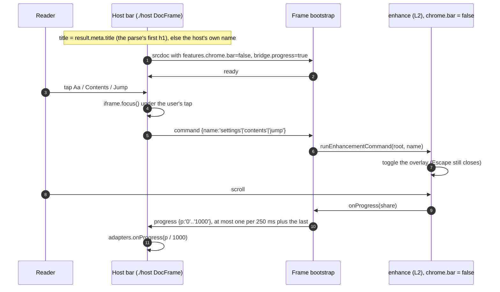
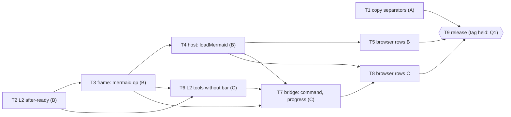

# docserver batch release: copy separators, Mermaid drawn after ready, one merged header bar: Implementation Plan

> **For agentic workers:** REQUIRED SUB-SKILL: Use superpowers:subagent-driven-development to implement this plan task by task. Each task runs as L3's did: an implementer subagent, a held-out review panel, then one fix round ("How this wave runs"). The plan is lean (C40): it holds no implementation code, only the contract each task must meet, its tests and its mutation rows.

**Status:** draft for the operator's review, written 2026-11-04 against `main` at `e301cf3` (the merge of #80: `package.json` version 1.0.1, untagged). The three items are the operator's rulings; this plan decides only how they are built. Every question that is the operator's is listed as a numbered Q with a recommended answer ("Where things stand"); no task decides one silently. The release tag waits for every task and for Q1. Runtime model of this plan's writer: Opus 5.5 (`claude-opus-5-5`).

**Revisions:** review round 1 (three lenses: rulings, executable, guards; 25 findings, 22 distinct): **25 applied, 0 rejected**. Every finding was re-measured at `e301cf3` before it was applied. Overlapping findings were applied once. They covered the command list's home, `update()` re-delivery and the raw separator bytes. Rejections: none.

**Goal:** One batched release of `@synapsium-labs/docserver` that (A) adds U+2028 and U+2029 to the copy check, (B) lets a host draw Mermaid on open without holding `ready` and hand the Mermaid build over after the frame has mounted, and (C) lets a host merge the frame's bar into its own: bar off, host commands for quick jump, Aa and contents, a throttled progress report, and the title.

**Architecture:** (A) is two table entries in `./host`. (B) is a third draw value, `'after-ready'`, carried through every layer (enhance option, seed enum, `frameDocument`, bootstrap, `./host`) plus one additive parent-to-frame op, `mermaid`, that carries the exact hashed text after `ready`; the bootstrap inserts it as an inline script whose hash the frame's policy already lists. (C) is one additive parent-to-frame op, `command`, one switch-gated frame-to-parent op, `progress`, an enhance export that runs a command, and L2 changes that keep the tools working with `chrome.bar` off. Bridge protocol stays 1; seed schema stays 1 (Q11).

**Tech Stack:** unchanged from L3 (`package.json` at `e301cf3`): Node `>=22`, esbuild 0.28.2, playwright-core 1.63.0, TypeScript 6.0.3, vitest 4.1.11, jsdom 29.1.1, Mermaid 12.1.0 as pinned (`package.json:79`). No new dependency.

**Spec:** the first consumer's public spec, [Rich Docs reader and a shared renderer](https://github.com/Synapsium-Labs/ccrc-pwa/blob/main/docs/superpowers/specs/2026-10-12-rich-docs-reader-and-shared-renderer-design.md): §4.4 the bridge, §4.5 one page load, §4.6 watchdog and fallback (its E17 risk), and the `reader-mermaid-on-tap` contingency the first consumer now retires. Item C's inputs come from the first consumer's phone-header plan, option 2 (its approved-for-later notes).

**Ledger:** [`docs/superpowers/programs/docserver.md`](../programs/docserver.md). C1 to C103 stay binding. This batch records its rulings from the next free number on (C104 on `main` today): one per item and one for the version (Task 9). C103 (4) and C103 (6) are superseded by new entries, never edited in place (the ledger is append-only).

---

## Design

### In short

- **Three items, one release.** (A) the copy check names U+2028 LINE SEPARATOR and U+2029 PARAGRAPH SEPARATOR; (B) a new draw mode, `'after-ready'`, draws every figure automatically once the document is ready, and the Mermaid build reaches the frame after mount, over the port; (C) a host can turn the frame's bar off and still drive quick jump, Aa and contents, and read the reading progress and the title.
- **Text first.** In `'after-ready'` the srcdoc carries no Mermaid script (about 3.7 MB less), so the frame's DOMContentLoaded and `ready` no longer wait for Mermaid's download, parse, evaluation or drawing. A host's watchdog then needs no Mermaid allowance.
- **The sealed frame's policy does not widen, but its hash list moves.** `frameCsp()` already lists Mermaid's hash (`src/frame/csp.ts:10,19-23`). The late script is the exact hashed text, inserted inline, so a hash-only `script-src` admits it and nothing else. The policy's shape stays the same. Its list carries the bootstrap and enhance hashes too (`csp.ts:10`), and the batch moves both, so a host that pins its page policy re-pins to the new hashes (`CHANGELOG.md:8`). Only Mermaid's hash stays. C94's violation listener and inline-style probe still fail a bad host policy closed before `ready`.
- **Additive wire.** Two parent-to-frame ops (`mermaid`, `command`) that an older frame ignores (`src/frame-runtime/inbound.ts:59-60`), and one frame-to-parent op (`progress`) that the frame sends only when the seed's bridge switch says the host asked for it, so an older host never sees it. `BRIDGE_PROTOCOL` stays 1 (`src/frame/protocol.ts:19-20`).
- **It is a minor.** New options, ops and an export, and moved hashes of `bootstrap.js`, `enhance.js` and `reader.css`: the CHANGELOG's own rule (`CHANGELOG.md:7-9`) makes it 1.1.0, so the untagged 1.0.1 on `main` is renamed rather than tagged (Q1).
- **The library's default stays `'auto'`** for every other host (Q2). The first consumer's wave that takes the release is Later, named, not planned here.

### 1. What changes, item by item

Each item's surface, measured at `e301cf3`.

| Item | Layer | Today | After |
|---|---|---|---|
| A | `./host` copy check | `OTHER_NAMES` (`src/host/copy.ts:47-70`) lacks U+2028/9; `test/host-copy.test.ts:99` pins `0x2029` as not hidden | both listed by character name; one table still serves `hiddenChars` and `hasHiddenChar` (`copy.ts:114-141`) |
| A | links | `WHITE_SPACE = /\s/u` already refuses both (`src/host/links.ts:31-32,52`) | refused twice; nothing observable moves |
| B | L2 `mermaid.draw` | `'auto' \| 'on-request'` (`src/enhance/options.ts:118`) | adds `'after-ready'` |
| B | frame seed | `MERMAID_DRAW` (`src/frame/seed.ts:91`) | adds `'after-ready'`, held equal to L2's list (C94(2)) |
| B | `frameDocument` | inlines Mermaid and requires `assets.mermaid` whenever Mermaid is on (`src/frame/document.ts:428-433`) | in `'after-ready'`: no inline script, no asset required, Mermaid's hash still required in the policy |
| B | bootstrap | a seed with Mermaid on and no registered API is `FAILED('mermaid')` in both modes (`src/frame-runtime/bootstrap.ts:328-341`) | in `'after-ready'`: no API required at boot; `load()` answers when the `mermaid` op arrives |
| B | `./host` | `mermaidDraw` `'auto' \| 'on-request'` (`src/host/mount.ts:78,114`) | adds `'after-ready'` and an optional `loadMermaid` adapter |
| C | bar off | `chrome.bar` already reaches L2 (`src/frame/seed.ts:104`, `src/host/mount.ts:325`); with it off Aa returns early (`src/enhance/settings.ts:41`), contents has no opener (`src/enhance/rail.ts:291`), progress is not computed (`src/enhance/scroll.ts:204`) | Aa built without the bar; three (or four, Q7) commands; progress computed for a host |
| C | `--bar-h` | 48 px for every root (`assets/reader.css:105`) | 0 inside the frame when the root has no bar (frame prelude, `scripts/build-frame.mjs:129-131`; Q10) |
| C | title | the frame's title is the first h1 (`src/render/meta.ts:18`), already in `RenderInput.result.meta.title` | no new op: the host reads that value (Q9) |

*Table 1. The surface of the batch.*

### 2. Drawing after ready (item B)

The new lifecycle in one picture. The host asks for the Mermaid build at mount, in parallel with the frame's boot; the frame posts `ready` with readable sources; the build is handed over whenever it arrives, before or after `ready`, and is posted only after `ready`.

```mermaid
sequenceDiagram
  autonumber
  participant H as Host page (./host)
  participant L as loadMermaid adapter
  participant F as Frame bootstrap
  participant E as enhance (L2)
  H->>L: loadMermaid() at mount
  H->>F: srcdoc without Mermaid script
  H->>F: hello (port)
  F->>E: enhance(), mermaid.draw = 'after-ready'
  E-->>F: resolved; root reads waiting, sources readable
  F->>H: ready (nonce)
  Note over H: watchdog cleared: no Mermaid allowance needed
  L-->>H: Mermaid text
  H->>H: sha256 equals FRAME_MANIFEST.mermaid
  H->>F: mermaid {text}
  F->>F: insert inline script (hash in policy)
  F-->>E: load() resolves with the registered API
  E->>E: gate on, drawing, draw every figure
  E-->>F: drawn / partial / failed (no message)
  alt loader rejects or hash differs
    H->>F: mermaid {unavailable:true}
    F-->>E: load() resolves null: every figure shows the load note
  end
```

*Figure 1. Drawing after ready, with the Mermaid build handed over after mount.*

| # | Decision | Why | Cost if wrong |
|---|---|---|---|
| BD1 | A third value, `'after-ready'`, in every layer under one name | C94(2)'s equality check between L2's and the seed's lists holds unchanged; `'auto'` and `'on-request'` keep their exact behaviour for every host | One more mode to keep green on both engines |
| BD2 | L2 sets no gate while it waits: the root reads `waiting`, sources stay readable; the gate and `drawing` come only after `load()` answers | `'auto'`'s order (gate before load, `src/enhance/diagrams.ts:673-674`) would leave transparent placeholders for as long as the host withholds the build | none: fail-readable by construction |
| BD3 | The text travels on the port as `{t:'mermaid', text}` and is inserted as an inline script; `{t:'mermaid', unavailable:true}` is the host's "no build" | A URL or blob is ruled out by the floor (`default-src 'none'`, hash-only `script-src`, opaque origin); a remount (`update()`) loses scroll, focus and state | Proven only when Task 5's row draws on every CI engine (risk BR1) |
| BD4 | The bootstrap accepts `docserver:register` only from the element it inserted, once, only in `settled` state, only for an `'after-ready'` seed | Element identity replaces today's position check (`bootstrap.ts:289-291`) | — |
| BD5 | `fastdom` and `injected` are reserved in Phase S as own, writable, non-configurable window properties holding `undefined`, in every mode | Mermaid writes them while it evaluates; the "safe because it lands before content" argument (`scripts/mermaid-frame-entry.mjs:13-15`) is false once Mermaid evaluates after content | none for the inline modes: their writes still succeed |
| BD6 | The inline-style probe runs in every mode but `'auto'` (`probesInlineStyle`, `src/frame-runtime/adapters.ts:175-177`) | C94(1): a mode whose first drawing comes after `ready` must probe inline style before `ready` | — |
| BD7 | `./host` verifies the text against `FRAME_MANIFEST.mermaid.sha256` before posting; a mismatch or a rejection posts `unavailable` and warns once | The frame's policy would block a wrong text anyway; checking in the host gives a clean `failed` instead of a CSP report | — |
| BD8 | A host that never hands the build over leaves the root `waiting` with readable sources for the life of the mount; the frame never times the handover out | The parent owns time (FD10's spirit) | A host bug looks like "figures never draw" — documented in the README; Q13 is the operator's |
| BD9 | Figures draw nearest first, reusing `'auto'`'s order (`diagrams.ts:690-713`) | A deep link to a late figure is not held behind every figure before it | Q4 is the operator's |
| BD10 | A policy that blocks Mermaid's hash after `ready` degrades to the load note on every figure; no `error` is sent | Protocol 1 has no error after `ready`; a script probe before `ready` would need the 3.7 MB text first | Q6 is the operator's |

*Table 2. Decisions for item B.*

### 3. One header bar (item C)

The host owns the only bar. It sends commands into the frame, and reads progress and title back.



*Figure 2. Host commands, progress and title with the frame's bar off.*

| # | Decision | Why | Cost if wrong |
|---|---|---|---|
| CD1 | `chrome.bar = false` is the existing switch; no new option turns the bar off | It already runs end to end (`src/frame/wire-types.ts:33-41`, `seed.ts:104`, `mount.ts:325`, `src/enhance/lifecycle.ts:371,416`) | — |
| CD2 | Aa is built without the bar, anchored to the frame's top right | Today it vanishes (`settings.ts:41`) | A placement the operator dislikes; a CSS change |
| CD3 | One parent-to-frame op `{t:'command', name}`, names `jump`, `settings`, `contents` (and `outline`, Q7); each toggles. L2 defines the names (`COMMAND_NAMES` in a new sibling `src/enhance/commands.ts`, Task 6). `protocol.ts` holds a twin `COMMAND_OPS` list (Task 7), and a test holds the two equal, as `MERMAID_DRAW_VALUES` (`src/enhance/options.ts:118`) and `MERMAID_DRAW` (`src/frame/seed.ts:91`) are held (C94(2), `test/enhance-mermaid-on-request.test.ts:406-408`) | A tap on the host's bar never reaches the frame's tap-outside-to-close; replaying the `/` key cannot reach Aa or contents. The walls forbid a member named `open` (`test/enhance-walls.test.ts:68`), and they forbid any `src/enhance` import that is not a sibling (`test/enhance-walls.test.ts:647-657`), so L2 cannot import the frame's list | — |
| CD4 | `DocFrame.command(name)` drops before `ready`, throws on an unknown name, and focuses the iframe before posting | Keyboard and screen-reader users need focus inside the overlay | Focus from a host tap into a sandboxed frame is unmeasured on WebKit (risk CR1) |
| CD5 | `{t:'progress', p}` with `p` a string of thousandths (`^(?:0\|[1-9][0-9]{0,2}\|1000)$`), sent only when the seed's `bridge.progress` is true. `./host` sets it only when `onProgress` is given. In `frameDocument` an absent `progress` defaults to **false**, unlike every other bridge switch, which defaults to true (`src/frame/document.ts:145,352-355`) | Every value on the wire is a string but `v` (`protocol.ts:111`). The switch and its false default mean that no host that leaves `progress` out receives the op. That covers an older `./host` and a host that builds `FrameOptions` itself, and neither can count it as `unknown-op` (`src/host/parse.ts:29`) | — |
| CD6 | Progress is coalesced over 250 ms, first and last value, at most 4 a second | The pacer allows 12 non-copy ops a second (`src/frame-runtime/outbox.ts:12-20`); the position save already takes up to 4 while scrolling; 4 more leave room for navigate, hash and version | A visibly stepped progress line on a fast fling; Q15 |
| CD7 | No title op: the host reads `result.meta.title`, byte for byte the frame's title, falling back to its own name | The host already holds it; an op would only echo it | Q9 is the operator's |
| CD8 | `--bar-h: 0px` for a root with no bar, as a frame-only prelude rule | Anchor offsets, sticky table heads, figure tools and the drawer (`reader.css:249,494,575,789-795`) stop reserving 48 px; `./enhance` hosts keep the documented 48 px (`reader.css:10-12`) | Q10 |
| CD9 | Optional trim: `ChromeOptions.topSpace?: boolean` (default true); false shrinks the root's top padding (52 px, 28 px on a phone: `reader.css:225,928`) | The frame has no 8 px body margin (`build-frame.mjs:129-131` sets `html,body{margin:0}`); the 29 px gap is the bar's own padding and leaves with it | Q8: the residual padding is the operator's |

*Table 3. Decisions for item C.*

### 4. Versions, assets and the wire

What the batch moves, so the release entry can name it.

| Surface | Moves? | Note |
|---|---|---|
| `assets/frame/bootstrap.js` | yes | inbound ops, insertion, reservation, probe rule, progress |
| `assets/frame/enhance.js` | yes | `'after-ready'` branch, commands, progress without the bar, Aa without the bar |
| `assets/frame/reader.css` | yes | Aa placement without the bar, prelude `--bar-h` rule, `topSpace` |
| `assets/frame/guard.js` | no | — |
| `assets/mermaid/mermaid.frame.js` and its CSP hash | no | Mermaid's hash stays. `frameCsp()`'s output still changes, because it lists the bootstrap and enhance hashes (`src/frame/csp.ts:10,21`), so hosts re-pin (`CHANGELOG.md:8`) |
| `MAX_SRCDOC_CHARS_DEFAULT` | yes | derived from the asset lengths (FD20) |
| `BRIDGE_PROTOCOL` | no (1) | three additive ops |
| `SEED_SCHEMA` | no (1) | closed keys grow (`bridge.progress`, `chrome.topSpace`), one enum value; the seed never travels without its own bootstrap (`protocol.ts:22-23`); Q11 |
| package version | minor | 1.1.0 (Q1) |

*Table 4. Release impact.*

---

## Global Constraints

Carried from L3 (its plan, "Global Constraints"), binding on every task:

- **Public-ready** text in every tracked file, commit and PR body. The consuming product is "the first consumer". No product, host, person or private repository names.
- **Pure where declared; CSP-safe; import-inert; host data is untrusted; no network in tests; release bytes only; hash-only CSP** (never widened: no `'unsafe-inline'` for scripts, no nonce, no `'strict-dynamic'`, no `blob:`/`data:` scripts).
- **Tests** run as `./node_modules/.bin/vitest run --maxWorkers=2 [file]` in the foreground, never a bare `npx vitest`; browser rows locally as `DOCREADER_BROWSERS=chromium ./node_modules/.bin/vitest run --maxWorkers=2 test/browser/<file>`; WebKit is proven in CI only (C69). `npm run typecheck` covers every tsconfig project. A run that loses a worker is run again.
- **Bounded commands** (C75): every command behind `timeout -k 10 900`, output captured to a log capped at 8 MiB; a run that hits a limit is incomplete, never passing.
- **Generated files.** A task that changes any input of `scripts/build-frame.mjs` runs `npm run build:frame` and commits `assets/assets.json` and `src/frame/manifest.generated.ts` in the same commit; `node scripts/build-frame.mjs --check` is green after. A conflict on them is resolved by rebuilding, never by hand.
- **The wire** changes additively only, and every wire choice is a fixture in `conformance/bridge-cases.json`.
- **Mutation discipline.** Every new guard ships with a case that goes red without it, measured before and after, in place, one row at a time (saved bytes plus sha256, `timeout -k 10 600`, `ulimit -u` at the measured thread count plus 1500, restored from the saved bytes and the sha256 checked, never `git checkout`). Rows are recorded in **`docs/superpowers/plans/batch-mutations/task-<n>.md`**, in L3's format (a table, then its JSON fence, per section). A row that stays green gets a new case, or is recorded as an equivalent mutant under a ruling; it is never dropped. A row that mutates a build input saves and restores the generated outputs too.
- **Low disk.** No repository copies, no parallel mutation runs, no Docker.
- **Commits.** Files staged by name; subject `<area>: <what> (docserver batch T<n>)`; the writer's `Co-Authored-By:` trailer. No task pushes; the coordinator pushes. Never `git stash`, `reset --hard` or `checkout --`.

## How this wave runs

- **Branches.** Each task is one branch and one PR from `main` once its "Depends on" have merged; no rebase or force push (C55). Before a group's first merge the coordinator merges the group's branches in a scratch branch and runs the touched suites and `node scripts/build-frame.mjs --check` there.
- **Per task.** Implementer subagent (tests first), a held-out panel of three lenses (contract; safety and lifecycle; tests, rows and evidence), a refute pass per finding, one fix round.
- **Shared files and their writers, in order.** The task dependencies below enforce this order: every later writer depends on every earlier one. `src/frame/protocol.ts` and `conformance/bridge-cases.json`: 3, then 7. `src/frame-runtime/bootstrap.ts`, `inbound.ts`, `adapters.ts`: 3, then 7. `src/frame-runtime/outbox.ts`: 7. `src/frame/seed.ts` and `test/frame-seed.test.ts`: 2, 6, then 7. `src/frame/document.ts`: 3, then 7. `src/host/mount.ts`: 4, then 7. `src/enhance/options.ts`, `types.ts`: 2, then 6. `src/enhance/diagrams.ts`: 2. `src/enhance/commands.ts` (new), `src/enhance/{settings,rail,jump,scroll,plans,lifecycle}.ts`, `enhance-entry.ts`: 6. `test/enhance-mermaid-on-request.test.ts`: 2, then 3. `test/enhance-walls.test.ts`, `scripts/consumer-smoke.mjs`, `test/pack.test.ts`: 6. `scripts/build-frame.mjs`: 3 (the allowlist reasons only), then 6 (the prelude only). `test/frame-runtime-walls.test.ts`: 3. `test/host-walls.test.ts`: 7. `assets/reader.css`: 6. `src/host/copy.ts`, `links.ts` (comment only): 1. `README.md` and `test/readme.test.ts`: 1, 3, 4, 6, 7 (each its own rows), then 9. `CHANGELOG.md`, `package.json` version, the ledger: 9 only. The generated manifests: every task that moves an asset, rebuilt on its merged base.

## Tasks

| # | Title | Item | Depends on | Group |
|---|---|---|---|---|
| 1 | The copy check names U+2028 and U+2029 | A | `e301cf3` | A |
| 2 | L2 and the seed: the `'after-ready'` draw mode | B | `e301cf3` | A |
| 3 | The frame: no inline Mermaid, the `mermaid` op, late insertion | B | 2 | B |
| 4 | `./host`: `mermaidDraw: 'after-ready'` and `loadMermaid` | B | 3 | C |
| 5 | Browser rows for drawing after ready, both engines | B | 4 | D |
| 6 | L2: the tools without the bar, commands, progress, `--bar-h`, `topSpace` | C | 2, 3 | C |
| 7 | The bridge for one bar: `command`, `progress`, `DocFrame.command`, `onProgress` | C | 3, 4, 6 | D |
| 8 | Browser rows for one bar, both engines, and the header measurement | C | 4, 7 | E |
| 9 | The batched release: version, CHANGELOG, README, ledger, consumer smoke | all | 1, 5, 8 | F |



*Figure 3. Task dependencies. T2 comes before T6 because both write `src/enhance/options.ts`, `types.ts` and `seed.ts`. T3 comes before T6 because both rebuild the generated manifests, and the hashes rebuild in order. T3, T4 and T6 all come before T7, because T7 writes after them in `protocol.ts`, `bootstrap.ts`, `inbound.ts`, `document.ts`, `mount.ts` and `seed.ts`.*

---

### Task 1: The copy check names U+2028 and U+2029

**Goal.** `hiddenChars` and `hasHiddenChar` report U+2028 LINE SEPARATOR and U+2029 PARAGRAPH SEPARATOR by character name (they are Zl and Zp, not controls, so they carry no name alias). The link classifier's verdicts do not change.
**Files.** Modify `src/host/copy.ts` (two `OTHER_NAMES` entries under a comment citing the new ledger entry, at `copy.ts:47-70`; the header comment `copy.ts:1-10` and the `name` docstring at `copy.ts:22` say the separators carry their character names), `src/host/links.ts` (comment at `links.ts:5-7` only), `test/host-copy.test.ts`, `README.md` (the `copy` row at `README.md:383`; the `onLink` row at `README.md:381` names the separators). Create `docs/superpowers/plans/batch-mutations/task-1.md`. Add one line to `docs/superpowers/plans/l3-mutations/task-9.md` (the L3.H7 section head, `task-9.md:1160`) pointing at the re-measurement in the new file, as C103 updated that record before.
**Consumes.** C103's table and walks. **Produces.** Two more listed characters; no API change; `HiddenChar` (`copy.ts:18-24`) unchanged.
**Steps.**
1. In `test/host-copy.test.ts`: add a `SEPARATORS` list `[[0x2028,'LINE SEPARATOR'],[0x2029,'PARAGRAPH SEPARATOR']]` and a loop in "L3.H7 each hidden character is reported…" asserting `hiddenChars('ab'+ch+'c')` is `[{index:2, codePoint, name}]`; in "L3.H7 hasHiddenChar" assert true for `'a\u2028b'` and `'a\u2029b'`, written as `\u` escapes in the test file as every such character there is (`test/host-copy.test.ts:228-233`), never as raw characters; in "L3.H7 what is not hidden" (`:94-102`) remove `0x2029` (`:99`) and add the neighbours `0x2027` and `0x202f`; update the header comment `:1-7`.
2. Run `./node_modules/.bin/vitest run --maxWorkers=2 test/host-copy.test.ts`: expect exactly the new separator cases and the `hasHiddenChar` case red, the neighbour case green.
3. Add the two entries and the comments.
4. Run the Verify line: green; the file counts 39 tests.
5. Measure the rows below, then re-measure every L3.H7 row (L3.H7a to L3.H7s and L3.H7c1) against the new tree: the count lines move from 37 to 39 and `copy.ts`'s restore sha256 changes, as C103 re-measured the section (`task-9.md:1164`). Record them in `batch-mutations/task-1.md`.
6. Commit.
**Acceptance tests.** B1.1 each separator reported with index and name; B1.2 `hasHiddenChar` true for each; B1.3 U+2027 and U+202F still not hidden; B1.4 `test/host-links.test.ts` unchanged and green (its `:51-52` already pins both refused through `WHITE_SPACE`).
**Mutation rows** (`batch-mutations/task-1.md`).

| Row | Guard | Edit that must red it | Expected red |
|---|---|---|---|
| B1a | the separator class | remove the comment line and both entries from `OTHER_NAMES` | the two per-character cases and the `hasHiddenChar` case; record that `test/host-links.test.ts` stays green (`WHITE_SPACE` still refuses) |
| B1b | the class's width | add `0x2027: 'HYPHENATION POINT'` to `OTHER_NAMES` | "clean text … give nothing" through the U+2027 neighbour |
| B1c | the right name | swap the two names | both per-character cases |

**Verify.** `./node_modules/.bin/vitest run --maxWorkers=2 test/host-copy.test.ts test/host-links.test.ts test/readme.test.ts`; `npm run typecheck`. No frame asset imports `copy.ts` (`scripts/build-frame.mjs:87-89,148`), so `node scripts/build-frame.mjs --check` stays green with no rebuild.

### Task 2: L2 and the seed: the `'after-ready'` draw mode

**Goal.** `EnhanceOptions.mermaid.draw` and the seed's `MERMAID_DRAW` both accept `'after-ready'`, in one commit. In that mode the second phase waits for `load()` with no gate and readable sources. It then draws every figure automatically and settles exactly as `'auto'` does. Both lists move together because a test already holds L2's list and type equal to the seed's: `test/enhance-mermaid-on-request.test.ts:406-408` checks the type with `expectTypeOf`, so `npm run typecheck` compiles that check too, and it checks the values with `toEqual`.
**Files.** Modify `src/enhance/options.ts` (`MERMAID_DRAW_VALUES` at `:118`, checked at `:373-378`), `src/enhance/types.ts` (the `draw` type and its docstring), `src/enhance/diagrams.ts` (a branch in `after()` at `:664`, beside the `'on-request'` branch at `:670-673`), `src/frame/seed.ts` (`MERMAID_DRAW` at `:91`; the longest-text budget at `:250` and `:312` grows by one character). Modify `test/enhance-options.test.ts`, `test/frame-seed.test.ts` and `test/enhance-mermaid-on-request.test.ts`. The last of these keeps its equality case at `:406-408` byte for byte; that case now covers the new value. Its `waitsForDrawing` unit at `:431-435` gains an `'after-ready'` line expecting false, and the predicate is unchanged. Create `test/enhance-mermaid-after-ready.test.ts`, `docs/superpowers/plans/batch-mutations/task-2.md`. Rebuild the frame manifests (enhance.js moves, and so does every frame asset that bundles `seed.ts`).
**Consumes.** L2's `load()` (`diagrams.ts:586-598`), queue (`:565-575`), `draw()` (`:566-569`), near-first order (`:690-713`), null-module path (`:685-689`). **Produces.** The root states `waiting` (new), then `drawing`, `drawn`, `partial`, `failed`; `draw: 'after-ready'` in the option.
**Behaviour.** On entry: set `data-docreader-diagrams="waiting"` without `data-docreader-mermaid`. Call `load()` once and await it; then wait for fonts; only then set the gate and `drawing`, and draw nearest first (BD9; Q4) through the existing queue. A null module gives every figure the load note and `failed`. An over-`maxTextSize` figure takes the long note through `draw()`, unchanged. `enhance()` does not wait for any of it (`src/enhance/lifecycle.ts:459-471`).
**Steps.**
1. Write `test/enhance-mermaid-after-ready.test.ts` (jsdom, a deferred fake Mermaid) with B2.1 to B2.5; add `'after-ready'` acceptance and the list-equality expectation to `test/enhance-options.test.ts`.
2. Run `./node_modules/.bin/vitest run --maxWorkers=2 test/enhance-mermaid-after-ready.test.ts test/enhance-options.test.ts test/frame-seed.test.ts`: expect red (value refused).
3. Implement L2's list, the seed's list and the branch in the same commit. Run them green, then run `test/enhance-diagrams.test.ts` and `test/enhance-mermaid-on-request.test.ts` green. The first is unchanged. The second carries only the edits listed under Files.
4. `npm run build:frame`; `node scripts/build-frame.mjs --check`.
5. Measure the rows; commit with the manifests.
**Acceptance tests.**
- B2.1: after `enhance()` resolves and before `load()` answers, the root reads `waiting`, has no gate, every source is a visible code block, no SVG exists.
- B2.2: once `load()` answers, every drawable figure is drawn with no tap, nearest first (a far-first viewport records the order), and the root settles `drawn`.
- B2.3: a null module: every figure shows the load note, root `failed`.
- B2.4: one figure that throws: `draw-failed` with note and source, root `partial`.
- B2.5: `'lazy'`, `true`, `null` still refused; `'after-ready'` accepted; `'auto'` and `'on-request'` behave as before.
- B2.6 (was B3.3): the seed and L2 draw lists are equal (C94(2)), and both contain `'after-ready'`. The seed accepts it and refuses an unknown value.
**Mutation rows** (`batch-mutations/task-2.md`).

| Row | Guard | Edit that must red it |
|---|---|---|
| B2a | no gate while waiting | set the gate before awaiting `load` in the new branch |
| B2b | automatic draw | return after load without drawing |
| B2c | nearest first | sort in document order |
| B2d | null module path | drop the `api === null` branch from the new path |
| B2e | option accepted | drop `'after-ready'` from `MERMAID_DRAW_VALUES` |
| B2f (was B3d) | draw lists equal | drop `'after-ready'` from `MERMAID_DRAW` in `seed.ts` only |

**Verify.** `./node_modules/.bin/vitest run --maxWorkers=2 test/enhance-mermaid-after-ready.test.ts test/enhance-mermaid-on-request.test.ts test/enhance-diagrams.test.ts test/enhance-options.test.ts test/frame-seed.test.ts`; `DOCREADER_BROWSERS=chromium ./node_modules/.bin/vitest run --maxWorkers=2 test/browser/diagrams.test.ts`; `npm run typecheck`; `node scripts/build-frame.mjs --check`.

### Task 3: The frame: no inline Mermaid, the `mermaid` op, late insertion

**Goal.** A frame seeded `'after-ready'` boots to `ready` with no Mermaid script in its srcdoc. It accepts the build once over the port after `ready`, inserts it under the unchanged hash-only policy, and hands enhance the registered API. The seed's list already carries the value (Task 2).
**Files.** Modify `src/frame/document.ts` (`:428-433`: no inline script and no required asset in `'after-ready'`; Mermaid's hash stays required in the policy), `src/frame/protocol.ts` (`OP_KEYS.mermaid = ['t','text','unavailable']` at `:130-142`, `PARENT_OPS` at `:148`, a new `BRIDGE_LIMITS.mermaidMaxChars` of 8,388,608), `src/frame-runtime/inbound.ts` (`:57-61` accepts `mermaid` with exactly one of `text` within the cap or `unavailable: true`), `src/frame-runtime/bootstrap.ts` (no registered API required in `'after-ready'`, `:328-341`; a deferred `load()`; the once-only handler in `settled` state; the Phase-S reservation of `fastdom` and `injected`, BD5), `src/frame-runtime/adapters.ts`. In that file, `enhanceMermaid` (`:153-163`) takes `api: object` and answers `load: () => Promise.resolve(api)`. It changes to take a load function, `enhanceMermaid(m, load: () => Promise<unknown>)`, and the bootstrap passes `() => Promise.resolve(mermaidModule)` in the inline modes and the deferred load in `'after-ready'`. `probesInlineStyle` becomes true for every mode but `'auto'` (`:175-177`), and `waitsForDrawing` (`:167-169`) is unchanged. In `src/frame-runtime/bootstrap.ts`, the conditional at `:359` is `seed.mermaid === null || mermaidModule === null ? {} : { mermaid: enhanceMermaid(seed.mermaid, mermaidModule) }`. As written, it would pass no `mermaid` option at all to an `'after-ready'` seed, because no module registered at boot, and L2's `after()` would then return at `src/enhance/diagrams.ts:666`. It changes so that an `'after-ready'` seed always passes the option with the deferred load. Also modify `src/frame-runtime/styles.ts` (comment `:1-13`) and `scripts/mermaid-frame-entry.mjs` (comment `:13-15` only: the reservation, not ordering, now makes the write safe; no code change, so its hash does not move). In `scripts/build-frame.mjs`, rewrite the two `FREE_GLOBALS_ALLOWLIST` reasons (`:116-122`). Both say the write "lands before … any content", which no longer holds in `'after-ready'`. They now cite the Phase-S reservation (BD5). Only these strings change, but `build-frame.mjs` is a build input, so rebuild. Modify `test/frame-document.test.ts`, `test/frame-runtime.test.ts`, `conformance/bridge-cases.json` (new `parent-to-frame` cases), and `test/frame-protocol.test.ts`. In the last file, the frame-side oracle `frameReads` hard-codes the port ops `['prefs','changes.result']` (`:353-354`); it gains `mermaid` and judges its shape. Modify `test/enhance-mermaid-on-request.test.ts` in three places. The `probesInlineStyle` unit near `:431` changes. The `enhanceMermaid` shape pin at `:415-421` now passes a load function, and keeps the case "the inline modes' load answers the registered API". The source-text pin at `:437-441` (`mermaid:\s*enhanceMermaid\(seed\.mermaid,\s*mermaidModule\)`) is rewritten to the new call. It gains a pin that the option is built for an `'after-ready'` seed without a module. Modify `test/frame-runtime-walls.test.ts`: a `SOURCE_SITES`/`BUILT_SITES` entry (`:58-66`) for creating a `script` element, exact count 1 in `bootstrap.ts`, with its planted control. Modify `README.md`: a `mermaid` row in The bridge, which `test/readme.test.ts:370-372` requires for every key of `OP_KEYS`. It also needs a sentence on the op's shaped key, because `{t:'mermaid', unavailable:true}` adds the accepted shaped key `parent-to-frame mermaid unavailable`. Extend `test/readme.test.ts`'s expected set (`:385-405`) with that key. Create `docs/superpowers/plans/batch-mutations/task-3.md`. Rebuild the frame manifests (bootstrap.js moves).
**Consumes.** Task 2's mode and the seed's `'after-ready'`; `styleIntrinsics` (`src/frame-runtime/styles.ts:22-29`: `createElement`, `setText`, `appendChild` captured in Phase S); `frameCsp()`'s Mermaid hash (`src/frame/csp.ts:10`). **Produces.** `ParentToFrame` gains `{t:'mermaid', text:string} | {t:'mermaid', unavailable:true}`; `enhanceMermaid` takes a load function.
**Behaviour.** On a `mermaid` op in `settled` state with an `'after-ready'` seed, first time only: `unavailable` resolves `load()` with null. `text`: create a `script` with the captured intrinsics, add a `docserver:register` listener on that element only, set its text, append it to the head (a classic inline script runs synchronously inside `appendChild` with `currentScript` set to it, so `mermaid.frame.js` needs no change), remove the listener; resolve `load()` with the API if it registered with `initialize` and `render`, else null. Every other case (other mode, before `settled`, second op) is ignored silently, as `inbound.ts:59-60` treats unknown ops. A CSP violation for a blocked late script after `ready` is ignored by the listener (`bootstrap.ts:313-320` ignores after `done`) and the figures show the load note.
**Steps.**
1. Write the unit cases B3.1, B3.2 and B3.4 to B3.7, and the `bridge-cases.json` entries. Run `./node_modules/.bin/vitest run --maxWorkers=2 test/frame-document.test.ts test/frame-protocol.test.ts test/frame-runtime.test.ts test/host-parse.test.ts test/enhance-mermaid-on-request.test.ts test/readme.test.ts`: expect red.
2. Implement in the order protocol, document, inbound, adapters, bootstrap, then the README rows and the allowlist reasons.
3. Run green; `npm run build:frame`; `node scripts/build-frame.mjs --check`; `npm run typecheck`.
4. Measure the rows (rows on build inputs save and restore the manifests); commit with them.
**Acceptance tests.**
- B3.1: `frameDocument` with `'after-ready'` emits no Mermaid script and needs no `assets.mermaid`.
- B3.2: it refuses a policy lacking Mermaid's hash with `missing-hash`.
- (B3.3 moved to Task 2 as B2.6.)
- B3.4: `parseParentMessage` accepts `{t:'mermaid', text}` and `{t:'mermaid', unavailable:true}`, and ignores every other shape. Each is a `parent-to-frame` case in `bridge-cases.json`, and each refusal names an existing reason from the closed list (`conformance/bridge-cases.json:11-29`, pinned by `test/frame-protocol.test.ts:393-403`). Text over the cap is `oversize`. A non-string `text` is `type`. Both keys, neither key, or an extra key is `keys`. `unavailable:false` is `type`, as `changes.result`'s `unavailable` is judged (`frame-protocol.test.ts:378-380`). No new reason is added, so `BridgeRefusal` (`src/host/parse.ts:25-40`), `src/conformance/bridge.ts` and `test/api.test.ts` are untouched.
- B3.5: `probesInlineStyle` is true for `'on-request'` and `'after-ready'`, and false for `'auto'` and null. `waitsForDrawing` is true only for `'auto'`. This is a predicate-only check: whether `ready` actually waits is B5.2's.
- B3.6: a Mermaid-on `'after-ready'` seed with no registered API boots (no `FAILED('mermaid')`); `'auto'` and `'on-request'` still fail without one.
- B3.7: for an `'after-ready'` seed with no module at boot, the bootstrap still hands L2 a `mermaid` option whose `load` is pending until the op arrives. The inline modes' `load` answers the registered API, as before.
**Mutation rows** (`batch-mutations/task-3.md`).

| Row | Guard | Edit that must red it |
|---|---|---|
| B3a | no inline script | inline Mermaid in `'after-ready'` anyway |
| B3b | no asset required | keep the `missing-asset` throw for `'after-ready'` |
| B3c | hash still required | push Mermaid's hash into `required` only when inlined |
| B3e | the op's shape | in turn: drop the cap; accept a non-string; accept both keys; accept neither |
| B3f | `PARENT_OPS` | drop `'mermaid'` from `PARENT_OPS` |
| B3g | no boot requirement | require the registered API in `'after-ready'` |
| B3h | probe | restore `probesInlineStyle` to `=== 'on-request'` |
| B3i | predicate only | make `waitsForDrawing` true for `'after-ready'`: reds B3.5's predicate case only (at the behaviour level this is an equivalent mutant; see B5g) |
| B3j | option always passed | restore `:359`'s `mermaidModule === null ? {}` for `'after-ready'` (the option is omitted when no module registered) |
| B3k | one script-creation site | add a second `script` creation in `bootstrap.ts` (the walls' planted control) |

The browser half of these guards (once-only, element identity, mode check, reservation, hash match, and `ready` not waiting) is measured in Task 5.
**Verify.** `./node_modules/.bin/vitest run --maxWorkers=2 test/frame-seed.test.ts test/frame-document.test.ts test/frame-protocol.test.ts test/frame-runtime.test.ts test/frame-runtime-walls.test.ts test/frame-csp.test.ts test/host-parse.test.ts test/enhance-mermaid-on-request.test.ts test/frame-build.test.ts test/mermaid-frame.test.ts test/readme.test.ts`; `npm run typecheck`; `node scripts/build-frame.mjs --check`.

### Task 4: `./host`: `mermaidDraw: 'after-ready'` and `loadMermaid`

**Goal.** `mountDocFrame` mounts at once in `'after-ready'`, fetches the build in parallel with the frame's boot, verifies it, and posts it only after a valid `ready`.
**Files.** Modify `src/host/mount.ts` (`mermaidDraw` type at `:78`, `MERMAID_DRAW` at `:114`, the adapter-key list at `:106`, validation near `:203-205`, the gate pass-through at `:324`, the post beside the queued prefs at `:469-470`), `src/host/index.ts` (types), `test/host-mount.test.ts`, `test/readme.test.ts`, `README.md` (the `mermaidDraw` row, a `loadMermaid` row, and the host duty: hand the build over or the figures stay as source). Create `docs/superpowers/plans/batch-mutations/task-4.md`.
**Consumes.** Task 3's op and `FRAME_MANIFEST.mermaid.sha256`; the pure SHA-256 (`src/frame/sha256.ts`). **Produces.** `HostAdapters.mermaidDraw?: 'auto' | 'on-request' | 'after-ready'`; `HostAdapters.loadMermaid?: () => Promise<string>`.
**Behaviour.** In `'after-ready'`, exactly one source is required: `loadMermaid`, or `assets.mermaid` when given instead. Having neither is a `TypeError` at step 1. The verdict is held at the **`DocFrame`** level, not per mount. `update()` is a full remount with a new iframe, channel and nonce (`mount.ts:96-97`), and each remount has its own `live` flag (`mount.ts:307,363`). The loader is called **at most once per `DocFrame`**, at the first mount whose gate admits Mermaid inline (`gated.inline`, `mount.ts:316-317,324`). A document with no fences never calls it, matching the first consumer's rule of loading the text only for a document the gate lets in. Every later remount reuses the held promise, and so does an `update()` that brings in a document with figures. The loader is untrusted host code. It is called inside `try`, and its result is wrapped with `Promise.resolve`. A synchronous throw, a rejection, a value that is not a string, a string over `BRIDGE_LIMITS.mermaidMaxChars`, or a sha256 that differs from `FRAME_MANIFEST.mermaid.sha256` each give the verdict `unavailable` and one console warning per `DocFrame`. None of them ever lets an exception escape `mountDocFrame`, `update()` or the port. Once the verdict is known, each Mermaid-on mount posts `{t:'mermaid', text}` or `{t:'mermaid', unavailable:true}` exactly once after its own valid `ready`. That is at once if its `ready` came first. A remount that `update()` replaced posts nothing, through its `live` flag (`mount.ts:511`). The current mount always receives the verdict. After `destroy()` nothing is posted. `loadMermaid` in another mode is ignored and never called.
**Steps.** 1. Write B4.1 to B4.9 in `test/host-mount.test.ts`; run `./node_modules/.bin/vitest run --maxWorkers=2 test/host-mount.test.ts`: red. 2. Implement. 3. Green; README rows; `test/readme.test.ts` green. 4. Measure rows; commit.
**Acceptance tests.**
- B4.1: for a document the gate admits, `loadMermaid` is called at mount, before `ready`; nothing is posted before `ready`; the op follows a valid `ready`.
- B4.2: an answer after `ready` is posted at once.
- B4.3: a wrong text posts `unavailable` and warns; a rejection does too.
- B4.4: an answer after `destroy()` posts nothing.
- B4.5: `'after-ready'` with neither source throws a `TypeError`; with `assets.mermaid` only, that text is posted after `ready`.
- B4.6: `'auto'` and `'on-request'` never call `loadMermaid`.
- B4.7: if `update()` is called before the loader resolves, the new mount's `ready` is followed by exactly one `mermaid` op, the replaced mount posts nothing, and the loader was called once. An `update()` after the build arrived also re-posts it to the new mount without calling the loader again.
- B4.8: a document with no Mermaid fences (gate not inline) never calls `loadMermaid`, and posts no `mermaid` op.
- B4.9: a loader that throws synchronously, resolves to a non-string, or resolves to a string over the cap posts `unavailable` and warns. `mountDocFrame` does not throw.
**Mutation rows** (`batch-mutations/task-4.md`).

| Row | Guard | Edit that must red it |
|---|---|---|
| B4a | post after ready | post on arrival, before `ready` |
| B4b | hash check | skip the sha256 comparison |
| B4c | replaced mount silent | drop the `live` check (the replaced mount posts too: B4.7) |
| B4d | a source is required | drop the step-1 check |
| B4e | mode accepted | drop `'after-ready'` from `MERMAID_DRAW` in `mount.ts` |
| B4f | other modes untouched | call `loadMermaid` in every mode |
| B4g | re-delivery on update | post only to the mount that called the loader (B4.7 reds) |
| B4h | gate first | call the loader for a document with no fences (B4.8 reds) |
| B4i | untrusted answer | drop the `typeof text === 'string'` check (B4.9 reds) |
| B4j | sync throw contained | call the loader outside `try` (B4.9 reds) |

**Verify.** `./node_modules/.bin/vitest run --maxWorkers=2 test/host-mount.test.ts test/host-walls.test.ts test/readme.test.ts`; `npm run typecheck`.

### Task 5: Browser rows for drawing after ready, both engines

**Goal.** Prove on the release bytes, on Chromium locally and on Chromium and WebKit in CI, that the late inline script matches its hash and draws, that `ready` does not wait, and that the frame's other guards hold with Mermaid evaluating after content.
**Files.** Modify `test/browser/frame-mermaid.test.ts`, `test/browser/frame-boot.test.ts`, `test/browser/frame-pins.test.ts`, `test/browser/host-frame.test.ts`, `test/browser/frame-host-page.ts` (the harness posts the op from the parent). Create `test/browser/mermaid-after-ready.test.ts`, `docs/superpowers/plans/batch-mutations/task-5.md`.
**Consumes.** Tasks 2 to 4. **Produces.** Rows only; no shipped code.
**Steps.** 1. Write the rows; run `DOCREADER_BROWSERS=chromium ./node_modules/.bin/vitest run --maxWorkers=2 test/browser/mermaid-after-ready.test.ts`: before the harness posts, expect B5.1's draw case red. 2. Wire the harness; green on Chromium. 3. Push to the PR; the row is accepted only when CI ran it on both engines. 4. Measure the rows (each in-frame edit is a rebuild row: save and restore the manifests); commit.
**Acceptance tests.**
- B5.1 (every CI engine, the design's load-bearing proof): the exact text posted after `ready` draws every figure under the hash-only policy, with no CSP violation recorded from the parent side.
- B5.2: at the instant `ready` is posted the root reads `waiting` (C90(3)'s instrumentation method, as L3.B6a).
- B5.3: a style-blocking host policy ends `ready`, then `error boot` (C94(1)).
- B5.4: a text with one character changed is blocked; every figure shows the load note; the frame stays mounted and sends no `error`.
- B5.5: a `docserver:register` dispatched by other code in the frame is ignored. Construction: the test installs a capture listener on the frame's document for the real register event. From inside that listener, so within the synchronous `appendChild` window, it dispatches a forged `docserver:register` on another element, carrying a fake API. The test then asserts that the API L2 draws with is the real one, never the fake.
- B5.6: a second `mermaid` op inserts no second script.
- B5.7: the op is ignored in `'auto'` and `'on-request'` seeds and before `settled`.
- B5.8: a document carrying `<!-- id:fastdom -->`, `<!-- id:injected -->` and anchors for Mermaid's other probed names draws in `'after-ready'` (extends L3.B3p's battery).
- B5.9: through `mountDocFrame` with `loadMermaid`, the text shows and `onReady` fires before the loader resolves (a deferred loader), then figures draw.
**Mutation rows** (`batch-mutations/task-5.md`).

| Row | Guard | Edit that must red it |
|---|---|---|
| B5a | exact text | the harness posts the text with one character changed (red B5.1) |
| B5b | wrong text degrades | fail the frame on that violation, or leave the figures `waiting` |
| B5c | element identity | move the register listener from the inserted element to the document, accepting any target (B5.5's forged dispatch then wins) |
| B5d | once | drop the once-flag |
| B5e | mode check | drop the seed-mode check on the op |
| B5f | reservation | remove the Phase-S reservation of `fastdom` and `injected` |
| B5g | ready does not wait | in L2's `'after-ready'` branch, set `drawing` and the gate before `load()` answers, so the bootstrap's `diagramsSettled` (`src/frame-runtime/bootstrap.ts:296-309,362`) holds `ready` (B5.2 and B2.1 red). Making `waitsForDrawing` true for `'after-ready'` is recorded as an equivalent mutant, because `diagramsSettled` resolves at once unless the root reads exactly `drawing` (`bootstrap.ts:298-301`), and the op cannot be accepted before `settled` (`bootstrap.ts:379`), so the root still reads `waiting` |

**Verify.** `DOCREADER_BROWSERS=chromium ./node_modules/.bin/vitest run --maxWorkers=2 test/browser/mermaid-after-ready.test.ts test/browser/frame-mermaid.test.ts test/browser/frame-boot.test.ts test/browser/frame-pins.test.ts test/browser/host-frame.test.ts test/browser/mermaid-on-request.test.ts`; the PR's CI green on both engines and both Node legs. If B5.1 is red on an engine, stop and report: the fallback (a remount, BD3) is the operator's call, not the task's.

### Task 6: L2: the tools without the bar, commands, progress, `--bar-h`, `topSpace`

**Goal.** With `chrome.bar = false`, every tool the bar carried stays reachable through a command, progress is reported to a callback, and nothing reserves room for the missing bar.
**Files.** Modify `src/enhance/settings.ts` (drop the `ctx.slots === null` early return at `:41`; anchor Aa to the root's top right without the bar), `src/enhance/rail.ts` (a toggle reachable without the bar, `:291`), `src/enhance/jump.ts` (a toggle reachable without the bar; the dialog and keys already survive, `:405-421`), `src/enhance/plans.ts` (the Outline toggle, `:280-290`; only if Q7 is yes), `src/enhance/scroll.ts` (compute the share whenever the bar or `onProgress` exists, `:204-230`; report only on change), `src/enhance/options.ts` and `types.ts` (`onProgress?: (share: number) => void`; `chrome.topSpace?: boolean`), a new export `runEnhancementCommand(root, name)` from `src/enhance/index.ts` and registered in `src/frame-runtime/enhance-entry.ts` (`:8`, as `setEnhancementPrefs` is), `assets/reader.css` (Aa without the bar; the `topSpace` class), `scripts/build-frame.mjs` (prelude, `:129-131`: `[data-docreader-root][data-docreader-root]:not(:has(> .topbar)){--bar-h:0px}`), `src/frame/seed.ts` (`FEATURE_KEYS.chrome` at `:104` gains `topSpace`), `src/frame/wire-types.ts` (`ChromeOptions`, `:33-41`). Create `src/enhance/commands.ts`, which holds `COMMAND_NAMES`, the one L2 definition of the command names (CD3). Modify `test/enhance-settings.test.ts`, `test/enhance-jump.test.ts`, `test/enhance-rail.test.ts`, `test/enhance-scroll.test.ts`, `test/enhance-options.test.ts`, `test/frame-seed.test.ts` and `test/enhance-frame-wire.test.ts`. In `test/enhance-walls.test.ts`, change the exact export list at `:409` to six names, raise the README export count at `:659-664` from 5 to 6, and keep the rule against a member named `open` (`:68`). The new export also breaks two pinned lists that the PR's CI runs. `scripts/consumer-smoke.mjs:184-185` compares `./enhance`'s sorted exports with exactly five names, and `test/pack.test.ts:81` pins the same smoke line. CI runs the smoke on the PR tarball (`.github/workflows/ci.yml:150-153`), so both lists gain `runEnhancementCommand` in this task. In `README.md`, the `./enhance` export row names `runEnhancementCommand`. Create `docs/superpowers/plans/batch-mutations/task-6.md`. Rebuild the frame manifests (enhance.js and reader.css move).
**Consumes.** L2's features, and Task 2's edits to the options and the seed. **Produces.** `COMMAND_NAMES` in `src/enhance/commands.ts`. L2 may import only sibling files (`test/enhance-walls.test.ts:647-657`), so the frame's twin list is Task 7's, held equal by a test. `runEnhancementCommand(root, name): boolean` (false for an unknown root, an unknown name or a tool turned off); `onProgress`; `chrome.topSpace`.
**Behaviour.** Each command toggles its overlay exactly as its bar button did; Escape and the overlay's own close still work; a command for a tool turned off (`chrome.settings: false`, no contents) is a no-op answering false. Progress is the same share the bar line draws (`scroll.ts:212`), reported only when it changes. `topSpace: false` shrinks the root's top padding to the value Q8 fixes.
**Steps.** 1. Write B6.1 to B6.7 (jsdom); run `./node_modules/.bin/vitest run --maxWorkers=2 test/enhance-settings.test.ts test/enhance-jump.test.ts test/enhance-rail.test.ts test/enhance-scroll.test.ts test/enhance-options.test.ts test/frame-seed.test.ts`: red. 2. Implement. 3. Green; `npm run build:frame`; `--check`; `npm run typecheck`. 4. Measure; commit with manifests.
**Acceptance tests.**
- B6.1: with the bar off, Aa is built and `runEnhancementCommand(root,'settings')` opens then closes it; Escape closes it.
- B6.2: the same for `'jump'` (the dialog) and `'contents'` (the drawer below 1240 px, `rail.ts:18`); and `'outline'` on a plan if Q7 is yes.
- B6.3: an unknown name or a tool turned off answers false and changes nothing.
- B6.4: with the bar off and `onProgress` given, scrolling reports the share, once per change; with neither, nothing is computed.
- B6.5: `topSpace` accepted by `normalizeOptions` and the seed; false sets the root class.
- B6.6: with the bar on, every existing scroll, settings, jump and rail case is unchanged.
- B6.7: the walls accept `runEnhancementCommand` and still refuse a member named `open`.
**Mutation rows** (`batch-mutations/task-6.md`).

| Row | Guard | Edit that must red it |
|---|---|---|
| B6a | Aa without the bar | restore the `ctx.slots === null` early return in `settings.ts` |
| B6b | toggle, not open | the contents command opens only |
| B6c | jump reachable | the jump command returns false without the bar |
| B6d | progress without the bar | move the share back under `slots !== null` |
| B6e | report on change only | report on every scroll tick |
| B6f | unknown name | run the jump command for any name |
| B6g | seed key | drop `'topSpace'` from `FEATURE_KEYS.chrome` |
| B6h | `--bar-h` rule | delete the prelude rule (rebuild row; red in Task 8's B8.2, recorded there) |

**Verify.** `./node_modules/.bin/vitest run --maxWorkers=2 test/enhance-settings.test.ts test/enhance-settings-table.test.ts test/enhance-jump.test.ts test/enhance-rail.test.ts test/enhance-rail-interaction.test.ts test/enhance-scroll.test.ts test/enhance-options.test.ts test/enhance-walls.test.ts test/enhance-frame-wire.test.ts test/frame-seed.test.ts test/pack.test.ts test/readme.test.ts`; `npm run typecheck`; `node scripts/build-frame.mjs --check`.

### Task 7: The bridge for one bar: `command`, `progress`, `DocFrame.command`, `onProgress`

**Goal.** A host drives the three (or four) commands and receives throttled progress, with no risk to a host that asked for neither.
**Files.** Modify `src/frame/protocol.ts` (`OP_KEYS.command = ['t','name']`, `OP_KEYS.progress = ['t','p']`, `PARENT_OPS` and `FRAME_OPS`, `COMMAND_OPS` (the wire's twin of L2's `COMMAND_NAMES`), the progress grammar and its 250 ms window beside the existing coalescing constant at `:43`), `src/frame/seed.ts` (`BRIDGE_KEYS` at `:95` gains `progress`), `src/frame/document.ts` (`FrameOptions.bridge` at `:146-152` gains `progress?: boolean`; `bridgeOf` at `:352-355` defaults an absent `progress` to **false**, while every other switch keeps its true default, and the docstring at `:145` says so), `src/frame-runtime/inbound.ts` (accept `command` with a known name), `src/frame-runtime/bootstrap.ts` (call `runEnhancementCommand`), `src/frame-runtime/adapters.ts` (build `onProgress` only when `bridge.progress`), `src/frame-runtime/outbox.ts` (coalesce progress, first and last), `src/host/parse.ts` (accept `progress` with the grammar), `src/host/mount.ts` (`onProgress` in `CALLBACKS` at `:111` and the key list at `:106-107`; `bridge.progress` set only when `onProgress` is given, `:326-332`; `DocFrame.command(name)` at `:95-101`). Modify `conformance/bridge-cases.json`, `test/frame-protocol.test.ts` (and its `frameReads` oracle's port ops at `:353-354`, which gain `command`), `test/frame-runtime.test.ts`, `test/frame-outbox.test.ts`, `test/frame-document.test.ts`, `test/host-parse.test.ts`, `test/host-mount.test.ts`, `test/frame-seed.test.ts`, `test/readme.test.ts`, `README.md` (the new rows; the title recipe: read `result.meta.title`, Q9). Modify `test/host-walls.test.ts`: `ALLOWED_SITES['mount.ts']['focus()']` at `:72` goes from 1 to 2, because `DocFrame.command` is a second focus site. Its planted control (one more `focus()`) stays red. Add a test, beside C94(2)'s, that holds `COMMAND_OPS` equal to L2's `COMMAND_NAMES`. Create `docs/superpowers/plans/batch-mutations/task-7.md`. Rebuild the frame manifests (bootstrap.js moves).
**Refusal reasons.** The new fixtures use existing reasons only (`conformance/bridge-cases.json:11-29`). A frame-to-parent `progress` with a missing `p` or an extra key is `keys`. A non-string `p` is `type`. A string outside the grammar is `type`, as the existing string-grammar refusals are. A parent-to-frame `command` with an unknown name or a non-string is `type`, and with an extra key it is `keys`. No new reason is added, so `BridgeRefusal` (`src/host/parse.ts:25-40`), `src/conformance/bridge.ts` and `test/api.test.ts` are untouched. If the implementer finds a case that no existing reason fits, that is a deviation (BX), which then touches all four.
**Consumes.** Task 6's `runEnhancementCommand`, `COMMAND_NAMES`, `onProgress`; Task 3's and Task 4's edits of the same files. **Produces.** `{t:'command', name}`; `{t:'progress', p}`; `HostAdapters.onProgress?: (share: number) => void`; `DocFrame.command(name): void`.
**Behaviour.** `command()` before `ready` or after `destroy()` posts nothing; an unknown name throws a `TypeError`; otherwise `iframe.focus()` then post. Progress leaves the frame at most once per 250 ms window, first value at once and the window's last value at its end, so the final value always arrives and a navigate asked mid-burst still leaves within 250 ms. The host hands `onProgress` the share as `p / 1000`.
**Steps.** 1. Write B7.1 to B7.8 and the bridge cases; run `./node_modules/.bin/vitest run --maxWorkers=2 test/frame-protocol.test.ts test/frame-runtime.test.ts test/frame-outbox.test.ts test/host-parse.test.ts test/host-mount.test.ts`: red. 2. Implement. 3. Green; build; `--check`; typecheck. 4. Measure; commit with manifests.
**Acceptance tests.**
- B7.1 `bridge-cases.json`: progress accepts `'0'`, `'500'`, `'1000'`; refuses `'1001'`, `'-1'`, `'5.5'`, `'05'`, a number, a missing `p`, an extra key. Command accepts each name; ignores an unknown name, a non-string, an extra key.
- B7.2: the frame sends no progress unless the seed's `bridge.progress` is true; `./host` sets it only with `onProgress`; `frameDocument` with a `bridge` that leaves `progress` out (or no `bridge` at all) seeds it false while the other switches seed true.
- B7.3 (fake clock): a scroll burst sends at most one progress per 250 ms plus the final value; a navigate asked mid-burst leaves within 250 ms; the frame never exceeds FD11's 16 per 1.1 s.
- B7.4: `command()` before `ready` posts nothing; after `ready` posts the exact op after focusing the iframe; an unknown name throws.
- B7.5: a fixture in `conformance/bridge-cases.json`, `{t:'command', name:'jump'}`, with a note that protocol-1 frames older than this release ignore it, as today's `parseParentMessage` ignores every op it does not know (`src/frame-runtime/inbound.ts:59-60`). The existing unknown-op case pins that behaviour; no unit case runs old code against the new parser.
- B7.8: `COMMAND_OPS` equals L2's `COMMAND_NAMES`, value for value.
- B7.6: the seed's bridge and chrome keys stay closed: an unknown key still refused.
- B7.7: `onProgress` receives `p / 1000`.
**Mutation rows** (`batch-mutations/task-7.md`).

| Row | Guard | Edit that must red it |
|---|---|---|
| B7a | command accepted | drop `'command'` from `inbound.ts`'s accepted ops |
| B7b | known names only | accept any `name` |
| B7c | `PARENT_OPS` | drop `'command'` from `PARENT_OPS` |
| B7d | progress keys | set the host's required keys to `progress: []` (an empty list, so it still compiles against `Record<FrameOp, …>`, `parse.ts:47`): the missing-`p` fixture reds on its reason `keys` while the valid cases stay green |
| B7e | progress grammar | change the grammar's `1000` to allow `1001` |
| B7f | coalescing | set the progress window to 0 |
| B7g | trailing edge | drop the window's last value |
| B7h | switch-gated in the frame | build `onProgress` regardless of `bridge.progress` |
| B7i | switch-gated in the host | hard-code `progress: true` in the bridge switches |
| B7j | not before ready | post a command before `ready` |
| B7k | focus | drop the `iframe.focus()` call (red in Task 8's B8.3 on the engines; recorded there if the unit test cannot see it) |
| B7l | progress defaults off | default an absent `progress` to true in `bridgeOf` (B7.2's `frameDocument` case reds) |
| B7m | command lists equal | drop `'jump'` from `COMMAND_OPS` only (B7.8 reds) |
| B7n | two focus sites | add a third `focus()` in `mount.ts` (the host walls' planted control reds) |

**Verify.** `./node_modules/.bin/vitest run --maxWorkers=2 test/frame-protocol.test.ts test/frame-runtime.test.ts test/frame-outbox.test.ts test/frame-seed.test.ts test/frame-document.test.ts test/enhance-mermaid-on-request.test.ts test/host-parse.test.ts test/host-mount.test.ts test/host-walls.test.ts test/frame-runtime-walls.test.ts test/readme.test.ts`; `npm run typecheck`; `node scripts/build-frame.mjs --check`.

### Task 8: Browser rows for one bar, both engines, and the header measurement

**Goal.** Prove focus, toggles, `--bar-h` and progress on the release bytes, and measure option 2's real top space on a phone viewport, so the operator answers Q8 on numbers.
**Files.** Modify `test/browser/host-frame.test.ts`, `test/browser/scroll.test.ts` (`:169-188` pins the root's padding-top today). Create `test/browser/frame-one-bar.test.ts`, `docs/superpowers/plans/batch-mutations/task-8.md`.
**Steps.** 1. Write the rows; run `DOCREADER_BROWSERS=chromium ./node_modules/.bin/vitest run --maxWorkers=2 test/browser/frame-one-bar.test.ts`; 2. green on Chromium; 3. CI on both engines; 4. measure rows (B6h and B7k recorded here); commit.
**Acceptance tests.**
- B8.1: a host button's tap with `command('settings')` opens Aa with focus inside the frame (Chromium and WebKit; risk CR1).
- B8.2: with the bar off `--bar-h` computes to `0px` and an anchor jump lands the target at the top; with the bar on it stays 48 px.
- B8.3: `command('contents')` opens the drawer on a 390 px viewport; a second command closes it.
- B8.4: scrolling to the end reports `1000` last.
- B8.5 (measurement, recorded in the PR body, not an assertion): pixels from the iframe's top to the title's top at 390 px wide with `topSpace` true and false.
**Mutation rows.** B8a: delete the prelude rule (B6h). B8b: drop `iframe.focus()` (B7k). B8c: the drawer command opens only (B6b's browser half).
**Verify.** `DOCREADER_BROWSERS=chromium ./node_modules/.bin/vitest run --maxWorkers=2 test/browser/frame-one-bar.test.ts test/browser/host-frame.test.ts test/browser/scroll.test.ts`; CI on both engines.

### Task 9: The batched release: version, CHANGELOG, README, ledger, consumer smoke

**Goal.** One release entry for the batch, the ledger rulings, and every pin green; the tag waits for the operator.
**Files.** Modify `package.json` (`version` at `:3`, per Q1), the lockfile's root version, `CHANGELOG.md` (rewrite the `## 1.0.1` entry at `:15-20` as the batch's entry per Q1: the C103 additions, item A, item B, item C, each moved asset's new sha256 from `assets/assets.json`, bridge protocol 1 and seed schema 1 unchanged (per Q11), the new ops named, and an explicit line that a host serving the frame re-pins its page policy: `frameCsp()` now lists the new bootstrap and enhance hashes, `CHANGELOG.md:8`), `assets/assets.json` (`version` via `npm run build:frame`), `README.md` (one review pass over Tasks 1, 4 and 7's rows; the release status line), `docs/superpowers/programs/docserver.md` (new entries from the next free C number: item A, superseding C103 (4); item B, with BD1 to BD10 and the answers to Q2 to Q6, Q13 and Q14; item C, with CD1 to CD9 and the answers to Q7 to Q12 and Q15; the version, superseding C103 (6)). (`scripts/consumer-smoke.mjs` and `test/pack.test.ts` moved to Task 6, whose new export breaks them.) Create `docs/superpowers/plans/batch-mutations/task-9.md` (empty table, stating no guard is added).
**Steps.** 1. Edit; `npm run build:frame`; `node scripts/build-frame.mjs --check`. 2. `npm run check` (typecheck, the whole suite, build) under the bounded wrapper. 3. `npm pack --dry-run` runs `prepack` (`scripts/verify-assets.mjs`). 4. Commit. 5. The tag, signed, is the operator's act after Q1 and the PR merge, as L3 Task 15's steps ran it.
**Acceptance tests.** `test/package.test.ts`, `test/readme.test.ts`, `test/pack.test.ts` green; the CHANGELOG entry names every moved hash equal to `assets/assets.json`.
**Verify.** `npm run check`; `node scripts/build-frame.mjs --check`; `npm pack --dry-run`.

---

## Risks

| # | Risk | Mitigation |
|---|---|---|
| BR1 | A dynamically inserted inline script may not match its hash on one CI engine | B5.1 on every engine before release; if red, stop and return to the operator (BD3's fallback is a remount) |
| BR2 | E17: once Mermaid evaluates and draws after `ready`, nothing bounds it; a figure-heavy document can stall a phone where the frame shares the parent's loop | The gate's caps (24 fences, 16 KiB each) stay the bound; Q5 asks whether to measure on a phone before the consumer flips |
| BR3 | A host that never hands the build over shows sources forever | Readable by design (BD8); README host duty |
| BR4 | Memory: the parent posts the 3.7 MB string by structured clone to every Mermaid-on mount, and again after every `update()` (Task 4 re-delivers it) | One copy per mount; the loader runs once per `DocFrame`; Q14 is the operator's |
| CR1 | Focus from a host tap into a sandboxed frame is unmeasured on WebKit | B8.1 on both engines; if red, the commands still open the overlays and the gap is recorded |
| CR2 | The host's buttons cannot show open or closed (`aria-expanded`): the frame reports no overlay state | Later: an additive report op |
| CR3 | The running head is lost with the bar | Later (Q12) |

## Deviations and rulings found

Numbered `BX-<n>` while the wave runs; each is folded into a C-ruling by Task 9 or the coordinator before the release. A task that departs from this plan records the departure here in its own PR, never silently.

| ID | Task | What departed and why | Ruling |
|---|---|---|---|
| — | — | (none yet) | — |

---

## Where things stand

### Agreed

- The three items and their scope, as the operator ruled them: U+2028 and U+2029 join the copy check; Mermaid draws on open in the first consumer through a library mode that does not hold `ready` and accepts the build after mount; header option 2's library side.
- The sealed frame's policy does not widen, and C94's violation listener and inline-style probe still fail a bad host policy closed before `ready`.
- Additive wire under bridge protocol 1; one batched release, its tag held until every task has merged.

### Waiting on you

- **Q1. The version.** Recommended: **1.1.0**. Rename the untagged 1.0.1 on `main` (#80) and fold its CHANGELOG entry into the 1.1.0 entry, so 1.0.1 is never tagged; the CHANGELOG's rule makes the batch a minor (moved hashes, new options and ops). Alternative: tag 1.0.1 now as C103's patch (plus item A, also a patch) and ship B and C as 1.1.0, which is two releases, not one.
- **Q2. The library's default draw mode for other hosts.** Recommended: **stays `'auto'`**; `'after-ready'` is opt-in. Changing a default is a behaviour change better left to a major.
- **Q3. The mode's name.** Recommended: `'after-ready'` (says what the frame guarantees). Alternative: `'on-open'`.
- **Q4. Draw order in `'after-ready'`.** Recommended: **nearest first**, reusing `'auto'`'s order, so a deep-linked figure is not held behind every figure before it. Alternative: document order.
- **Q5. E17 before the consumer flips.** Recommended: accept the risk with the gate's caps as the bound, and measure a figure-heavy document on a phone during the first consumer's take-up wave, not as a gate on this release.
- **Q6. A host policy that blocks Mermaid's hash after `ready`.** Recommended: accept the degradation (sources with the load note, frame mounted, no `error`), recorded as a C-ruling; a pre-`ready` script probe would need the full text first.
- **Q7. An `outline` command for plan documents.** Recommended: **yes**, a fourth name; without the bar a plan's Outline is otherwise reachable only by the `o` key.
- **Q8. The top-space trim.** Recommended: ship `chrome.topSpace` (default true) and fix the residual padding with `false` at **8 px** after Task 8's B8.5 measurement; the "81 px" estimate assumed an 8 px body margin the shipped frame does not have, so the real figure comes from that row.
- **Q9. The title.** Recommended: **no new op**; the host reads `result.meta.title` (the parse's first h1), which is byte for byte the frame's title, and falls back to its own name.

- **Q10. Where `--bar-h: 0` lives.** Recommended: in the frame's prelude only, so `./enhance` hosts keep the documented 48 px (`assets/reader.css:10-12`). Alternative: a rule in `reader.css` for any root without a bar, which changes `./enhance` hosts too.
- **Q11. The seed's schema number.** Recommended: **`SEED_SCHEMA` stays 1**. The seed's closed keys grow (`bridge.progress`, `chrome.topSpace`) and its draw enum gains a value, but the seed is always built and read by one release: it never travels without its own bootstrap (`src/frame/protocol.ts:22-23`). Alternative: bump it to 2, since `CHANGELOG.md:13` versions the seed's schema on its own. That costs nothing at run time, but it says a reader of schema 1 might meet the new keys, which cannot happen.
- **Q12. Running head and overlay state.** Recommended: neither report ships in this batch (Later). Alternative: add an additive report op now, so the host's buttons carry `aria-expanded` (CR2) and the running head survives (CR3).
- **Q13. A host that never hands the build over (BD8).** Recommended: **the frame never times the handover out**. The root stays `waiting` with readable sources, and the README names the host's duty, because the parent owns time (FD10's spirit). Alternative: a frame-side timeout that settles the figures to the load note, which puts a clock in the frame and needs a ruling on its length.
- **Q14. The 3.7 MB post per mount (BR4).** Recommended: **accept** one structured-clone copy per Mermaid-on mount, with the loader called once per `DocFrame`. Alternative: a remount-free `update()` that keeps the frame's copy, which is out of this batch's scope.
- **Q15. The progress rate.** Recommended: at most 4 a second, in 250 ms windows, sending the first and last value of each (CD6). Alternative: 100 ms windows (up to 10 a second), which leaves the pacer's 12 a second (`src/frame-runtime/outbox.ts:12-20`) almost no room for the position save.

### Later

- **The first consumer's take-up wave** (named, not planned here): bump its exact pin to the release; re-pin its page policy to the moved bootstrap and enhance hashes, if it pins one; mount at once with `mermaidDraw: 'after-ready'` and `loadMermaid`, deleting its pre-mount await on the Mermaid chunk and its scan-drop; pass `features: { chrome: { bar: false } }`, `onProgress` and the commands; its pinned adapter-key count grows by three (`loadMermaid`, `features`, `onProgress`), not one; amend its spec's `reader-mermaid-on-tap` default and E17 status.
- A report op for overlay open and closed state, so the host's buttons carry `aria-expanded`.
- A running-head report for the host's bar.
- Whether `'after-ready'` becomes the library's default, at a major.
- Percent-encoded hidden characters in an href (carried from C103 (5)).
