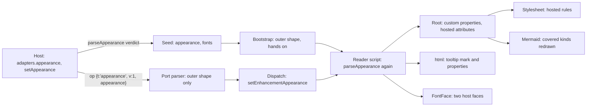
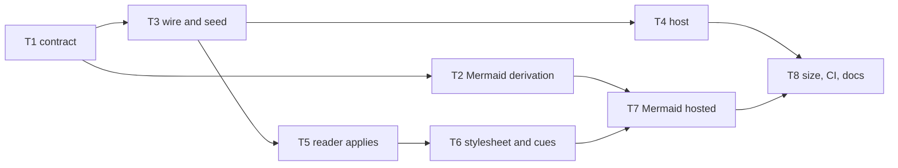

# docserver appearance contract: a host's colours, skin and faces in the frame: Implementation Plan

> **For agentic workers:** REQUIRED SUB-SKILL: Use superpowers:subagent-driven-development to implement this plan task by task. Each task is an implementer subagent (tests first), then one held-out review over the task's diff, then one fix round. The plan is lean (C40): it holds no implementation code, only the contract each task must meet, its tests and its mutation rows.

**Status:** written 2026-11-20 against `main` at `aceb346` (the ledger merge after #82; its tree equals the `v1.1.0` tag's but for the ledger file, so every source file and asset is 1.1.0's). One wave on one branch and one PR. The design is the first consumer's, approved by its operator on 2026-11-19; this plan decides only how the library builds it. A sentence of the design that cannot be built as written is a stop-and-ask, never a silent departure. The package version does not change here; the release and its signed tag are the operator's. Runtime model of this plan's writer: Opus 5.5 (`claude-opus-5-5`).

**Goal:** A host can hand the sealed frame one appearance (a mode, 33 base colours, ten skin values and a one-line label) and two optional faces, at mount and while open. The frame paints in them, keeps meaning off colour alone, draws eight Mermaid kinds in derived colours, and changes nothing for a host that sends none.

**Architecture:** One pure module holds the contract (slot names, grammars, `parseAppearance`, the contrast pairs, the Mermaid derivation and the author-styled scan). It sits beside the reader in `src/enhance/`, so the reader imports it as a sibling, and `./frame` re-exports it, so a host reads the same validator. The host passes the contract through a new adapter key and a new `DocFrame.setAppearance`, which posts one new parent-to-frame op on the existing port. The bootstrap checks only the op's and the seed field's outer shape (its budget has 2.6 KB left); the reader script runs `parseAppearance` on every value it applies. The reader writes the verdict's values as custom properties on its root through the journal, and the stylesheet's hosted rules read them. Bridge protocol stays 1; seed schema stays 1.

**Tech Stack:** unchanged from 1.1.0: Node `>=22`, esbuild 0.28.2, playwright-core 1.63.0, TypeScript 6.0.3, vitest 4.1.11, jsdom 29.1.1, Mermaid 12.1.0 as pinned. No new dependency.

**Spec:** the first consumer's public design, [Native Docs reader: appearance continuity](https://github.com/Synapsium-Labs/ccrc-pwa/blob/main/docs/superpowers/specs/2026-11-18-native-docs-appearance-continuity-design.md), §2 (the contract and its grammars), §2.2 (faces), §5 (pairs), §6 (Aa), §7 (fail-safe), §8 (boundaries) and **§10, the library's part, which this plan builds in full**, tests 1 to 10. Its leaf plan, [`2026-11-18-native-docs-appearance-continuity.md`](https://github.com/Synapsium-Labs/ccrc-pwa/blob/main/docs/superpowers/plans/2026-11-18-native-docs-appearance-continuity.md), gives the twelve fixture appearances (Results, "Library input (X4)") and the measurements §10 cites. The spec is read at its merged commit `0b96bd0dcc4`.

**Ledger:** [`docs/superpowers/programs/docserver.md`](../programs/docserver.md). C1 to C114 stay binding. This wave writes no ledger entry: its notes go to a new file, [`docs/superpowers/programs/docserver/appearance-contract.md`](../programs/docserver/appearance-contract.md), which the coordinator folds into the ledger.

---

## Design

### In short

- **One module, two homes.** `src/enhance/appearance.ts` is pure (no DOM, no globals beyond the language's). The reader imports it; `src/frame/index.ts` re-exports its public names, so `./frame` carries `APPEARANCE_CONTRACT`, `APPEARANCE_SLOTS`, `APPEARANCE_PAIRS`, `APPEARANCE_LABEL_DEFAULT`, `parseAppearance`, `MERMAID_HOSTED_KINDS`, `mermaidThemeOf` and the three types. `FRAME_ACCEPTS` lives in `src/frame/protocol.ts`.
- **The bootstrap stays small.** It accepts `{t:'appearance', appearance}` when `appearance` is a plain object with own data properties, and the seed's `appearance` and `fonts` fields by outer shape. It hands each to the reader. The reader script runs `parseAppearance` on everything it applies, so a forged or stale value meets the full grammar in the frame, as §8 requires.
- **Hosted, and coloured.** A mount whose seed carries an appearance is hosted for life: the reader stamps `data-docreader-hosted` on its root. A verdict with a colour group adds `data-docreader-colours`; one without removes it and every host colour. A verdict's skin slots are listed in `data-docreader-skin` (space-separated slot names). Hosted rules key on these attributes, so without an appearance no new rule matches and 1.1.0's computed styles stand.
- **Values reach the page as custom properties on the root**, written through `journal.setStyle` (LD11's one style write), whose closed list gains exactly the host's slot properties. The colour slots write 1.1.0's own token names where one exists (`--bg`, `--text`, `--accent` …), so every 1.1.0 rule follows them, and new names for new roles (`--focus`, `--accent-ink`, `--code-ink`, `--syn-*`). The frame's `html` element takes the tooltip's mark and three properties (§10, "Mermaid's tooltip"), from frame-runtime code, because the reader never reaches outside its root.
- **Mode.** A verdict's `mode` replaces the reader's `theme` while hosted: `light` and `dark` set `data-theme`, `auto` removes it. The stored `theme` is ignored, the Aa theme row is replaced by the label line, and a write of the prefs omits `theme`.
- **Faces.** `FrameAssets.fonts` crosses as two seed strings. A frame-runtime module in the reader script checks the base64 alphabet, the `wOF2` signature and the 131 072-byte cap, then loads each with `FontFace` under fixed family names; the hosted stylesheet prepends those names to the sans and mono stacks, so a face that is dropped or fails falls through to the library's own.
- **Mermaid.** While coloured, each figure is classified before it is drawn: the bundled Mermaid's own `parse` names the kind, and a statement scan marks author-styled text. A covered, not author-styled figure draws with `mermaidThemeOf(colours)` and an `svg` mark (`data-docreader-hosted-figure`) that the hosted Mermaid rules (all `!important`) are scoped to; every other figure draws as 1.1.0 draws it. An appearance change redraws drawn figures nearest first, one per task, and cancels redraws queued for an older appearance.
- **Size.** Test 8's two tables land here with their genesis rows. This contract's growth over 1.1.0's 4 528 020 characters must stay within 32 768 on both totals; a measurement over that stops the wave and goes to the coordinator.

### 1. Where each part of §10 lands

| §10 part | Layer | File(s) | Task |
|---|---|---|---|
| Types, `APPEARANCE_CONTRACT`, `APPEARANCE_SLOTS`, `APPEARANCE_LABEL_DEFAULT`, `parseAppearance`, `APPEARANCE_PAIRS` | pure | `src/enhance/appearance.ts`, re-exported by `src/frame/index.ts` | 1 |
| `MERMAID_HOSTED_KINDS`, `mermaidThemeOf`, the series, the author-styled scan | pure | `src/enhance/appearance-mermaid.ts`, re-exported | 2 |
| `FRAME_ACCEPTS`, the `appearance` op, the port parser, dispatch, `bridge-cases.json`, test 9's record | wire | `src/frame/protocol.ts`, `src/frame-runtime/{inbound,dispatch,bootstrap}.ts`, `conformance/` | 3 |
| Seed fields `appearance` and `fonts`, `FrameOptions.appearance`, `FrameAssets.fonts`, the derived srcdoc cap | frame | `src/frame/{seed,document}.ts` | 3 |
| `HostAdapters.appearance`, `FrameAssets.fonts` checks, `DocFrame.setAppearance` | host | `src/host/mount.ts` | 4 |
| Applying a verdict, hosted state, Aa line, stored theme, faces, the `html` mark | reader and frame runtime | `src/enhance/{lifecycle,state,settings,journal,options}.ts`, `src/frame-runtime/{enhance-entry,host-fonts,host-page}.ts` | 5 |
| The stylesheet: slots, derivations, code on the well, chrome colours, skin slots, the cues | stylesheet and reader | `assets/reader.css`, `src/enhance/{rail,jump,settings}.ts` where a cue needs a class | 6 |
| Mermaid while hosted: classification, theme, mark, hosted rules, cue colours, tooltip, redraw | reader and stylesheet | `src/enhance/{diagrams,diagram-tools}.ts`, `assets/reader.css` | 7 |
| Test 8's tables, the `Size-Design:` line, CI | repository | `conformance/size/{shares,growth}.json`, `test/size-contract.test.ts`, `.github/workflows/ci.yml` | 8 |

*Table 1. §10 by layer.*



*Figure 1. One validator on each side of the port; the frame's bootstrap only checks shape.*

### 2. Choices this plan makes, and why

| # | Choice | Why | Cost if wrong |
|---|---|---|---|
| A1 | The contract module lives in `src/enhance/` and `./frame` re-exports it | The reader may import only its siblings (walls rule 5), and it must run the same validator and the Mermaid derivation; `./frame`'s import graph may hold any pure relative file (L3.M9, M9b) | One more file in `./frame`'s graph, held pure by the existing walls |
| A2 | The bootstrap checks outer shape only; the reader script runs `parseAppearance` | The bootstrap has 2 615 bytes left of its 32 KiB budget; the full validator would exceed it, and the budget moves only by a ruling | A shape-only check in the bootstrap lets a bad value reach the reader script, which judges it there; covered by test 3's malformed-op row |
| A3 | Values are written as custom properties on the root, with 1.1.0's token names for the slots that have one | Every 1.1.0 rule already reads those tokens, so the hosted stylesheet adds rules only for what 1.1.0 hard-codes; without an appearance nothing is written | A slot's name and a 1.1.0 token's name are held equal by a table in Task 1 and a unit row |
| A4 | Presence attributes (`data-docreader-hosted`, `-colours`, `-skin`) gate every hosted rule | A rule that does not match cannot move a computed style, so test 4's equality holds by construction | Specificity against 1.1.0's dark blocks: hosted rules that compete with them carry `!important` or the doubled root attribute, as 1.1.0 already does |
| A5 | Faces load from frame-runtime code in the reader script, not the bootstrap | `FontFace` and `atob` are DOM globals the reader's walls refuse; the bootstrap's budget is spoken for | The faces load after `ready` is decided; a face that is late swaps in as `font-display: swap` would |
| A6 | Test 4's equality compares in one browser run the current stylesheet with `git show v1.1.0:assets/reader.css` over the same rendered DOM | No committed computed-style baseline exists, and one per engine could not be produced here (WebKit runs in CI only, C69). The DOM half is already pinned by `conformance/layout` | The `v1.1.0` tag must be in the checkout: CI fetches full history with tags (`fetch-depth: 0`); a missing tag fails the row, never skips it |
| A7 | Test 8 reads the committed `src/frame/manifest.generated.ts` at the judged commit and at `HEAD^1`, and CI hands it the pull request's description | The manifest is committed source, held equal to the build by CI's `--check` and diff steps, so no build of the parent is needed | — |
| A8 | Test 9's record is `conformance/frame-boundaries.json`, append-only | §10 test 9's text | — |

*Table 2. Technical choices. A product choice found while executing goes to the coordinator as a structured ask.*

## Global Constraints

Carried from 1.1 (its plan, "Global Constraints"), binding on every task:

- **Public-ready** text in every tracked file, commit and PR body: no product, host, person, account or private repository names, and no tracker ids. The consuming product is "the first consumer", and its design is cited by its public GitHub path.
- **Pure where declared; CSP-safe** (no `innerHTML`, `outerHTML`, `insertAdjacentHTML`, `eval`, inline handlers, `cssText`); **import-inert; host data is untrusted; no network in tests; hash-only CSP, never widened.** The sandbox stays exactly `allow-scripts`; no new channel, port, window listener or frame-to-parent op.
- **One raw-HTML allowlist**, unchanged. The label is text content only.
- **Tests** run through the fleet's test wrapper as `./node_modules/.bin/vitest run --maxWorkers=2 [file]`, in the foreground, never a bare `npx vitest`; browser rows locally with `DOCREADER_BROWSERS=chromium`; WebKit is proven in CI only (C69). `npm run typecheck` covers every tsconfig project.
- **Bounded commands**: every heavy command behind `timeout -k 10 900`, output to a log in the session's temp root.
- **Generated files.** A task that changes any input of `scripts/build-frame.mjs` runs `npm run build:frame` and commits `assets/assets.json` and `src/frame/manifest.generated.ts` in the same commit; `node scripts/build-frame.mjs --check` is green after.
- **The wire** changes additively only, and every wire choice is a fixture in `conformance/bridge-cases.json`.
- **The conformance corpus is the contract.** No golden under `conformance/expected` and no snapshot under `conformance/layout` moves: with no appearance the output is 1.1.0's. A move is a stop-and-ask.
- **Mutation discipline.** Every new guard ships with a case that goes red without it, measured in place one row at a time (saved bytes and sha256, restored and checked, never `git checkout`). Rows are recorded in `docs/superpowers/plans/appearance-mutations/task-<n>.md` (a table, then its JSON fence). A row that stays green gets a new case or is recorded as an equivalent mutant with its reason; it is never dropped.
- **Budgets.** The bootstrap's 32 KiB and every other `ASSET_BUDGETS` entry stand. This contract's growth on test 8's totals is at most 32 768 characters. A breach of either stops the wave.
- **Commits.** Files staged by name; subject `<area>: <what> (docserver appearance T<n>)`; the writer's `Co-Authored-By:` trailer. Never `git stash`, `reset --hard` or `checkout --`. The branch is pushed once, when every task is done.

## Tasks

| # | Title | Depends on |
|---|---|---|
| 1 | The contract and its validator | `aceb346` |
| 2 | The Mermaid derivation and the author-styled scan | 1 |
| 3 | The wire: `FRAME_ACCEPTS`, the op, the seed fields, the srcdoc cap, test 9 | 1 |
| 4 | `./host`: the adapter key, the faces, `setAppearance` | 3 |
| 5 | The reader applies a verdict: hosted state, Aa, faces, the `html` mark | 3 |
| 6 | The stylesheet on the slots, and meaning without colour | 5 |
| 7 | Mermaid while hosted | 2, 6 |
| 8 | Size by contract (test 8), CI, README and the release notes | 7 |



*Figure 2. Task order. Tasks land in the table's order on one branch.*

---

### Task 1: The contract and its validator

**Goal.** The pure contract of spec §2, exactly: the slot lists, the grammars, `parseAppearance` with its size walk and label rules, the default label and the pairs of §5.
**Files.** Create `src/enhance/appearance.ts`, `test/appearance-contract.test.ts`, `docs/superpowers/plans/appearance-mutations/task-1.md`. Modify `src/frame/index.ts` (re-exports), `README.md` (a `./frame` section for the contract), `test/readme.test.ts` if it pins the export list.
**Produces.**
- `APPEARANCE_CONTRACT = 1`.
- `APPEARANCE_SLOTS`: frozen `{colour: [33 names in §2's order], skin: ['radius','radiusSmall','radiusLarge','controlRow','popShadow','sectionFamily','sectionSize','sectionWeight','sectionTracking','sectionCase']}`.
- `type AppearanceColourSlot`, `type AppearanceSkinSlot` (unions from the lists), `type Appearance = {mode: 'light'|'dark'|'auto'; colour?: Record<AppearanceColourSlot,string>; skin?: Partial<Record<AppearanceSkinSlot,string>>; label?: string}`.
- `APPEARANCE_LABEL_DEFAULT = "Appearance follows the app's settings"`.
- `parseAppearance(x: unknown): {appearance: Appearance; refused: {key: string; why: string}[]}`. Never throws. The `why` words are closed: `unknown-key`, `type`, `grammar`, `range`, `incomplete`, `too-many-keys`, `too-large`, `unreadable`, `label`.
- `APPEARANCE_PAIRS`: frozen `{fg, bg, floor}[]`, the product of §5's table: each of the 14 text colours on `bg`, `surface`, `surface2` and the five tints (named `tint:<slot>@<ground>`, e.g. `tint:chg@bg`, `tint:chg@surface`), `code-ink` and the eleven `syn-*` on `code-block-bg`, `accent-ink` on `accent`, all at 4.5; `focus` on `bg`, `surface`, `surface2` and the tints at 3. `accent-hover` appears as a derived text colour (`derived:accent-hover`).
- An internal, exported-for-tests `SLOT_PROPERTY` map: each colour slot to the custom property the reader writes (1.1.0's token where one exists: `bg`→`--bg`, `text-muted`→`--text-muted`, `code-block-bg`→`--code-block-bg` …; new: `--accent-ink`, `--focus`, `--code-ink`, `--syn-<name>`), and each skin slot to `--dr-<kebab>`.
**Behaviour.** As spec §2, "The value grammars, exact" and "Size", word for word: outer U+0020 spaces ignored and dropped; inner single U+0020; every other white space refuses; the walk reads own data descriptors only and never calls an accessor; it counts own keys first and stops at 64 per group (`too-many-keys`, the top level as `*` with verdict `{mode:'auto'}`); a non-plain group or non-string value is `type`; it counts UTF-16 code units of every key and string visited and stops at 8 193 (`{key:'*', why:'too-large'}`, verdict keeps only a valid `mode`); any throw ends it as `{key:'*', why:'unreadable'}` with `{mode:'auto'}`. The colour group is all or nothing: a missing slot is `{key:'colour', why:'incomplete'}`; one bad value drops the group with its own entry. A skin slot or the label drops alone. The `popShadow` grammar and ranges as the table; the label by `\p{Cc}`, `\p{Cf}`, `\p{Zl}`, `\p{Zp}` and lone surrogates (a `u`-flag test), 1 to 64 code units, never trimmed.
**Steps.**
1. Write test 1 (every bullet of spec §10 test 1) and the validator half of test 6 (lengths, astral counting, the listed code points, U+061C, U+206A, U+00AD, U+E0041, U+2028, U+2029, lone U+D800; `<b>x</b>` is accepted as text). Add rows: the slot lists equal §2's names and order; `SLOT_PROPERTY`'s 1.1.0 names are each declared on the root in `assets/reader.css`; every pair's `fg` and `bg` is a slot or a named derived/tint; the pairs count equals the product (14 x 8 + 12 + 1 at 4.5, and 8 at 3); the walk's code-unit count of a value of exactly 8 192 and 8 193.
2. Run the file: red (no module).
3. Implement. Re-export from `src/frame/index.ts`.
4. Green; `npm run typecheck`; `test/frame-pure.test.ts` green (the new file passes `./frame`'s purity walls) and `test/enhance-walls.test.ts` green.
5. Measure the mutation rows; commit.
**Mutation rows.**

| Row | Guard | Edit that must red it |
|---|---|---|
| A1a | outer spaces only | accept a tab as an outer space |
| A1b | single inner space | accept two spaces between shadow tokens |
| A1c | popShadow ranges | raise the blur ceiling to 65 |
| A1d | colour all or nothing | keep the other colours when one is refused |
| A1e | incomplete group | accept a colour group missing `rule` |
| A1f | accessor never called | read values with `x[k]` instead of the descriptor |
| A1g | key count first | check types before counting keys |
| A1h | size cap | raise the cap to 8 193 |
| A1i | unreadable | remove the try around the walk |
| A1j | label categories | drop `\p{Cf}` |
| A1k | label length in code units | count code points |
| A1l | strings only | accept the number `600` for `sectionWeight` |
| A1m | `sectionTracking` digits | accept four decimals |
| A1n | the pairs product | drop the tints from the grounds |

**Verify.** `test/appearance-contract.test.ts test/frame-pure.test.ts test/enhance-walls.test.ts test/readme.test.ts`; `npm run typecheck`.

### Task 2: The Mermaid derivation and the author-styled scan

**Goal.** The pure half of spec §10, "Mermaid while hosted": the kinds constant, the derivation table, the series and the scan.
**Files.** Create `src/enhance/appearance-mermaid.ts`, `test/appearance-mermaid.test.ts`, `docs/superpowers/plans/appearance-mutations/task-2.md`. Modify `src/frame/index.ts`, `README.md`.
**Produces.** `MERMAID_HOSTED_KINDS = ['flowchart-v2','sequence','classDiagram','stateDiagram','gantt','pie','er','gitGraph']` (frozen). `mermaidThemeOf(colours: Record<AppearanceColourSlot,string>): Readonly<Record<string,string>>`: every key of §10's derivation table from its slot (tints as `color-mix(in srgb, <slot> 4%, <surface>)` text, resolved to `#rrggbb` by the module's own 8-bit mix so Mermaid's colour parser reads a hex), the series keys `pie1`…`pie12`, `git0`…`git7`, `gitInv0`…`gitInv7` from the series rule, every key of 1.1.0's `THEME_VARIABLES` but `fontFamily` (which the reader adds), `fontSize: '14px'`, `pieOpacity: '1'`, `dropShadow: 'none'`. `seriesOf(colours)`: the twelve text colours in §10's order, each value once. `isAuthorStyled(text: string): boolean`: front matter skipped; statements split at line breaks and `;`, leading white space trimmed; heads `classDef`, `style`, `linkStyle`, `rect`, `box`, `todayMarker` compared without case, followed by white space or the statement's end; or an HTML element other than `br` (`<` or `</` then a letter, where the `<` does not follow another `<`).
**Steps.**
1. Tests: the constant's eight ids; the output's keys are exactly the derivation table's 110 keys, plus 1.1.0's `THEME_VARIABLES` keys, plus the three fixed keys (the table is typed once in the test from §10); each key's value equals its slot's value in a fixture appearance (Phosphor & Ink, from the X4 list); series de-duplication on the five equal pairs §10 names (one fixture each); every author-styled form and spelling of §10 test 5's author-styled row is true, and `<<interface>>`, `<<fork>>`, `x < y`, `<|--`, `<-->`, `<<->>`, a `click` line and each of the eight covered fixtures' texts are false.
2. Red; implement; green.
3. Measure rows; commit.
**Mutation rows.** A2a drop one key from the table (reds "exactly the keys"); A2b map `lineColor` to `border`; A2c no de-duplication; A2d case-sensitive heads; A2e no `;` split; A2f no leading-tab trim; A2g treat `<<` as an element; A2h drop `todayMarker`; A2i `dropShadow` left out.
**Verify.** `test/appearance-mermaid.test.ts test/frame-pure.test.ts test/enhance-walls.test.ts`; `npm run typecheck`.

### Task 3: The wire: `FRAME_ACCEPTS`, the op, the seed fields, the srcdoc cap, test 9

**Goal.** The `appearance` op and the two seed fields cross the frame's boundary under the existing rules, and test 9 pins what may not change.
**Files.** Modify `src/frame/protocol.ts` (`ParentToFrame` gains `{t:'appearance'; v: 1; appearance: object}`; `OP_KEYS.appearance = ['t','v','appearance']`; `PARENT_OPS` gains it; `FRAME_ACCEPTS = ['prefs','changes.result','mermaid','command','appearance']`, frozen, exported from `./frame`), `src/frame-runtime/inbound.ts` (the `t` check reads `FRAME_ACCEPTS`; `appearance` is accepted when `v === 1` and `appearance` is a plain object whose own properties are data properties; nothing deeper), `src/frame-runtime/dispatch.ts` (`appearance` to the reader API's `setEnhancementAppearance(root, value)`, only with a root and an API, a throw contained), `src/frame-runtime/bootstrap.ts` (passes the seed's `appearance` and `fonts` to the reader), `src/frame/seed.ts` (keys `appearance`, `fonts`: absent, or for `appearance` a plain object at depth at most 3 of strings, and for `fonts` a plain object with only `sans` and `mono`, each a string of the base64 alphabet at most 174 764 code units; `SEED_FIELDS_MAX_CHARS` counts both at their caps: the appearance cap is the serialised length of the longest verdict `parseAppearance` accepts, computed from the grammars by a `/* @__PURE__ */` function, the label at 64 code units of the longest-escaping accepted character), `src/frame/document.ts` (`FrameOptions.appearance?` and `FrameAssets.fonts?` written to the seed; `MAX_SRCDOC_CHARS_DEFAULT` rises by both derived amounts), `conformance/bridge-cases.json` (accepted and refused `appearance` ops), `README.md`. Create `conformance/frame-boundaries.json`, `test/frame-boundaries.test.ts`, `docs/superpowers/plans/appearance-mutations/task-3.md`. Rebuild the frame manifests.
**Behaviour.** The seed carries the host's verdict; the frame does not trust it and re-parses in the reader (Task 5). The bootstrap grows by the shape checks and two keys only. `FRAME_OPS` does not change.
**Test 9** (`test/frame-boundaries.test.ts`, spec §10 test 9, word for word): the record's first entry is the first parent's (1.1.0's): its `FRAME_OPS` equals the literal parsed from `git show HEAD^1:src/frame/protocol.ts` at the genesis landing (thereafter the byte-equal rule holds it), its `FRAME_ACCEPTS` equals the four port ops, and its masked CSP is 1.1.0's `frameCsp()` with every `script-src` token matching `HASH_SOURCE` replaced by `'sha256-*'` (the copy is a review check, as the spec says). The second entry is this landing's. Rows: the newest entry equals the values computed now; every entry at `HEAD^1` is byte-equal here (at the genesis landing, when `HEAD^1` has no record, that row checks the first entry against the parsed parent instead); `FRAME_OPS` equals the parent's; `FRAME_ACCEPTS` is the parent's plus `appearance`; the port parser, driven with one well-formed message per name in `OP_KEYS`, `PARENT_OPS`, `FRAME_OPS` and a planted name, accepts exactly `FRAME_ACCEPTS` (and refuses `hello`); the masked `frameCsp()` equals the parent's, with as many hash sources as `KNOWN` has entries; behaviour: the srcdoc's CSP meta and the iframe's `csp` attribute of a mount with an appearance and both faces equal those without, and a port spy counts the same frame-to-parent messages for a mount with a seed and 20 `appearance` ops as for the same mount with none (the browser half runs in `test/browser/frame-appearance.test.ts`, Task 5).
**Steps.** 1. Tests in `test/frame-protocol.test.ts`, `test/frame-seed.test.ts`, `test/frame-document.test.ts`, `test/frame-runtime.test.ts` and the new test 9 file; red. 2. Implement; `npm run build:frame`. 3. Green, with `test/frame-build.test.ts` (budgets) and `test/frame-runtime-walls.test.ts`. 4. Rows; commit with the manifests.
**Mutation rows.** A3a accept `appearance` without `v`; A3b accept a non-plain `appearance`; A3c port parser accepts a name outside `FRAME_ACCEPTS` (hard-code a fifth); A3d `FRAME_ACCEPTS` loses `appearance`; A3e seed accepts `fonts` with a third key; A3f seed accepts a non-base64 face; A3g the cap formula leaves out the fonts; A3h the cap leaves out the appearance; A3i dispatch drops the op; A3j a mask that also matches `'none'` (the row must red).
**Verify.** `test/frame-protocol.test.ts test/frame-seed.test.ts test/frame-document.test.ts test/frame-runtime.test.ts test/frame-runtime-walls.test.ts test/frame-boundaries.test.ts test/frame-build.test.ts test/host-parse.test.ts test/readme.test.ts`; `npm run typecheck`; `node scripts/build-frame.mjs --check`.

### Task 4: `./host`: the adapter key, the faces, `setAppearance`

**Goal.** Spec §10's three host rows and test 2.
**Files.** Modify `src/host/mount.ts` (`ADAPTER_KEYS` gains `appearance`; `HostAdapters.appearance?: Appearance`; `FrameAssets.fonts` checked; `DocFrame.setAppearance`), `src/host/index.ts`, `test/host-mount.test.ts`, `README.md`. Create `docs/superpowers/plans/appearance-mutations/task-4.md`.
**Behaviour.** `appearance` that is not a plain object throws `TypeError`; any plain object goes through `parseAppearance` and its verdict is seeded (a bad slot never throws). `fonts` not a plain object, with a key other than `sans`/`mono`, or a face that is not a string throws `TypeError`; a face that fails the alphabet, signature or cap is dropped silently and the mount continues. `setAppearance(a)`: a non-plain `a` throws `TypeError`, whatever the state; before `ready` the verdict is queued (latest wins) and posted after `ready`; after `ready` it posts exactly one `{t:'appearance', v:1, appearance: verdict}`; it seeds every later remount; after `destroy()` or a fallback it does nothing. The frame-to-parent traffic does not depend on an appearance.
**Tests (test 2 and the host half of test 7).** An unknown adapter key still throws; `appearance` accepted; `setAppearance` before `ready` queues and after `ready` posts exactly one op; the op's keys are exactly `t`, `v`, `appearance`, and its value's keys are a subset of `mode`, `colour`, `skin`, `label`; latest wins before `ready`; `update()` seeds the latest; a bad face is dropped and the srcdoc carries only the good one; a malformed `fonts` throws.
**Mutation rows.** A4a post before `ready`; A4b queue keeps the first; A4c remount forgets the appearance; A4d the op passes the raw value, not the verdict; A4e a bad face throws.
**Verify.** `test/host-mount.test.ts test/host-walls.test.ts test/readme.test.ts`; `npm run typecheck`.

### Task 5: The reader applies a verdict: hosted state, Aa, faces, the `html` mark

**Goal.** Tests 3, 6 (rendered) and 7 (frame half).
**Files.** Modify `src/enhance/types.ts` and `options.ts` (`EnhanceOptions.appearance?: unknown`, accepted as any value and parsed), `src/enhance/lifecycle.ts` and `index.ts` (`setEnhancementAppearance(root, value)`; the seed's appearance applied in the same synchronous run that applies the prefs, before `enhance()` first yields), `src/enhance/state.ts` (hosted: `theme` from the verdict's `mode`, stored `theme` ignored, a prefs write omits `theme`), `src/enhance/journal.ts` (`STYLE_PROPS` gains exactly the `SLOT_PROPERTY` values, and a `removeStyle` for them; the value filter unchanged), `src/enhance/settings.ts` (hosted: no theme fieldset; one `p.aa-hosted` with the label or `APPEARANCE_LABEL_DEFAULT` as text content, not focusable, in the theme row's place), `src/frame-runtime/enhance-entry.ts` (registers `setEnhancementAppearance` and `loadHostFonts`; before handing a value to the reader it sets or clears the `html` element's `data-docreader-hosted` and `--dr-tip-bg`, `--dr-tip-fg`, `--dr-tip-edge` from the verdict's `surface`, `text`, `border`), `src/frame-runtime/host-fonts.ts` (new: the checks of §2.2 and `FontFace` under `Docreader Host Sans` and `Docreader Host Mono`; a failure drops the face; never throws), `test/frame-runtime-walls.test.ts` (the new module's sinks: `FontFace`, `atob`, `document.fonts.add`, each named). Create `test/enhance-appearance.test.ts` (jsdom), `test/browser/frame-appearance.test.ts`, `docs/superpowers/plans/appearance-mutations/task-5.md`.
**Behaviour.** Applying a verdict: write each colour slot's property (or remove them all when the verdict has no colour group), each skin slot's property, set `data-docreader-hosted`, toggle `data-docreader-colours`, write `data-docreader-skin`, set the mode as `data-theme`, emit the reader's `prefs` event so Aa and the colour key resync, and emit a new `appearance` event for Task 7. No remount, no relayout unless a skin slot changed `controlRow` (a popover is closed if open, never moved). An op on an unhosted mount makes it hosted (the host decided). A value that is not a plain object changes nothing.
**Tests.** Unit (jsdom): the seed paints before the first yield (properties on the root when `enhance()` returns its promise); an op applies with the same root and no remount; a malformed op changes nothing; stored `{"theme":"dark"}` is ignored with an appearance and honoured without; Aa has no theme row with an appearance and its line reads the label or the default; a label `<b>x</b>` renders those eight characters and no element; with no label the line is the default; an op with no colour group removes every colour property and keeps the hosted state; while hosted a `prefs` change never writes `theme`. Faces (unit, a fake `FontFace`): a face with a bad alphabet, a missing signature, over the cap, or a rejecting load is dropped and the call resolves. Browser (Chromium locally, both in CI): the seed's values are the root's computed values at the first `ready`; an op applies within one task in the same iframe; a font face that fails reaches `ready`; a document at 1.1.0's default srcdoc cap mounts with both faces and the largest accepted appearance; test 9's behaviour rows (CSP equality, equal port traffic over 20 ops). The string `ccrc` appears in no built asset.
**Mutation rows.** A5a stored theme honoured while hosted; A5b prefs write keeps `theme`; A5c theme row kept while hosted; A5d label as markup (an element-creating path); A5e no-colour op keeps the colours; A5f html mark not cleared; A5g a bad face throws; A5h appearance applied after the first yield.
**Verify.** `test/enhance-appearance.test.ts test/enhance-settings.test.ts test/enhance-state.test.ts test/enhance-walls.test.ts test/frame-runtime.test.ts test/frame-runtime-walls.test.ts test/frame-build.test.ts`; `DOCREADER_BROWSERS=chromium` `test/browser/frame-appearance.test.ts test/browser/frame-boot.test.ts test/browser/settings.test.ts`; `npm run typecheck`; `node scripts/build-frame.mjs --check`.

### Task 6: The stylesheet on the slots, and meaning without colour

**Goal.** Spec §10's "Frame behaviour" bullets on colour and skin, and its "Meaning without colour"; tests 4 and 10.
**Files.** Modify `assets/reader.css` (hosted rules, each under the presence attributes of Design A4; new tokens declared with 1.1.0-equal defaults where a 1.1.0 rule moves to read them), `src/enhance/rail.ts`, `src/enhance/jump.ts`, `src/enhance/settings.ts`, `src/enhance/strip.ts` only where a cue needs a class or attribute that 1.1.0 lacks (no class 1.1.0 already emits moves; no layout snapshot moves). Create `test/browser/appearance-style.test.ts`, `test/browser/appearance-cues.test.ts`, `conformance/appearance/fixtures.json` (the twelve fixture appearances of the X4 list, and test 10's collision appearance), `docs/superpowers/plans/appearance-mutations/task-6.md`. Rebuild the frame manifests.
**The rules, by §10's bullets.** Derived colours (`accent-hover`, `accent-soft`, `th-bg`, `wait-soft`, `wait-tint`, `no-tint`, `chg-tint`, `chg-soft`, `chg-bg` with its `.short` and waiting-callout case at 4% over `short-bg`, `short-bg`, `paper`, `topbar-bg`, `plate` for covered figures only, `code-inline-bg` opaque `surface2`, `code-comment`), each by its one rule, under `data-docreader-colours`. Code on the well: `.codehilite` text and `pre.fig-src` in `code-ink`; every `.hljs-*` class by §10's table, the context rules and `.rs-facts .sep` as §10 says, no deletion or addition background. Chrome literals: figure tool buttons, the pressed one, the full-screen overlay and its bar and buttons, `::selection`. Focus: every 1.1.0 ring reads `--focus`, declared `var(--accent)` by default. Skin slots under `data-docreader-skin~="<slot>"`: the three radii on their element groups, `controlRow` on popover rows under `(pointer: fine)`, `popShadow` on every popover (Aa, changes menu, cross-reference card, quick jump, keys, contents drawer), the section-label type on the popovers' headings (Aa legends and colour-key heading, `.cm-lab`, `.xc-k`, `.jump .lvl`, `.keys h2`, `.toc-tabs button`, `.ix-group`). Faces: while hosted, `--sans` and the chrome take `"Docreader Host Sans"` first and code takes `"Docreader Host Mono"` first; the serif reading face is untouched. Cues while hosted: changed marks as a double bar (two 2 px `chg` bars, 2 px gap, outer edge where 1.1.0's bar ends, tint reaching 3 px less; a row's inset, 6 px in all), attention marks unchanged; status dots by shape (`ok` disc, `wait` ring, `no` square, `info` short bar) and the colour-key swatches the same; `a.term` dotted, `a.xref` dashed, kept on hover and expanded; the glossary term cell at 600; quick jump's selected row with an inset 2 px `accent` bar; Aa's checked option at 600 with an inset 2 px `accent` start bar; the summary box's pressed view button at 600 with a 2 px bottom bar; the table filter's `:focus-visible` ring.
**Test 4** (`appearance-style.test.ts`): (a) **no appearance, equal to 1.1.0:** for every corpus document and the layout cases' interactive states (each popover open in turn, the overlay open, a tool pressed, text selected, `:hover` and `:focus-visible` forced on every control and row), the computed values of a fixed property list (colours, backgrounds, borders, outline, box-shadow, text-decoration, font family, weight and style, filter, opacity, border-radius) on every element equal those of the same page served `git show v1.1.0:assets/reader.css` in place of the current stylesheet; the DOM half is `conformance/layout`, unchanged. (b) **pairs:** with each fixture appearance, every `APPEARANCE_PAIRS` pair the corpus draws meets its floor on computed values. (c) **closed grounds:** with an appearance, under the same states, every element that holds text has a nearest painted background equal to one of §5's grounds and a `color` that ground admits.
**Test 10** (`appearance-cues.test.ts`): every row of spec §10 test 10, under the collision appearance, the geometry sampled from a screenshot's pixel row through each mark, and the 1.1.0 comparison row ("ends at the same x") against the `v1.1.0` stylesheet.
**Steps.** 1. Fixtures and both test files; red on Chromium. 2. Rules and the cue classes. 3. Green on Chromium; `test/enhance-styles.test.ts` green (every `var()` declared, every rule root-scoped). 4. `npm run build:frame`; measure the stylesheet's growth and record it in Results (the running sum against 32 768). 5. Rows; commit.
**Mutation rows.** A6a a hosted rule without its presence attribute (reds test 4 (a)); A6b one `.hljs-*` class left on 1.1.0's hex while coloured (reds closed grounds); A6c the double bar restored to a single bar (reds test 10's geometry); A6d dots without shapes; A6e `a.xref` solid on hover; A6f quick-jump bar removed; A6g Aa checked at 400; A6h filter focus removed; A6i a tint at 6%; A6j `code-inline-bg` a tint; A6k selection back to the literal.
**Verify.** `test/enhance-styles.test.ts test/frame-build.test.ts`; `DOCREADER_BROWSERS=chromium` `test/browser/appearance-style.test.ts test/browser/appearance-cues.test.ts test/browser/layout-corpus.test.ts`; `node scripts/build-frame.mjs --check`.

### Task 7: Mermaid while hosted

**Goal.** Spec §10, "Mermaid while hosted", in full, and test 5.
**Files.** Modify `src/enhance/diagrams.ts` (per-figure classification while coloured: the bundled Mermaid's `parse` gives the kind, `isAuthorStyled` the scan; a covered, not author-styled figure draws with `themeVariables: {...mermaidThemeOf(colours), fontFamily}` and its `svg` gets `data-docreader-hosted-figure`; every other figure draws with 1.1.0's configuration; on the reader's `appearance` event, drawn figures are redrawn nearest first, one per task, a newer event cancelling every queued redraw of an older one; a redraw replaces the figure's drawing in place, never adding a second chrome node), `src/enhance/diagram-tools.ts` (the cue colours: 1.1.0's literals `#0b6b66`, `#0b6b66`, `#ffffff` except on a hosted figure, where the verdict's `focus`, `accent` and `bg`, resolved hex, inline with `!important`, written when painted and on every redraw), `assets/reader.css` (the hosted Mermaid rules, each `!important` and scoped to the `svg` mark: no plate, filter or shadow; the stick-arrowhead markers' paths in `text-muted`; `[filter*="drop-shadow"]` `filter: none`; `.commit-cherry-pick` in `bg`; `.commit-label-bkg` opacity 1; the 3 px `surface` halo on `.messageText`, `.loopText`, `.loopText > tspan`; and outside the root scope, `html[data-docreader-hosted] > body > .mermaidTooltip` from the three `--dr-tip-*` properties). Create `test/browser/appearance-mermaid.test.ts`, `conformance/appearance/mermaid/` (one fixture per covered kind as §10 test 5 lists, the author-styled spellings, a `journey`, the sequence `box` case), `docs/superpowers/plans/appearance-mutations/task-7.md`. Rebuild the frame manifests.
**Test 5** (`appearance-mermaid.test.ts`), each row of spec §10 test 5: the constant against the bundled `parse`; every key assigned (sentinels over the base theme's colour keys, read from the bundled module at test time, never typed); drawn pairs in the twelve fixture appearances, the commit labels and the crossed sequence labels from pixels; closed colours, overlays and computed filters, the tooltip shown in turn; the definition cues and the tooltip pairs; the stick arrowheads; author-styled with its full-screen check and the covered twin; outside the constant (`journey`); init directives still cannot set `themeVariables`, `themeCSS` or `darkMode`; a newer appearance cancels queued redraws.
**Steps.** 1. Fixtures and tests; red. 2. Implement. 3. Green on Chromium; `test/browser/diagrams.test.ts`, `diagram-tools.test.ts`, `diagram-viewer.test.ts`, `mermaid-parity.test.ts` and `frame-mermaid.test.ts` green (no change without an appearance). 4. Build, measure the running growth, record it. 5. Rows; commit.
**Mutation rows.** A7a drop one key from `mermaidThemeOf` (reds every key assigned); A7b drop the commit-label rule; A7c drop the halo; A7d drop the stick-marker rule; A7e drop the shadow rule; A7f cue colours back to 1.1.0's literals while hosted; A7g drop the tooltip rule; A7h author-styled figure drawn hosted; A7i no cancellation of queued redraws; A7j `journey` drawn hosted.
**Verify.** `test/enhance-diagrams.test.ts test/enhance-diagram-tools.test.ts test/frame-build.test.ts`; `DOCREADER_BROWSERS=chromium` `test/browser/appearance-mermaid.test.ts test/browser/diagrams.test.ts test/browser/diagram-tools.test.ts test/browser/diagram-viewer.test.ts test/browser/frame-mermaid.test.ts`; `node scripts/build-frame.mjs --check`.

### Task 8: Size by contract (test 8), CI, README and the release notes

**Goal.** Spec §10 test 8, every bullet, at its genesis landing; and the documents.
**Files.** Create `conformance/size/shares.json`, `conformance/size/growth.json`, `test/size-contract.test.ts`, `docs/superpowers/plans/appearance-mutations/task-8.md`, `docs/superpowers/programs/docserver/appearance-contract.md`. Modify `.github/workflows/ci.yml` (the `pull_request` trigger names `opened`, `synchronize`, `reopened` and `edited`; a job-level `DOCSERVER_SIZE_TEXT` from the pull request's description on a pull request, empty otherwise), `test/ci-workflow.test.ts` (rows for both), `scripts/build-frame.mjs` and the manifest (each entry carries `layout: null`, the enhance bundle `layout: "default"`), `README.md`, `CHANGELOG.md` (an Unreleased section; no version).
**The tables.** Shares: `[{"design":"x1","total":32768,"frame":32768},{"design":"x2","total":1166336,"frame":72704}]`. Growth: `[{"design":"baseline","total":4528020,"frame":4528020},{"design":"x1","total":<measured>,"frame":<measured>}]`.
**The test.** It judges `HEAD` against `HEAD^1` (CI checks out the merge ref on a pull request and the landing commit on a push; a checkout without `HEAD^1` fails). The text it parses is `DOCSERVER_SIZE_TEXT` when set and non-empty, else `git log -1 --format=%B HEAD`; it holds exactly one line starting `Size-Design: `, whose word (trimmed of white space and a carriage return) decides what the landing may append. Every bullet of spec §10 test 8 is a row: the rule (byte-equal rows at `HEAD^1`, newest growth row equal to the recomputation from `HEAD`'s manifest), where the design is named, the introducing landing (baseline equal to `HEAD^1`'s manifest total, own row equal to the recomputation, exactly two growth rows and two share rows), one landing one line, the reserved words, correcting a row, the shares table, history depth, within the share, and layouts. A frame asset changes when any entry's sha256 differs from `HEAD^1`'s committed manifest. The rules are pure functions over two parsed states; unit rows drive each with synthetic states (a correction, a revert, a superseding share, a reserved word misused, two lines, none) so every branch reds without a real history. The test prints each row's measuring commit from `git log -L --first-parent` when the history holds it.
**Steps.** 1. Pure rule tests, red. 2. Implement; the tables with the measured `x1` row. 3. Green, run locally with `DOCSERVER_SIZE_TEXT='Size-Design: x1'` on a merge of this branch into `origin/main` made in a throwaway index (never a second worktree), or by pointing the judged pair at the branch tip and `origin/main` through the test's pure entry. 4. CI rows, README, CHANGELOG, the notes file. 5. Rows; commit.
**Mutation rows.** A8a skip the byte-equal check; A8b accept two `Size-Design:` lines; A8c read shares from `HEAD`; A8d accept growth over the share; A8e accept a design row on an asset-free landing; A8f accept a correction whose second row differs from the recomputation; A8g accept a superseding share below growth; A8h a layout larger than the default.
**Verify.** `test/size-contract.test.ts test/ci-workflow.test.ts test/manifest.test.ts test/frame-build.test.ts test/readme.test.ts`; `npm run typecheck`; `node scripts/build-frame.mjs --check`; the whole suite once (`./node_modules/.bin/vitest run`, Chromium only locally).

## Risks

| # | Risk | Mitigation |
|---|---|---|
| R1 | The stylesheet's growth, uncompressed in the srcdoc, crowds the 32 768 share | Hosted rules share selector prefixes with `:is()`; growth is measured after Tasks 6 and 7 and recorded; a breach stops the wave |
| R2 | WebKit's computed values or Mermaid's drawing differ from Chromium's | Rows compare values within one engine (test 4 against 1.1.0's stylesheet in the same run); CI runs both engines; a WebKit-only red is fixed on this branch before wave-done |
| R3 | The main-line run of test 8 reads the landing commit's message, and the repository's merge-commit message is the pull request's title today | The candidate run passes on the description; the setting that carries the description into the landing commit is the operator's, flagged in Where things stand |
| R4 | A redraw races the first drawing | Redraws enter the same per-module queue as first drawings; a generation counter cancels older ones |

## Where things stand

### Agreed
- The design, §10 in full, as approved by the first consumer's operator on 2026-11-19; the shares `x1` 32 768 on both totals and `x2` 1 166 336 total and 72 704 frame, as the coordinator set them.

### Waiting on you
- **The landing setting (test 8).** The main-line run reads the landing commit's message. Today the repository's merge commit message is the pull request's title, so after this landing the main-line run cannot find the `Size-Design:` line and reds. A merge commit whose message is the title and description, or a squash commit with the same, satisfies the test; rebase landings must be off. Which setting is the operator's.

### Later
- The release and its signed tag; the first consumer's re-pin.
- X2's additions (layouts, items, the place and overlay ops, print-figures, print mode), L2 of this programme, measured from this landing against X2's share.

## Results

Run 2026-11-20, one wave on one branch. Each task was an implementer subagent (Sonnet), then a held-out review of its commit (Opus), then one fix round; the review findings and their fixes are the "review" commits. Mutation rows are in `appearance-mutations/task-<n>.md`; every guard row is red except the equivalent mutants each file names with its reason.

### Size (test 8's x1 row)

Measured from the committed `src/frame/manifest.generated.ts` after the last asset change, against 1.1.0's 4 528 020 characters:

| Entry | 1.1.0 | This landing | Growth |
|---|---|---|---|
| guard | 3 643 | 3 643 | 0 |
| bootstrap | 30 153 | 31 161 | +1 008 |
| enhance (the default layout) | 198 215 | 212 653 | +14 438 |
| stylesheet | 549 069 | 561 940 | +12 871 |
| Mermaid | 3 746 940 | 3 746 940 | 0 |
| **total, and frame** | **4 528 020** | **4 556 337** | **+28 317** |

X1's share is 32 768 on both totals, so 4 451 are left (measured after review 2906's fix round). The bootstrap stays under its 32 KiB budget (31 161 bytes). The appearance seed's longest text is 1 455 characters, under §9's 4 096, and `SEED_FIELDS_MAX_CHARS` rose by 351 027: the two faces' 349 528, the appearance's 1 455 and 44 of key punctuation.

### Departures and readings

- **The cherry-pick disc (ccrc D-8816, the coordinator's ruling of 2026-11-20).** Mermaid 12.1.0 draws a cherry-pick commit as a disc with no series class (so unstyled, default black) and two dots and two stems in inline white. §10's "painted `bg`, which meets 4.5:1 on its commit's series colour" cannot hold: there is no series colour, and a rule on `.commit-cherry-pick` paints disc and marks alike. While hosted the disc is `text-muted` and its dots and stems `bg`, targeted apart by element and attribute. Measured over the twelve fixture appearances: the marks on the disc at worst 6.14:1 (Catppuccin Latte), the disc on `surface` 6.74:1 (Solarized Light) and on `surface2` 5.54:1 (Catppuccin Mocha). Rows A7k (the disc rule dropped) and A7l (the disc rule widened to the marks) are red.
- **The stick arrowheads (ccrc D-8825, the coordinator's ruling of 2026-11-20)** are painted through `marker path[stroke="black"]`, not the spec's `marker[id$="-stickTopArrowHead"] path` and its twin: the full-screen copy remaps every id, so an id-suffix rule would miss the copy. Only Mermaid's stick markers carry that literal among the covered kinds' markers; test 5 finds the paths by marker id, so a rule that missed one would red.
- **`popShadow`'s longest accepted value is 148 characters,** not §2's 154: 154 is the grammar's maximum before ranges, and the seed cap is derived from the longest value the validator accepts. A unit row builds it and checks that `parseAppearance` accepts it.
- **The derivation table lists 124 keys** (96 plus the 28 series keys) where §10's prose counts the 110 keys measured as drawn; the test asserts the rows as written. `gitInv0` to `gitInv7` follow the series: they paint a highlight commit's outer square, and the inner square is `surface2` through `primaryColor`.
- **Test 7's old-cap row (ccrc D-8824, the coordinator's ruling of 2026-11-20).** The first build's Node row framed the html at its cap alone, about `IMAGE_BUDGET_CHARS` (7 003 820) short of 1.1.0's default cap, and the line here said it "frames a document at 1.1.0's default cap": that overstated it. The row now builds the document the way 1.1.0 counted its cap (`test/frame-old-cap.ts`): the html at `SEED_HTML_MAX_CHARS`, 512 images of the 5 MiB budget (each ref 2 048 code units), and the title, the front list, the 100 commits, the snapshot, the features' word lists and the 64 Mermaid secure keys at their caps in the longest-escaping character, Mermaid's asset inlined. Measured: that srcdoc is 114 582 493 characters; with the assets counted at 1.1.0's lengths it is 114 554 743, 15 085 under 1.1.0's default cap of 114 569 828 (the slack is the skeleton's, the base64 padding's and the small fields a mount writes at their own values). With both faces at 131 072 decoded bytes and the largest accepted appearance it frames, at 114 933 520 characters, within the derived `MAX_SRCDOC_CHARS_DEFAULT` of 114 948 605, and grows by exactly the two fields' seed text; one character under that length it is refused `too-large`. The row stays in CI. In a Node process it needs about 2.8 GB at peak, so locally it is run alone (`-t`) and, beside other sessions, is killed by the shared slice about half the time.
- **Test 7's old-cap row in a browser: UNMEASURED here (ccrc D-8824).** A row mounts that document with both faces and the largest appearance through `./host` and asserts `ready` with no fallback (`test/browser/frame-appearance.test.ts`, gated on `DOCREADER_MEASURE=1` as `frame-measure.test.ts`'s rows are, off in CI). It was run once on Chromium, through the test wrapper, in the foreground, under `timeout -k 10 1500`, and the shared test slice's kernel OOM killer ended the worker 43 s in with no row completed; its scope's peak was 1.3 GB while the slice sat at its 6 GB cap beside other sessions' runs. So there is no figure for time to `ready`, nor for whether the watchdog or a fallback fires near the old cap. WebKit: `ci.yml`'s `workflow_dispatch` takes no inputs and sets no `DOCREADER_MEASURE`, so there is no manual run of that gate; WebKit is an unmeasured carry. Both runs wait for a quiet slice or a runner. The browser row builds its mount without the snapshot (a store of eight 64 KiB values, about 3 million characters) and the Mermaid secure keys, which the library page's mount does not carry. The row in the ordinary run mounts a 1.5 MiB document.
- **Test 4's sweeps, widened (the coordinator's ruling on review 2906 F7; the cut it would have recorded, ccrc D-8827, is not needed).** The first build left out of every sweep the 12 layout cases whose options hold `mermaid`, and read the full state sweep (each popover open in turn, the overlay, a tool, a narrow window, `:hover` and `:focus-visible` forced) only over 21 representative documents, the other documents at rest and with text selected. Row (a) now reads all 111 documents, the 12 Mermaid cases included (they add 9 s on Chromium, 12 rows). Row (c) was measured before it was widened, as the ruling asked: the (b) and (c) rows together took 70 s on Chromium (this box, `--maxWorkers=1`) with the at-rest sweep over every document and 154 s with the full state sweep over every document but the 12 Mermaid cases, so the full sweep adds 83 s; the whole file took 332 s with all three widenings. The CI log of the last green run gives only per-file durations, both engines in one (792 s on the Node 24 leg, 738 s on the Node 22 leg), so the WebKit factor is the ruling's fallback, 2x: the slower leg adds about 83 + 166 = 249 s (4.2 minutes), and scaling 83 s by that file's CI time over the same file's local Chromium time (792 s over about 240 s) gives 274 s (4.6 minutes). Either is under the 5 minutes the ruling allowed, so (c) is widened, and (b) with it, since both read the same collected sweep: every document in every state, under the two sweep fixtures, and the representative documents in every state under all twelve. What stays out of (b) and (c) is the 12 Mermaid cases (they load the Mermaid bundle per page, and the text in a drawing is test 5's). Two mutants, each a scratch copy of the stylesheet served through `DOCREADER_STYLE_UNDER_TEST`, are red: the `.draw-failed` figure's `display: none` made `block` reds all 12 Mermaid rows of (a), and the keys sheet's `bg` ground made a literal reds both widened (c) rows (9 offending elements over 99 documents).
- **The author-styled scan, widened (ccrc D-8826, the coordinator's ruling of 2026-11-20).** §10's split rule and `<` wording missed three families the bundled Mermaid accepts (review 2906 F5): a statement head after a closing token on the same line (`end style A …`, `} style X …`, ER's separator-less statements), `rect` followed by `:` (`rect:wrap:…`), and an element after `<<` (`<<font color=red>`). A head is now taken after the text's start, white space, `;` or `}`, before white space, `;`, `:` or the end, and the `<` rule spares only a `<<name>>` annotation. Erring toward styled keeps such a figure on 1.1.0's plate. One addition: `%%{…}%%` init directives are left out of the scan, because a directive's own text (`.node rect {` in test 5's directive fixture) would otherwise mark a covered figure styled; a directive cannot set a styling key (the reader's `secure` list), and an unclosed one is not left out.
- **The host's `assets` stay live, as in 1.1.0 (review 2906 F3, no departure).** The first build snapshot every own property of `assets` at mount, which changed inherited assets, an `assets.mermaid` filled in after mount and a throwing Proxy for a host that passes no new key. Now only `fonts` is read at mount (an own data property; a getter on it is a TypeError, unread). A host that gives no `fonts` hands `frameDocument` its own object, exactly as in 1.1.0; one that gives `fonts` is read through a Proxy that answers `fonts` with the checked faces and forwards every other read to the host's object, as receiver, so a getter that reads a private field still works.
- **The `html` mark is the reader's, written through its journal (review 2906 F10 and F11).** Task 5's file list had `enhance-entry.ts` set the `html` element's `data-docreader-hosted` and the three tooltip properties before handing a value to the reader. They are written instead by `applyAppearance` on the root's own document element through `journal.setAttribute` and `journal.setStyle` (the three names join `STYLE_PROPS`), so a value the reader did not apply writes nothing and teardown puts the element back; the entry hands the reader's functions over as they are. The reader's walls allow that one reach (`documentElement`, once, in `state.ts`), and the frame runtime's walls refuse any `.style`. A reader enhancing a page in place with an appearance now marks that page's `html` element too, as the frame's reader always did.
- **The font wait includes the host faces (review 2906 F8).** `env.fonts`, the reader's one font wait, also waits, within its existing bound, for every `Docreader Host Sans` and `Docreader Host Mono` face the document's font set holds, until each has loaded or failed. With no host face in the set, it waits exactly as in 1.1.0.
- **An open full-screen figure copy follows an appearance change (review 2906 F15):** it is cloned again from the redrawn figure, its zoom and position kept while the drawing's box keeps its size.
- **The order of landing (review 2906 F13).** Task 8's commits landed before Task 7's, against "Tasks land in the table's order", because Task 8 shared no file with Task 7 and ran beside it; Task 7's commit also carries Task 6's review fixes, which share `reader.css`. History is not rewritten.
- **Generated files at one commit (review 2906 F14).** Commit 9f69678 (Task 5's review fixes) changed four inputs of the reader bundle without its rebuilt manifests, against the generated-files rule, because another task's stylesheet was in flight; the next asset commit rebuilt them, and every later tip is consistent (`build-frame --check`). History is not rewritten.
- **A cherry-pick named by its author (review 2906 F16).** Mermaid writes a commit's id into its class attribute, so `commit id: "commit-cherry-pick"` matches the cherry-pick rules and paints that commit's disc `text-muted`. It is author-caused and stays inside the figure; no change.
- **Unknown keys in `colour`** are refused and named, and the group stands when its 33 slots are valid: an unknown key is not a refused colour slot.
- **The lists are frozen at the `./frame` boundary** (`src/frame/appearance.ts`), because the reader's walls allow no call at a module's top level.
- **A redraw renders into a hidden temporary `pre`** and swaps the drawing in, because Mermaid empties the container it draws into; a failed redraw leaves the old drawing.
- **Faces are seeded whenever a host gives them,** and used only while hosted. A face loads with `display: swap`, and with a `100 900` weight range when its WOFF2 directory holds an `fvar` table.
- **The changelog** gains an `## Unreleased` entry above 1.1.0, which `test/package.test.ts` now reads for the hash bullets; the version is the release's.
- **WebKit and the definition ring.** WebKit does not report `:focus-visible` on a Tab-focused SVG node, so 1.1.0's own rule never shows the ring there, with or without an appearance. Test 5 reads the ring's stroke, its contrast and the dot in both engines, as §10 asks, and whether the ring is shown in Chromium only. Carried for the library programme: on WebKit a keyboard-focused node has no visible indicator, as in 1.1.0.
- **Not fixed, recorded:** the port parser can throw on a Proxy whose traps throw, which a structured clone cannot deliver; a Mermaid `parse` that never settles stalls the drawing queue while colours apply; focus on a figure tool button is not carried across a redraw (focus on a node is).

### Unmeasured here

- WebKit: every browser row ran on Chromium locally (the pinned 1243 build is served from the box's cached 1248); WebKit runs in CI only (C69).
- Two rows fail locally on that Chromium build, and fail the same way with the parent commit's reader sources (`layout-corpus` `diagrams/html-label` and `frame-mermaid` L3.B15, a `script-src-attr` report on a hostile label); CI's pinned browser is the authority.
- `test/frame-document.test.ts` and `test/frame-build.test.ts` were run by parts: the shared 6 GB test slice killed whole-file runs while other sessions held it.

### Commands

```text
./node_modules/.bin/vitest run --maxWorkers=2 <files>   (through the test wrapper)   per task, Verify lists
PLAYWRIGHT_BROWSERS_PATH=<scratch> DOCREADER_BROWSERS=chromium ... test/browser/<file>  browser rows
DOCSERVER_BOUNDARY_BASE=origin/main ... test/frame-boundaries.test.ts                    test 9, local
DOCSERVER_SIZE_BASE=origin/main DOCSERVER_SIZE_TEXT='Size-Design: x1' ... test/size-contract.test.ts
npm run build:frame; node scripts/build-frame.mjs --check                               after every asset change
```
