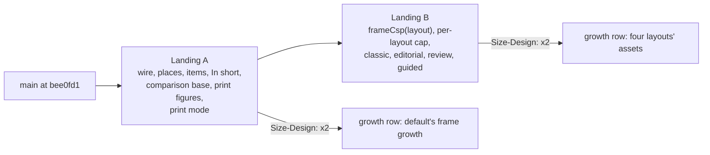
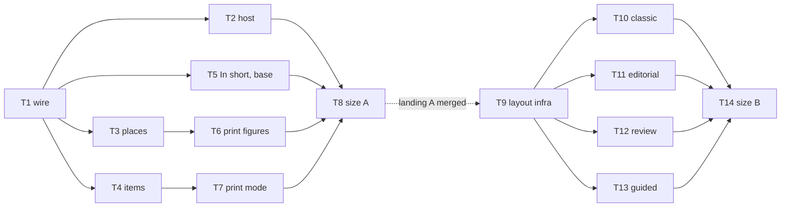

# docserver parity additions: layouts, places, item links, print figures and print mode: Implementation Plan

> **For agentic workers:** REQUIRED SUB-SKILL: Use superpowers:subagent-driven-development to implement this plan task by task. Each task is an implementer subagent (tests first), then one held-out review over the task's diff, then one fix round. The plan is lean (C40): it holds no implementation code, only the contract each task must meet, its tests and its mutation rows.

**Status:** written 2026-11-20 against `main` at `bee0fd1` (the appearance contract, then the rename to `@synapsium-labs/pinax-lib`). Two sequential landings, A and B (Design §3), as the coordinator ruled on 2026-11-20: landing A (Tasks 1 to 8, print mode included) is this run; landing B (Tasks 9 to 14, all four layouts in one landing) is a run of its own once A lands. The design is the first consumer's, approved by its operator on 2026-11-19; this plan decides only how the library builds it. A sentence of the design that cannot be built as written is a stop-and-ask, never a silent departure. The package version does not change here; the release and its signed tag are the operator's. Runtime model of this plan's writer: Opus 5.5 (`claude-opus-5-5`).

**Goal:** Everything the first consumer's parity design asks of the library: four more layouts beside `default`, each on the appearance slots and its own frame policy; Back-to-close and Back-from-a-jump through places on the existing port; item links seeded by the host; drawn figures handed to the host for print; the In short "Headlines / Full" option and a seeded comparison base; and a print mode of `render` with its own stylesheet. A host that asks for none of it gets exactly today's behaviour.

**Architecture:** Every addition rides the existing port, the existing host parser and `BRIDGE_LIMITS`. Two new frame-to-parent ops (`place`, `print-figure`), three new command names (`close-overlay`, `goto`, `print-figures`) on the existing `command` op, and two optional keys (`push`, `from`) on the existing `hash` op; the bridge stays version 1. The frame sends a new op only when the seed's `bridge` table says the host answers it, and the host sets that flag only when it is given the adapter (as `progress` already works). Item links and the comparison base are seed fields. Print mode is a pure option of `render`, outside the frame. Layouts are separate enhance bundles over the same shared modules; a frame inlines exactly one, and `frameCsp(layout)` carries that layout's hashes.

**Tech Stack:** unchanged: Node `>=22`, esbuild 0.28.2, playwright-core 1.63.0, TypeScript 6.0.3, vitest 4.1.11, jsdom 29.1.1, Mermaid 12.1.0 as pinned. No new dependency.

**Spec:** the first consumer's public design, [Native Docs reader: full parity with the standalone reader](https://github.com/Synapsium-Labs/ccrc-pwa/blob/main/docs/superpowers/specs/2026-11-18-native-docs-parity-design.md), **§6, "Library side", which this plan builds in full**, with §2.3 (the reading-layer rows R5 to R21), §4.2 (layouts), §4.6 (print, stage 2, and the print allow-list this mode feeds) and §4.7 (places). The appearance contract every layout keeps is [§10 of the appearance design](https://github.com/Synapsium-Labs/ccrc-pwa/blob/main/docs/superpowers/specs/2026-11-18-native-docs-appearance-continuity-design.md), as amended through ccrc D-8827, with test 8 (size by contract) and test 9 (boundaries). The consumer side these interfaces serve is wave P5 (tasks P5.1 to P5.5) and P6.1 of [the parity plan](https://github.com/Synapsium-Labs/ccrc-pwa/blob/main/docs/superpowers/plans/2026-11-18-native-docs-parity.md). Both are read at the consumer's commit `5041cf1`.

**Ledger:** [`docs/superpowers/programs/docserver.md`](../programs/docserver.md). C1 to C114 stay binding, with the appearance contract's plan and its notes. This wave writes no ledger entry: its notes go to a new file, [`docs/superpowers/programs/docserver/parity-additions.md`](../programs/docserver/parity-additions.md), which the coordinator folds into the ledger.

---

## Design

### In short

- **Two landings, each with one `Size-Design: x2` line (proposed; §3).** Landing A carries the wire, places, item links, the In short option, the comparison base, print figures and print mode. Landing B carries the layouts and the per-layout frame policy. A changes the default layout only; B adds four layouts and changes no asset `default` inlines.
- **The bridge stays 1, and grows only where §6 says.** `FRAME_OPS` gains `place` and `print-figure`; `COMMAND_OPS` gains `close-overlay`, `goto` and `print-figures`; `OP_KEYS.hash` gains `push` and `from`, `OP_KEYS.command` gains `id` and `from`; `BRIDGE_KEYS` gains `places` and `printFigures`, both default false. `FRAME_ACCEPTS` does not change: every new parent-to-frame word is a `command` name. No channel, window listener, parent-DOM access or CSP source is added.
- **Nothing new is sent to a host that did not ask.** `place`, and `push` and `from` on `hash`, are sent only under `bridge.places`; `print-figure` only under `bridge.printFigures`. `./host` sets each flag only when its adapter is given (`onPlace`, `onPrintFigure`), so a 1.1 host never counts them as refused.
- **Print figures are capped by the host parser before any decode.** At most 64 a run, 1 MiB of PNG each and 16 MiB in all, each size computed from the base64 text's length and padding; a figure over a cap is a refusal and counts toward `refusalsToClose`. The frame draws each figure with HTML labels off, rasterises it at most 2048 px a side and sends at most 16 a second, inside the existing pacer.
- **Items come from `render`, links from the host.** `render` answers the doc's item values (at most 50 of at most 100 code units) from the three sources the reader already reads; the seed's `items` carries resolved `{value, href}` pairs, and the reader's existing item link draws from them. The library carries no tracker.
- **Print mode is in `render`, not in the frame.** With `print`, `render` emits, statically and inside its own allowlist, the blocks the enhance step builds on screen (§6's list, with the strip and plan marks), and `assets/print.css` styles them under one root class. Neither is a frame asset, so test 8 does not count them; their growth is reported beside it.
- **Layouts are bundles, not skins.** Each of `classic`, `editorial`, `review` and `guided` is its own enhance bundle over the shared modules, with any stylesheet of its own as a separate asset, ported from the reference layouts and scrubbed as L2 scrubbed the default. Each is at most the default enhance bundle (test 8's layout row), passes the corpus, the appearance pairs and closed grounds in hosted mode, and keeps no horizontal scroll at three widths.

### 1. Where each row of §6 lands

| §6 row | Layer | File(s) | Task | Landing |
|---|---|---|---|---|
| `place {kind}`; `push` and `from` on `hash`; `close-overlay` and `goto {id, from?}` | wire, host, frame | `src/frame/{protocol,seed,anchor}.ts`, `src/frame-runtime/{inbound,dispatch,adapters}.ts`, `src/host/{mount,parse}.ts`, `src/enhance/{nav,overlays,commands,lifecycle}.ts` | 1, 2, 3 | A |
| `print-figures`; `print-figure {i, n, png}` and its caps | wire, host, frame | as above, and `src/enhance/diagram-tools.ts`, `src/enhance/print-figures.ts` (new) | 1, 2, 6 | A |
| Item values from `render`; resolved item links in the seed | render, frame | `src/render/{types,render,items}.ts`, `src/frame/{seed,document}.ts`, `src/frame-runtime/adapters.ts`, `src/enhance/editorial.ts` | 4 | A |
| The In short "Headlines / Full" option; the comparison-base seed field | frame, reader | `src/frame/seed.ts`, `src/enhance/{editorial,since,options}.ts` | 5 | A |
| Print mode of `render`, its stylesheet, the strip and plan marks, its fixture | render | `src/render/print/*.ts` (new), `assets/print.css` (new), `conformance/print/` (new) | 7 | A |
| Layouts beside `default`; `frameCsp(layout)`; per-layout srcdoc cap; test 9 re-pinned per layout | build, frame, host | `scripts/build-frame.mjs`, `src/frame/{csp,document,layouts}.ts`, `src/host/mount.ts`, `conformance/frame-boundaries.json` | 9 | B |
| Each layout on the appearance slots and the pairs' gate; conformance and contrast per layout | reader, stylesheet | `src/enhance/layouts/<name>/` (new), `assets/layouts/<name>.css` (new), `conformance/layouts/<name>/` (new) | 10 to 13 | B |
| Test 8's rows, one per landing | repository | `conformance/size/growth.json` | 8, 14 | A, B |

*Table 1. §6 by layer, task and landing.*

### 2. Choices this plan makes, and why

| # | Choice | Why | Cost if wrong |
|---|---|---|---|
| B1 | The new parent-to-frame words are `command` names, not ops | §6 names them "host commands"; the port parser already accepts `command`, so `FRAME_ACCEPTS` and test 9's accepts row stay as they are | One more key pair on `command` (`id`, `from`), checked only for `goto` |
| B2 | Op values stay flat strings: `push` is the literal `'true'`, `i` and `n` decimal strings | The protocol's invariant, "every value a string except v" (`protocol.ts`); both parsers already read it | A host reading `push` as a boolean misses it; `bridge-cases.json` pins the spelling |
| B3 | The anchor grammar moves to a pure `src/frame/anchor.ts`; nav keeps a twin held equal by a test | `./host`'s parser must check `from` with the library's own grammar (§4.7), and the reader may import only its siblings (walls rule 5), as with `COMMAND_OPS` | One equality test, as for `COMMAND_OPS` |
| B4 | The bootstrap checks only shape for the new words (`id` by the fragment grammar it already holds, `from` a string of at most 4096 code units); the reader re-checks `from` in `goToHash` | The bootstrap has 1 607 bytes left of its 32 KiB budget; the reader already checks a `from` "like a stored position" | If the bootstrap still passes its budget, the wave stops and asks (R1) |
| B5 | A run of print figures belongs to one `printFigures()` call: the host parser refuses a `print-figure` with no open run, an `n` that changes within a run, an `i` repeated or at or above `n`, and the 65th; the run ends at the next call or at unmount (a stale figure from a cancelled run costs at most one refusal) | The caps are per document print; a frame must not open its own runs | A host that never calls `printFigures()` refuses every `print-figure`, as a 1.1 host would never receive one |
| B6 | Print figures are drawn in a hidden offscreen container through the bundled Mermaid with `htmlLabels: false`, serialised, loaded as a `data:` image and drawn to a canvas | `img-src data:` is already in the frame policy; no `foreignObject`, so the canvas stays readable (§4.6) | A figure that taints or fails is skipped, and the host prints its source (§4.6) |
| B7 | `RenderOptions.reader` carries the vocabulary print mode and item values need (`itemFields`, `itemHeadings`, status words, addressees, qualifiers, rule ids, `rules`) with the frame's defaults | The enhance step reads the same lists from `features`; print and screen must agree (§6), so both read one shape, and a test holds the two equal | Two option shapes for one vocabulary, held equal by a test |
| B8 | The In short switch is a `features` flag, `inShort`, default false, its state kept in the reader's existing `ui` pref | §6: "an option"; a flag keeps a host that asks for nothing at 1.1's output; `ui` is already a bridge store key | None for the wire; a host sees the switch only when it asks |
| B9 | The comparison base is an optional seed key, `changesBase`, a full sha, used only when `bridge.changes` is on | §5.6: the host records the base when the frame asks through `changes`, and seeds it back; the frame then asks `changes` for it at mount and shows it | A base the host cannot answer shows nothing, as an unanswered `changes` does today |
| B10 | Print mode works on the token stream, before markdown-it renders, and emits its blocks as the render's own escaped elements | `render` is pure and has no DOM; a token transform keeps the raw-HTML allowlist untouched, because nothing from the document is parsed as HTML | A block the enhance step builds from the DOM is computed twice; the agreement test (Task 7) holds the two equal on the corpus |
| B11 | Each layout's own stylesheet is its own frame asset, marked with its layout in the manifest; nothing a layout adds goes into `reader.css` | `reader.css` is an entry every frame inlines, so a layout's rules there would grow `frame` for every layout; a separate asset counts only in its layout's assets (test 8) | One more manifest entry per layout that has a stylesheet |
| B12 | `checkFrameCsp(csp, required)` keeps accepting any hash this version ships; `frameCsp(layout)` emits only that layout's | A host's stored policy for one layout stays valid; `missing-hash` still catches a policy that lacks the chosen layout's hash | A policy naming another layout's hash is accepted, which inlines nothing more |

*Table 2. Technical choices. A product choice found while executing goes to the coordinator as a structured ask.*

### 3. Two landings (ruled 2026-11-20)

*Figure 1. The two landings. Each appends one growth row under `x2`; test 8 sums them against the shares.*

| Landing | Tasks | Frame assets it changes | Expected growth | Why it stands alone |
|---|---|---|---|---|
| A | 1 to 8 | bootstrap, the default enhance bundle, `reader.css` | about 71 905 on both totals (§6's estimate), within the frame share of 72 704 | Every op, seed field and command a host needs for P5.2 to P5.5; reviewable as one wire change with one threat model |
| B | 9 to 14 | four new layout bundles and their stylesheets; `frameCsp` and the build; no asset `default` inlines | `frame` unchanged (each layout at most the default bundle); `total` up by the four layouts, within the rest of the total share | Four ports of the reference layouts; each a review of its own, measured against the default bundle that A leaves |

*Table 3. The split. Landing B starts from A's landing on `main`, so each layout is measured against the default bundle at that commit.*

**Landing B's size.** The default layout's port took L2 twenty-four tasks. Each of B's four layouts is a smaller port over shared modules, but it still brings its own structure, its own state keys, its own stylesheet on the slots, and its own corpus snapshots. If the coordinator prefers, B can land as four landings, one per layout, each with its own `Size-Design: x2` line; Task 9 then lands with the first.

## Global Constraints

Carried from 1.1 and the appearance contract, binding on every task:

- **Public-ready** text in every tracked file, commit and PR body: no product, host, person, account or private repository names, and no tracker ids. The consuming product is "the first consumer", its design cited by its public GitHub path, and its departures as "ccrc D-n" only. A private-name scan runs over every file and commit message before the push.
- **Pure where declared; CSP-safe** (no `innerHTML`, `outerHTML`, `insertAdjacentHTML`, `eval`, inline handlers, `cssText`); **import-inert; host data is untrusted; no network in tests; hash-only CSP, never widened.** The sandbox stays exactly `allow-scripts`. No new channel, port, window listener or CSP source; the only new ops are §6's.
- **One raw-HTML allowlist**, unchanged. Print mode emits only the render's own elements.
- **The corpus is the contract.** With no new option asked for, no golden under `conformance/expected` and no snapshot under `conformance/layout` moves. A move is a stop-and-ask. New fixtures are additions named in the commit's `Goldens-moved:` trailer.
- **Tests** run through the fleet's test wrapper as `./node_modules/.bin/vitest run --maxWorkers=2 <file>`, in the foreground, one file at a time, timeout at least 600 000 ms; browser rows locally with `DOCREADER_BROWSERS=chromium`; WebKit is proven in CI only (C69). A timeout under the slice's memory kills, with no assertion mismatch, gets one isolated rerun, then is recorded unmeasured for CI on the exact tip.
- **Generated files.** A task that changes any input of `scripts/build-frame.mjs` runs `npm run build:frame` and commits `assets/assets.json` and `src/frame/manifest.generated.ts` in the same commit; `node scripts/build-frame.mjs --check` is green after.
- **The wire** changes additively only, and every wire choice is a fixture in `conformance/bridge-cases.json`.
- **Mutation discipline.** Every new guard ships with a case that goes red without it, measured in place one row at a time (saved bytes and sha256, restored and checked, never `git checkout`). Rows are recorded in `docs/superpowers/plans/parity-mutations/task-<n>.md` (a table, then its JSON fence). A row that stays green gets a new case or is recorded as an equivalent mutant with its reason; it is never dropped.
- **Budgets.** Every `ASSET_BUDGETS` entry stands, the bootstrap's 32 KiB included. X2's growth is at most 1 166 336 characters on `total` and 72 704 on `frame`, read from the shares table at each landing's first parent; each layout's assets are at most the default enhance bundle at the same commit. A breach of any stops the wave and goes to the coordinator with the numbers.
- **Commits.** Files staged by name; subject `<area>: <what> (docserver parity T<n>)`; the writer's `Co-Authored-By:` trailer. Never `git stash`, `reset --hard` or `checkout --`. Each landing's branch is pushed once, when its tasks are done.

## Tasks

| # | Title | Depends on | Landing |
|---|---|---|---|
| 1 | The wire: new ops, commands, bridge keys, print limits, the anchor grammar, test 9's entry | `bee0fd1` | A |
| 2 | `./host`: the new adapters, commands and the print-figure parser | 1 | A |
| 3 | The frame reports places and obeys `close-overlay` and `goto` | 1 | A |
| 4 | Item values from `render`, item links from the seed | 1 | A |
| 5 | The In short option and the comparison base | 1 | A |
| 6 | Print figures in the frame | 3 | A |
| 7 | Print mode of `render` and its stylesheet | 4 | A |
| 8 | Landing A's size row, README, CHANGELOG and notes | 2 to 7 | A |
| 9 | Layout infrastructure: bundles, `frameCsp(layout)`, per-layout cap, test 9 per layout | A on `main` | B |
| 10 | Layout `classic` | 9 | B |
| 11 | Layout `editorial` | 9 | B |
| 12 | Layout `review` | 9 | B |
| 13 | Layout `guided` | 9 | B |
| 14 | Landing B's size row, README, CHANGELOG and notes | 10 to 13 | B |

*Figure 2. Task order. Landing A's tasks land in the table's order on one branch; landing B starts from A's landing.*

---

### Task 1: The wire

**Goal.** §6's ops and commands, and the bridge flags that gate them, under the existing rules.
**Files.** Modify `src/frame/protocol.ts`, `src/frame/seed.ts` (`BRIDGE_KEYS`), `src/frame/index.ts`, `src/frame-runtime/inbound.ts`, `src/frame-runtime/dispatch.ts`, `conformance/bridge-cases.json`, `conformance/frame-boundaries.json` (one appended entry), `README.md`. Create `src/frame/anchor.ts`, `docs/superpowers/plans/parity-mutations/task-1.md`. Rebuild the frame manifests.
**Produces.**
- `FrameToParent` gains `{t:'place'; kind:'overlay'|'overlay-closed'}` and `{t:'print-figure'; i:string; n:string; png:string}`; `hash` gains `push?: 'true'` and `from?: string`. `FRAME_OPS` gains `place` and `print-figure`. `PLACE_KINDS = ['overlay','overlay-closed']`.
- `COMMAND_OPS` gains `close-overlay`, `goto` and `print-figures`; `ParentToFrame`'s command arm gains `{t:'command'; name:'goto'; id:string; from?:string}`. `OP_KEYS.command = ['t','name','id','from']`, `OP_KEYS.hash = ['t','id','push','from']`, `OP_KEYS.place = ['t','kind']`, `OP_KEYS['print-figure'] = ['t','i','n','png']`. `FRAME_ACCEPTS` is unchanged.
- `BRIDGE_KEYS` gains `places` and `printFigures`, each default false in `FrameOptions.bridge`, as `progress`.
- `BRIDGE_LIMITS` gains `printFiguresMax: 64`, `printFigurePngMaxBytes: 1048576`, `printFiguresTotalMaxBytes: 16777216`, `printFigureSideMaxPx: 2048`.
- `src/frame/anchor.ts`: `ANCHOR_LIMITS` (`line` 1024, `from` 4096, `coord` 10 000 000) and `isAnchorToken(s): boolean`, the grammar of nav's `TOKEN` and its `from` check, word for word; `pngBytesOfBase64(b64): number | null` (canonical base64 only, size from length and padding, null otherwise).
**Behaviour.** The port parser accepts `command` with `name` in `COMMAND_OPS`; `id` and `from` only with `goto`, `id` by the fragment grammar, `from` a string of at most `ANCHOR_LIMITS.from` code units. `close-overlay` and `print-figures` carry no other key. Dispatch hands each to the reader's API (Task 3, Task 6), with a root and an API only, a throw contained.
**Test 9.** One entry appended to the record: `FRAME_OPS` with the two new ops, `FRAME_ACCEPTS` unchanged, the masked CSP unchanged. Today's two delta rows compare only the newest entry with the one before (`FRAME_OPS` equal, `FRAME_ACCEPTS` plus `appearance`), which would no longer describe the appearance contract's entry once a third is appended. They become one table of deltas keyed by entry index, append-only like the record: entry 1 (the appearance contract) adds no frame op and `appearance` to the accepted list; entry 2 (this landing) adds exactly `place` and `print-figure` to the frame ops and nothing to the accepted list. Every entry's lists are the previous entry's in the same order with only additions at the end, and an entry with no delta row reds, so a later landing that changes a list writes its own row.
**Steps.** 1. Tests in `test/frame-protocol.test.ts`, `test/frame-seed.test.ts`, `test/frame-runtime.test.ts`, `test/frame-boundaries.test.ts`, `test/frame-anchor.test.ts` (new: the grammar against nav's own `tokenOf` output and against every rejected shape of nav's check); red. 2. Implement; `npm run build:frame`. 3. Green, with `test/frame-build.test.ts` (budgets: the bootstrap's growth measured and recorded) and `test/frame-runtime-walls.test.ts`. 4. Rows; commit with the manifests.
**Mutation rows.** P1a the port parser accepts `goto` without `id`; P1b accepts `id` on `close-overlay`; P1c accepts a `from` of 4097; P1d `FRAME_ACCEPTS` gains a word; P1e `BRIDGE_KEYS.places` defaults true; P1f `pngBytesOfBase64` ignores padding; P1g `isAnchorToken` accepts a `y` below zero; P1h dispatch drops `goto`.
**Verify.** `test/frame-protocol.test.ts test/frame-seed.test.ts test/frame-runtime.test.ts test/frame-runtime-walls.test.ts test/frame-boundaries.test.ts test/frame-anchor.test.ts test/frame-build.test.ts test/readme.test.ts`; `npm run typecheck`; `node scripts/build-frame.mjs --check`.

### Task 2: `./host`: the new adapters, commands and the print-figure parser

**Goal.** A host can ask for places and print figures, receive them checked, and send the three commands.
**Files.** Modify `src/host/mount.ts`, `src/host/parse.ts`, `src/host/limits.ts`, `src/host/index.ts`, `test/host-mount.test.ts`, `test/host-parse.test.ts`, `test/host-limits.test.ts`, `README.md`. Create `docs/superpowers/plans/parity-mutations/task-2.md`.
**Produces.**
- `HostAdapters.onPlace?(kind: 'overlay'|'overlay-closed')`; `onHash?(id, entry?: {push: boolean; from: string | null})`, the second argument given only under `bridge.places`; `onPrintFigure?(f: {i: number; n: number; png: string})`. Giving `onPlace` sets the seed's `bridge.places`; giving `onPrintFigure` sets `bridge.printFigures`. `ADAPTER_KEYS` and `CALLBACKS` gain both.
- `DocFrame.closeOverlay()`, `DocFrame.goto(id: string, from?: string)`, `DocFrame.printFigures(): void`. Each posts its command after `ready` and does nothing before it, after `destroy()` or after a fallback, as `command` does; `goto` with an `id` outside the fragment grammar or a `from` that fails `isAnchorToken` throws `TypeError`, whatever the state; `closeOverlay` and `goto` without `onPlace`, and `printFigures` without `onPrintFigure`, throw `TypeError`.
**Behaviour (the parser).** `place`: `kind` in `PLACE_KINDS`, else a refusal. `hash`: `push` absent or `'true'`; `from` absent or `isAnchorToken`; either key without `bridge.places` is a refusal. `print-figure`, in this order, each failure a refusal counted toward `refusalsToClose`, before any decode: an open run (B5); `i` and `n` canonical decimals with `0 <= i < n <= printFiguresMax`, `n` equal to the run's, `i` not seen in the run; `pngBytesOfBase64(png)` not null and at most `printFigurePngMaxBytes`; the run's total plus it at most `printFiguresTotalMaxBytes`. Only then is `onPrintFigure` called, with the base64 text unchanged: the host decodes, never `./host`.
**Tests.** Every bullet above, and: a 1.1-shaped host (no new adapters) seeds both flags false and its `onHash` is called with one argument; 1 048 575 and 1 048 576 bytes pass and 1 048 577 is refused; sixteen figures of 1 048 576 bytes pass, one more byte refused by the total while within its own cap; the 64th accepted and a 65th refused; a refused figure is never handed to the adapter; the per-op caps hold under `BRIDGE_LIMITS`' buckets (64 figures at 16 a second, none refused by the bucket, a fake clock).
**Mutation rows.** P2a `bridge.places` set without `onPlace`; P2b `push` accepted without `bridge.places`; P2c `from` not checked; P2d size from length without padding; P2e total cap removed; P2f the 65th accepted; P2g a repeated `i` accepted; P2h a figure with no open run accepted; P2i a refused figure handed on; P2j `printFigures` posts before `ready`.
**Verify.** `test/host-mount.test.ts test/host-parse.test.ts test/host-limits.test.ts test/host-walls.test.ts test/readme.test.ts`; `npm run typecheck`.

### Task 3: The frame reports places and obeys `close-overlay` and `goto`

**Goal.** §4.7's frame half.
**Files.** Modify `src/frame-runtime/adapters.ts` (the `onHash` adapter forwards `push` and `from` under `bridge.places`; a new `onPlace` adapter), `src/enhance/host.ts` (`HOST_CALLBACKS` gains `onPlace`), `src/enhance/overlays.ts` (reports `overlay` when the figure overlay opens and `overlay-closed` when it closes for any reason), `src/enhance/commands.ts` (`close-overlay` closes the figure overlay without a report of its own; `goto` routes to `goToHash(id, from)`), `src/enhance/nav.ts` (its `TOKEN` and check held equal to `src/frame/anchor.ts`), `test/enhance-nav.test.ts`, `test/enhance-frame-wire.test.ts`, `test/browser/frame-places.test.ts` (new). Create `docs/superpowers/plans/parity-mutations/task-3.md`. Rebuild the frame manifests.
**Behaviour.** Only the figure overlay is a place (§4.7); the keys sheet, quick jump and the rest are not. An overlay closed by `close-overlay` sends no `overlay-closed`, so the host's own Back is not answered twice; closed by Esc, Close or a reveal, it sends one. A jump through `nav.goTo` with `push` sends `hash {id, push:'true', from}`; scroll-spy's `hash` keeps no `push`. `goto` with a `from` the reader rejects goes to `id` alone, as `goToHash` does today.
**Tests.** Unit (jsdom): open, Esc: `overlay` then one `overlay-closed`; open, `close-overlay`: `overlay` and nothing more; a jump sends `push` and a `from` that `isAnchorToken` accepts; spy sends neither; with `bridge.places` false none of the three is sent and `hash` is exactly 1.1's; the nav and anchor grammars equal. Browser (Chromium): a real jump's `from` passed back through `goto` lands on the place left, within a pixel.
**Mutation rows.** P3a `place` sent with `bridge.places` false; P3b `overlay-closed` sent on `close-overlay`; P3c spy's `hash` carries `push`; P3d `goto` ignores `from`; P3e the keys sheet reported as a place.
**Verify.** `test/enhance-nav.test.ts test/enhance-frame-wire.test.ts test/enhance-walls.test.ts test/frame-runtime-walls.test.ts test/frame-build.test.ts`; `DOCREADER_BROWSERS=chromium` `test/browser/frame-places.test.ts`; `node scripts/build-frame.mjs --check`.

### Task 4: Item values from `render`, item links from the seed

**Goal.** §6's item row (spec §4.5's library half).
**Files.** Modify `src/render/types.ts` (`RenderOptions.reader?: ReaderVocabulary`; `RenderMeta.items: readonly string[]`), `src/render/render.ts`, `src/frame/seed.ts` (optional key `items`), `src/frame/document.ts` (`FrameOptions.items?`), `src/frame-runtime/adapters.ts` (the `itemLink` adapter answers from the seed), `src/host/mount.ts` (`HostAdapters.items?`), `README.md`. Create `src/render/items.ts`, `test/render-items.test.ts`, `docs/superpowers/plans/parity-mutations/task-4.md`. Rebuild the frame manifests.
**Produces.** `ReaderVocabulary`: the reader's word lists and grammars as `FrameFeatures` carries them (B7), defaults the frame's. `meta.items`: the distinct item values the reader would ask `itemLink` for, in document order, from the byline item fact, a promise-delta `item:` line and the legacy item header, at most 50, each at most 100 code units (a longer one is left out, not cut). Seed `items`: at most 50 `{value, href}`, `value` 1 to 100 code units, `href` an absolute `https:` URL of at most `hrefMaxChars`; anything else refuses the seed key (`validateSeed` names it). `SEED_FIELDS_MAX_CHARS` counts the field at its cap.
**Behaviour.** The reader's item link asks `itemLink(value)`; the frame answers the seeded `href` for an exact `value`, else null, so an unseeded item stays text. A click goes the way every item link goes today (`navigate`, the host decides). No default tracker anywhere in the library (a scan of `src/` and `assets/` for a tracker host: none).
**Tests.** `meta.items` against a fixture per source and every bound; equality: for every corpus document under a vocabulary that names item fields and headings, `meta.items` equals the keys the enhance step asks `itemLink` for (jsdom, a spy); the seed's bounds one below, at and one above; an `http:` href refused; a seeded link draws as the reader's `item-link` and an unseeded value as text; with no `items`, every golden is unchanged.
**Mutation rows.** P4a a 101-unit value cut instead of left out; P4b the 51st kept; P4c `http:` accepted; P4d prefix match instead of exact; P4e body text scanned for items; P4f the cap leaves out `items`.
**Verify.** `test/render-items.test.ts test/frame-seed.test.ts test/frame-document.test.ts test/enhance-editorial.test.ts test/corpus.test.ts test/expected.test.ts test/frame-build.test.ts`; `npm run typecheck`; `node scripts/build-frame.mjs --check`.

### Task 5: The In short option and the comparison base

**Goal.** §6's R7 and R9 row.
**Files.** Modify `src/frame/seed.ts` (`FEATURE_KEYS.flags` gains `inShort`; optional seed key `changesBase`), `src/frame/document.ts`, `src/host/mount.ts` (`HostAdapters.changesBase?`), `src/enhance/options.ts`, `src/enhance/editorial.ts` (the switch), `src/enhance/since.ts` (the seeded base), `assets/reader.css` (the switch, on the slots), `README.md`. Create `test/enhance-inshort.test.ts`, `docs/superpowers/plans/parity-mutations/task-5.md`. Rebuild the frame manifests.
**Behaviour.** With `features.inShort` on, the In short box carries a two-button group, "Headlines" and "Full", `aria-pressed` on the chosen one; Headlines shows each item's lead (its first strong run, else its first sentence) and hides the rest from view and from the accessibility tree; the choice persists in the `ui` pref. Off, the box is 1.1's. With `changesBase` a full sha and `bridge.changes` on, the reader asks `changes` for it once after `ready` and shows the comparison as "Changes since" shows it, labelled by the base's commit when the seed's commits name it, else "Since your comparison"; no other source sets it. Hosted, the switch follows test 10's rule for the pressed button (weight 600 and an inset 2 px `accent` bar), and its colours are slot colours.
**Tests.** The switch's presence by flag, its two views, the persisted choice, the pressed state's computed style while hosted; the base asked once, shown, and refused shapes (a short sha, a non-string) refused by `validateSeed`; with neither option every golden and layout snapshot unchanged; the box's pairs and closed grounds under the twelve fixture appearances (test 4 (b) and (c)'s rows gain the switch's states).
**Mutation rows.** P5a switch drawn with the flag off; P5b Headlines hides the lead; P5c choice not persisted; P5d base asked twice; P5e a short sha accepted; P5f the pressed button by colour alone.
**Verify.** `test/enhance-inshort.test.ts test/enhance-since.test.ts test/enhance-editorial.test.ts test/frame-seed.test.ts test/enhance-styles.test.ts test/frame-build.test.ts`; `DOCREADER_BROWSERS=chromium` `test/browser/appearance-style.test.ts test/browser/appearance-cues.test.ts`; `node scripts/build-frame.mjs --check`.

### Task 6: Print figures in the frame

**Goal.** §4.6 stage 2's frame half, under §6's caps.
**Files.** Create `src/enhance/print-figures.ts` (the draw and the raster), `test/enhance-print-figures.test.ts`, `test/browser/print-figures.test.ts`, `docs/superpowers/plans/parity-mutations/task-6.md`. Modify `src/enhance/commands.ts` (`print-figures`), `src/enhance/diagrams.ts` (a print draw beside the screen draw, sharing its queue and its secure keys), `src/frame-runtime/adapters.ts` (`onPrintFigure`), `src/enhance/host.ts`. Rebuild the frame manifests.
**Behaviour.** On `print-figures` under `bridge.printFigures`, the reader takes every `figure.mermaid-figure` in document order, `n` their count capped at 64, and for each: draws it for print in a hidden offscreen container with `htmlLabels: false` and the screen's theme (hosted or 1.1's), serialises the `svg`, loads it as a `data:image/svg+xml` image, draws it to a canvas scaled to fit 2048 px a side at the print scale, and sends `print-figure {i, n, png}` with the canvas's PNG as base64. A figure that fails to draw, taints the canvas or exceeds 1 MiB is skipped (its `i` is never sent). Sends go through the existing pacer, at most 16 a second; a second `print-figures` cancels the first run's unsent figures. Without the flag the command does nothing. No figure on screen changes.
**Tests.** Unit (a fake Mermaid and canvas): the order, `n`, the skip rules, the 64 cap, the cancel, nothing sent without the flag. Browser (Chromium): a document of three covered figures and one failing figure answers three `print-figure`, each a PNG whose IHDR is at most 2048 px a side, whose bytes are at most 1 MiB, and whose `i` values are 0, 1 and 3 of `n` 4; a figure drawn hosted prints in the host's colours; the screen's figures are byte-equal before and after.
**Mutation rows.** P6a HTML labels left on; P6b no side cap; P6c a skipped figure sent empty; P6d no cancel on a second command; P6e sends bypass the pacer; P6f sent without the flag.
**Verify.** `test/enhance-print-figures.test.ts test/enhance-diagrams.test.ts test/enhance-walls.test.ts test/frame-build.test.ts`; `DOCREADER_BROWSERS=chromium` `test/browser/print-figures.test.ts test/browser/diagrams.test.ts`; `node scripts/build-frame.mjs --check`.

### Task 7: Print mode of `render` and its stylesheet

**Goal.** §6's print row, with "Print mode's strip and plan marks" in full.
**Files.** Create `src/render/print/` (the token transforms, one module per block group: facts, byline and eyebrow, boxes and section numbers, status labels, the review strip, plan marks, rules), `assets/print.css`, `conformance/print/` (the fixture of §6 and its pinned output; one more fixture per block group), `test/render-print.test.ts`, `test/print-agreement.test.ts`, `docs/superpowers/plans/parity-mutations/task-7.md`. Modify `src/render/types.ts` (`RenderOptions.print?: boolean`), `src/render/render.ts`, `scripts/build-frame.mjs` (lists `assets/print.css` in `assets.json`, not in `FRAME_MANIFEST`; the package's `./assets/*` export already carries it), `README.md`.
**Behaviour.** With `print: true`, `render` emits, after the title, inside one `div.docreader-print` root: the eyebrow, the byline and reading time, the facts panel from the front matter, the review strip (§6's waiting list, decisions' counts and plan facts, each block exactly as §6 words it), section numbers on numbered headings, In short and Where things stand boxes, status labels in table cells, each task's `span.task-id` chip with its `span.tmeta` step count and owner and each step's `span.step-no` with its `span.who`, with no owner bracket or colon, and, with `reader.rules` on, rule paragraphs with heads and status pills and the rules index. Every `details` prints open; no element is `hidden`; no figure is drawn (each prints as its source, which the host replaces with a picture). Text comes from the document's tokens and is escaped; no attribute but `class`, `id`, `data-line`, `open`, `colspan`, `rowspan`, `align`, `alt`, `title` and `href` is emitted. Without `print`, output is byte-equal to today's. `assets/print.css` scopes every rule under `.docreader-print`, forces the light palette and 11 pt text, unfolds every section and keeps figures and table rows whole; it prints separators in its muted text colour.
**Tests.** The §6 fixture's pinned output, one assertion per block on elements and classes as well as text: the waiting list is `div.rs-wait > ol > li`, three of them, the long one whole and no `a`; `p.rs-facts` holds the counts in `span.cnt`, each with its word, and "3 tasks · 9 steps" and "2 yours"; each task's chip `span.task-id span.tmeta`; no bracket or colon of an owner; agreement: for every corpus document, the print output's strip, marks, labels and numbers equal, by text and class, what the enhance step builds on screen (jsdom); every element and class print mode emits is listed in `conformance/print/vocabulary.json`, which a test holds equal to the output over the corpus with `rules` on (the consumer derives its allow-list from it); every rule of `print.css` is scoped; no golden moves without `print`.
**Mutation rows.** P7a the waiting item clipped to the screen's clip; P7b the item as a link; P7c owner brackets printed; P7d a `hidden` attribute emitted; P7e a rule of `print.css` unscoped; P7f rules printed with `rules` off; P7g the strip's counts without their words; P7h the vocabulary file out of date.
**Verify.** `test/render-print.test.ts test/print-agreement.test.ts test/corpus.test.ts test/expected.test.ts test/hostile-input.test.ts test/manifest.test.ts`; `npm run typecheck`; `node scripts/build-frame.mjs --check`.

### Task 8: Landing A's size row, README, CHANGELOG and notes

**Goal.** Test 8's row for landing A, and the documents.
**Files.** Modify `conformance/size/growth.json` (one appended row, `x2`, measured), `README.md`, `CHANGELOG.md` (the Unreleased section), this plan's Results. Create `docs/superpowers/programs/docserver/parity-additions.md`, `docs/superpowers/plans/parity-mutations/task-8.md`.
**Steps.** 1. Build; measure each entry against the first parent's manifest; append the row. 2. Run `test/size-contract.test.ts` with `DOCSERVER_SIZE_TEXT='Size-Design: x2'` against the branch tip and `origin/main` through the test's pure entry. 3. Record in Results the per-entry growth, the running sum against both shares, the bootstrap's bytes against 32 768, print mode's size beside test 8 (not in it), and the old-cap row per test 7 at the new assets. 4. The whole suite once, Chromium only locally.
**Mutation rows.** P8a the row names `x1`; P8b two `Size-Design:` lines in the text.
**Verify.** `test/size-contract.test.ts test/manifest.test.ts test/frame-build.test.ts test/readme.test.ts test/package.test.ts`; `npm run typecheck`; the whole suite.

### Task 9: Layout infrastructure

**Goal.** §6's first row: one frame, one layout, one policy.
**Files.** Create `src/frame/layouts.ts`, `src/enhance/layouts/` (one entry per layout), `test/frame-layouts.test.ts`, `docs/superpowers/plans/parity-mutations/task-9.md`. Modify `scripts/build-frame.mjs` (one enhance bundle per layout from its entry, each with its CSP hash, and each layout stylesheet; every layout asset marked with its layout in both manifests), `src/frame/csp.ts`, `src/frame/document.ts`, `src/frame/index.ts`, `src/host/mount.ts`, `test/frame-boundaries.test.ts`, `conformance/frame-boundaries.json`, `README.md`.
**Produces.** `FRAME_LAYOUTS = ['default','classic','editorial','review','guided']`, `type FrameLayout`. `frameCsp(layout: FrameLayout = 'default')`: guard, bootstrap, that layout's enhance and Mermaid, in that order; `frameCsp()` equals `frameCsp('default')`, byte for byte as before this landing. `checkFrameCsp` per B12. `FrameOptions.layout?`, `HostAdapters.layout?` (unknown name: `TypeError`), each defaulting to `default`. `maxSrcdocChars(layout)`, derived from the entries that layout's frame inlines, every seed field at its cap and the faces' cap; `MAX_SRCDOC_CHARS_DEFAULT` stays `maxSrcdocChars('default')`.
**Test 9, re-pinned per layout.** The record's entry shape gains `csp` per layout (`{layout: maskedCsp}`); the entry appended here holds `default` equal to the parent's single masked policy, and each new layout's masked policy, whose first value is this landing's review check (test 9: "a new layout has no parent entry"). Rows: each layout's masked CSP equals the parent's for the same layout; one hash source per script that layout inlines; `frameCsp()` is `default`'s; the behaviour rows run per layout.
**Tests.** The bundle per layout exists and is marked; the srcdoc of each layout inlines only its own bundle and stylesheet (a scan of the built srcdoc for every other layout's hash and asset text: none); the per-layout cap's old-cap row (test 7) per layout; a host naming no layout gets `default`'s exact srcdoc.
**Mutation rows.** P9a `frameCsp('review')` carries every layout's hash; P9b the srcdoc inlines two bundles; P9c the cap derived from `default` for every layout; P9d `frameCsp()` differs from `frameCsp('default')`; P9e a layout asset left unmarked (test 8 then miscounts).
**Verify.** `test/frame-layouts.test.ts test/frame-csp.test.ts test/frame-boundaries.test.ts test/frame-document.test.ts test/host-mount.test.ts test/size-contract.test.ts test/frame-build.test.ts`; `node scripts/build-frame.mjs --check`.

### Tasks 10 to 13: The four layouts

One task per layout, each the same contract. `classic` is the reference's layout before AB; `editorial` its A; `review` its B (the review workbench: ID chips, a Contents and Index rail, its own keys); `guided` its C (guided layers: folded sections with reading time, a hero, tables as cards on a phone).

**Files (per layout `<name>`).** Create `src/enhance/layouts/<name>/` (the layout's own modules; shared modules imported, never copied), `assets/layouts/<name>.css` (only if it needs one), `conformance/layouts/<name>/` (its DOM snapshots over the layout cases), `test/browser/layout-<name>.test.ts`, `docs/superpowers/plans/parity-mutations/task-<n>.md`, `docs/superpowers/plans/parity-scrub-<name>.md` (the scrub audit, as L2's). Rebuild the frame manifests.
**Behaviour.** The reference layout's behaviour, ported as L2 ported the default: every element built with `createElement` and text or by moving the document's own nodes; no CDN, no direct storage (its per-doc state through the bridge's `store.set` as `doc:` fields named per layout, DOC_FIELDS regenerated), no link rewriting of its own (the reader's nav and link services); every operator-specific default scrubbed into an off-by-default option or dropped, each recorded in the scrub audit. Colours and fonts come only from the reader's tokens and the appearance slots: no literal colour outside the rules that 1.1's own tokens define. A layout brings its own structure, never its own palette.
**Tests (per layout).** The corpus renders under it with its snapshots pinned; hosted, under the twelve fixture appearances, every `APPEARANCE_PAIRS` pair it draws meets its floor and every text sits on a closed ground (test 4 (b) and (c), per layout); test 10's cue rows that its structure carries; at 412×915, 1280×800 and 1920×1080, no horizontal scroll and the contents reachable; its assets at most the default enhance bundle (test 8's layout row); the scrub scan: no host, account, workspace or product name in its sources or assets.
**Mutation rows (per layout).** Lx-a a literal colour in its stylesheet (reds closed grounds); Lx-b its state read from `localStorage` (reds the walls); Lx-c a horizontal overflow at 412 px; Lx-d its bundle padded past the default's (reds the layout row).
**Verify.** `test/frame-layouts.test.ts test/enhance-walls.test.ts test/size-contract.test.ts test/frame-build.test.ts`; `DOCREADER_BROWSERS=chromium` `test/browser/layout-<name>.test.ts test/browser/appearance-style.test.ts`; `node scripts/build-frame.mjs --check`.

### Task 14: Landing B's size row, README, CHANGELOG and notes

As Task 8, for landing B: one appended `x2` row; `frame` unchanged from A's row; `total` up by the four layouts' assets; the running sum of X2's rows against both shares; each layout's characters against the default bundle; the notes file extended. Mutation row P14a: a layout's stylesheet moved into `reader.css` (reds `frame`).

## Risks

| # | Risk | Mitigation |
|---|---|---|
| R1 | The bootstrap passes its 32 KiB budget: 1 607 bytes are left, and §6 estimates the parser rows at 2 329 | B4 keeps the bootstrap to shape checks over lists it already reads; measured at Task 1; a breach stops the wave and goes to the coordinator with the bytes, never a silent budget move |
| R2 | Landing A's frame growth passes 72 704: §6's estimate is 71 905, 799 under | Measured after Tasks 3, 5 and 6, the three that grow the default bundle and `reader.css`; a measured row over the share stops the wave |
| R3 | A layout cannot fit the default bundle, or cannot keep the three widths | Measured per layout at its task; a layout that cannot is stopped and goes to the coordinator with its numbers (§6) |
| R4 | Print mode's agreement with the screen drifts on a corpus document | The agreement test over the whole corpus; a disagreement is fixed in the transform, never by moving a golden |
| R5 | Drawing a figure for print in the frame costs too much on a phone (the consumer's lab PRINT-L1) | Out of this wave's reach: the consumer measures it, and its operator may waive stage 2 |

## Where things stand

### Agreed
- The design, §6 in full, as approved by the first consumer's operator on 2026-11-19; X2's shares, 1 166 336 total and 72 704 frame, as the coordinator set them and the shares table records them.

### Waiting on you
- Nothing. The split is ruled (2026-11-20): A then B, B's four layouts in one landing. The bootstrap's 32 768 bytes and the frame share are stops, measured at each task that changes the default layout's assets; neither budget moves here.

### Later
- The release and its signed tag; the first consumer's re-pin (its wave P5).
- Reader mode's library part (the `reader` op and screen pages), a later wave of its own.

## Results

Filled as each task lands: per task, the commits, the tests run and their counts, the mutation rows and their verdicts, the measured sizes, and every choice made while executing, with why.
