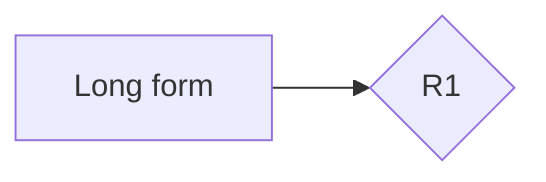

# Diagram tools sample

**Spec** · 2026-10-25 · Status: Draft

A neutral flowchart whose named blocks open the document's existing definitions.

## 1. Decisions

| ID | Meaning |
|---|---|
| R1 | A neutral decision used by the diagram. |

## 2. Words used here

| Term | Meaning |
|---|---|
| Long form | A neutral term used by the diagram. |

*Figure 1. Definition cues on a neutral flowchart.*
