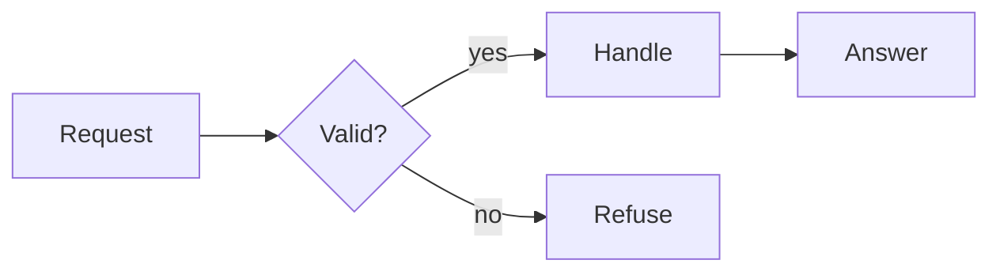
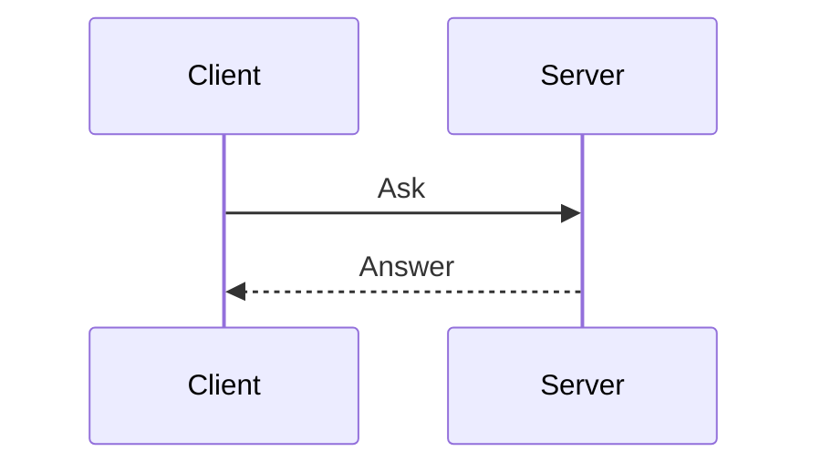
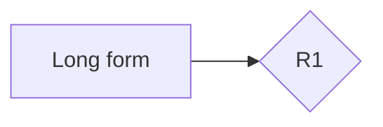

# Diagrams sample

**Spec** · 2026-10-20 · Status: Draft

A sample for drawing diagrams: a flowchart and a sequence diagram, each drawn on its plate, a diagram with
terms and IDs that open their existing definitions, and an error shown as its source behind a note.

## 1. Drawn

A flowchart with a decision.



*Figure 1. The flow of one request, from its arrival to its answer.*

A sequence diagram between two parties.



*Figure 2. One exchange between a client and a server.*

## 2. Decisions

| ID | Meaning |
|---|---|
| R1 | A neutral reference used by the diagram. |

## 3. Words used here

| Term | Meaning |
|---|---|
| Long form | A neutral term used by the diagram. |



*Figure 3. A diagram with existing term and ID definitions.*

## 4. Not drawn

A diagram whose source has an error.

```mermaid
flowchart LR
  A --> --> B
```

*Figure 4. A diagram with an error.*

The paragraph after it.
