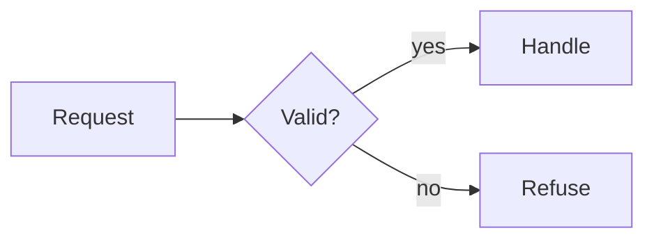
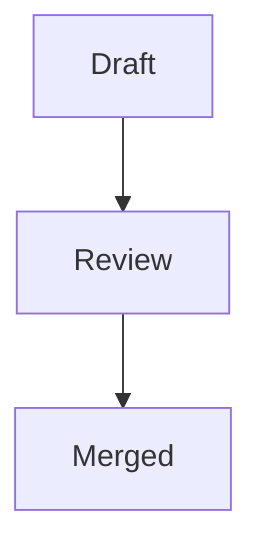
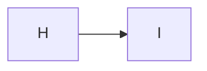
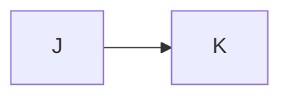
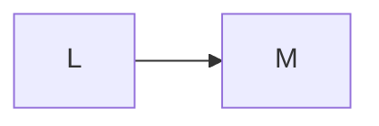

# Figures sample

**Spec** · 2026-10-20 · Status: Draft

A sample for the figure captions: each figure ends in a caption of another shape, or in none. The captions follow
the format contract, a line `*Figure N. Text.*` right after the diagram's fence.

## 1. Shapes

A caption with its number and its text.

*Figure 1. The flow of one request, from its arrival to its answer.*

A caption with markup in its text, and a long one that wraps onto a second line in the reading column.

*Figure 2. A caption with **bold** words and `code`, long enough that it runs on past the end of the first line and wraps.*

## 2. Other shapes

A caption with no space after its number, and one that is its number alone.

*Figure 3.No space after the number.*

*Figure 4.*

A figure with no caption.

The paragraph after it is not a caption.
